# The full tour

Everything in Unmasked, house by house and system by system. The [README](../README.md) has the
short version: what the game is, how to set it up, and where it stands. Every picture here is drawn
from the game's own level, costume and case files by the scripts in [`Docs/tools`](tools); they're
illustrations, not screenshots from Unity.

**Contents:** [the story](#solve-the-haunting-unmask-the-person) ·
[how a match plays](#how-a-match-plays) · [the villains](#tonights-legends-the-villains) ·
[the town](#hollow-creek-the-town) · [Blackwood Manor](#the-3d-world-blackwood-manor) ·
[the sound](#the-sound) · [how it's built](#how-its-built)

## Solve the haunting. Unmask the person.

Hollow Creek's old folklore masks were brought out for the Halloween festival, and whoever wears
one can really haunt a house. Tonight a resident is using one to cover up something ordinary: a
stolen lantern, a wrecked prize display, a missing ledger. Everyone knows **which mask** is in play;
**who is wearing it** is the case. At the unmasking you find out why they did it. The full story
and art direction is in [`Docs/ART_DIRECTION.md`](ART_DIRECTION.md).

<p align="center">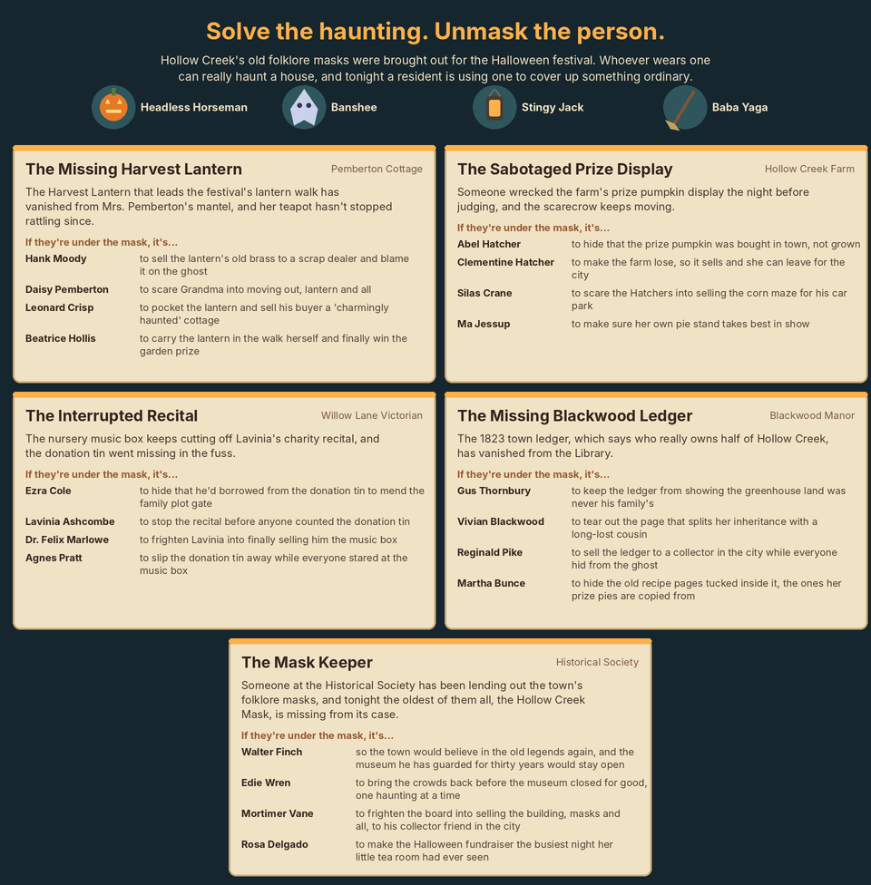</p>

Every scare has a beat of warning, the surprise, then a moment to recover. A chair leans back
before it hops, a lamp pauses and turns to look at you, a suspect swallows before answering (guilty
or not), and the trap wobbles before it snaps:

<p align="center">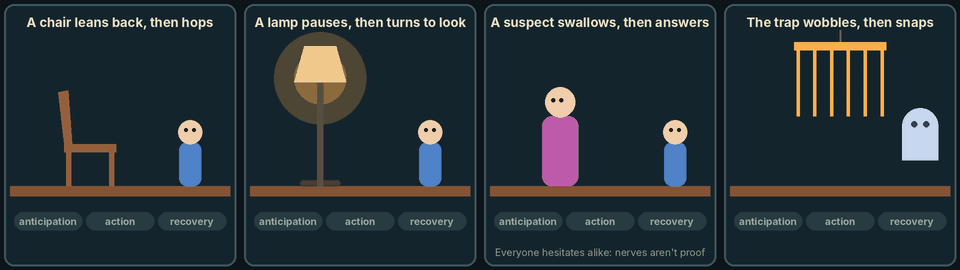</p>

Want to look around without GitHub or Unity? The **`Reference renders`** folder has big stills of
every house (outside and roof off) and `gameplay-tour.mp4`, a short tour of a night. They're
drawn from the game's level files by the project's own renderer, not captured in Unity.


## How a match plays

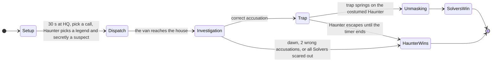

1. **Setup, at HQ.** Everyone picks a side. Solvers pick a role and tonight's call on the call
   board (or get a random one). The Haunter picks tonight's legend (the costume everyone will see)
   and secretly chooses which suspect they really are.
2. **Dispatch.** Pile into the Mystery Club van and drive across town to the house, following the
   map (**M**) and the arrow. A special night may be rolled: Blood Moon, Thunderstorm, Pea-Soup Fog,
   Power Outage or Harvest Festival. The suspects and the Haunter are already there.
3. **Investigation.** Glowing clues are hidden around the house. Each clue points at every suspect
   who shares one of its traits, so you deduce instead of guess. Suspects can be interviewed once;
   the culprit lies.
4. **The Haunter fights back.** Every power costs Ectoplasm, and every scare risks **leaking a real
   clue**. The Haunter can also plant fake clues to frame an innocent.
5. **Accuse.** Once you have 2 clues, accuse from the Suspect Board. Get it wrong and that suspect is
   cleared, but the Haunter powers up. Two wrong guesses and the Haunter wins.
6. **Trap.** Get it right and the Haunter is forced into costume. Grab 3 trap pieces, build the trap
   (Brawn builds twice as fast), and lure the Haunter in.
7. **Unmask!**

<p align="center"></p>

### The Solvers

| Role | Ability |
|---|---|
| **Sleuth** | Clue sense: clues within 9 m pulse on your screen, and the HUD says how close the nearest one is. |
| **Techie** | Ecto-detector beeps near possessed objects, fog and phantoms. The flashlight drains 40% slower. |
| **Brawn** | Builds the trap twice as fast. |
| **Snacker** | Suspects open up more. Interviews point at the real culprit more often. |

Scares fill your **Fear Meter**. At 100% you panic and run screaming. Teammates nearby calm you
faster, and any teammate can calm you with **E**. Panic three times and you flee the house for good.

<p align="center">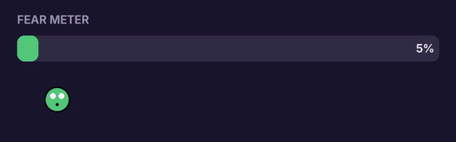</p>

### The Haunter

As a ghost, the Haunter is invisible and isn't even sent to the Solvers' computers. Possess
furniture (**E**) and use its two actions (**LMB/RMB**), or use the five spectral powers, plus
tonight's villain power on **6** or **Q**:

<p align="center">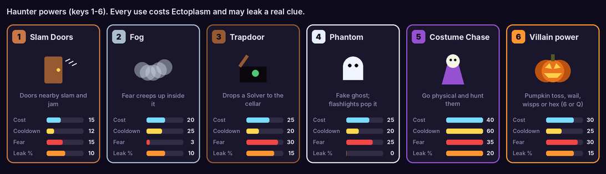</p>

In costume the Haunter is visible and can tag Solvers for big scares, but leaves footprints, and a
flashlight held on the costume stuns them. Nobody playing the Haunter? The **AI Director** haunts the
house instead, using the same tools and leaking clues the same way.

#### The case book

A new club's first call is always **The Missing Harvest Lantern** at Pemberton Cottage, the gentle
intro case. Solve a case and what was taken is put right (the lantern goes back on the mantel in
time for the lantern walk), and a keepsake appears on the shelf at HQ. The host's game remembers
solved cases between sessions, and the call board marks them **SOLVED**.

<p align="center">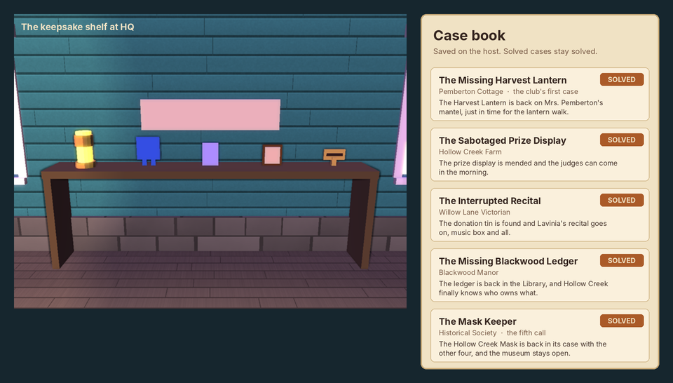</p>

#### Another night: back to HQ

When a case ends, the host presses **Next night: back to HQ**. Nobody restarts: the van is back in
the HQ driveway, every house is put back the way it was (lamps on, doors shut, traps packed away),
everyone's fear, batteries and ectoplasm start full, and the call board is waiting for the next call.
The case book carries on, so a club can play through the whole town in one sitting.

#### The Mask Keeper: the story behind every case

None of the culprits took a folklore mask on their own. Each solved case gives the club one clue
about who has been lending the masks out (a museum loan tag, inky fingers and a note on a porch, a
smell of lavender and old paper, a brass key to a back door marked "STAFF ONLY"), and the clues fill
a page in the case book at HQ. Solve all four and every clue points to the same place: a fifth call
appears on the board.

<p align="center">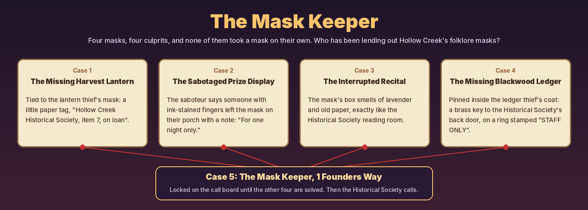</p>

#### The fifth call: 1 Founders Way

<p align="center">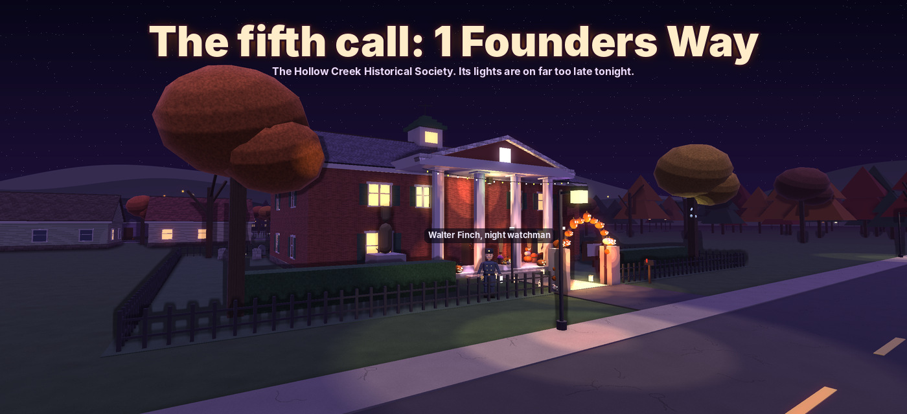</p>

The **Hollow Creek Historical Society** stands on its own street, Founders Way, across town from
HQ: a red-brick museum with a white-columned portico, a clock in the pediment and a cupola on the
roof. Its call stays locked on the call board ("solve the other four cases and this one will call")
until the four clues are in. Then the museum's lights are on far too late, and the oldest mask of
all, the **Hollow Creek Mask**, is missing from its case.

<p align="center">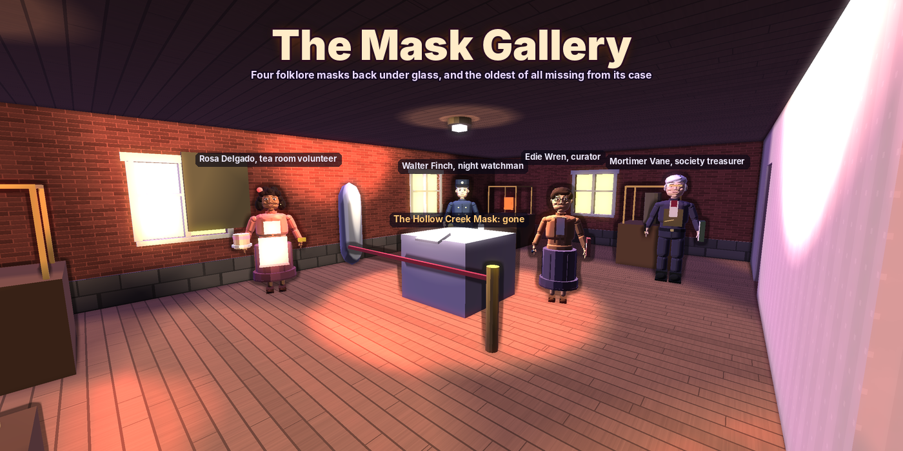</p>

It's the biggest case so far: two floors (the Mask Gallery, the Entrance Hall, the Gift Shop, the
Curator's Office, the Reading Room and the Archive), a courtyard with a fountain where the trap
goes, and a Restoration Workshop out back. The suspects are the people who keep the place running:
**Walter Finch**, the night watchman with his keys and lantern; **Edie Wren**, the curator with ink on
her fingers; **Mortimer Vane**, the treasurer who'd sell the building to a collector; and
**Rosa Delgado**, who runs the tea room at the fundraiser. Only two accusations, only two alibi
checks. Unmask the Mask Keeper and the case book closes the story, and a little brass plaque goes on
the keepsake shelf at HQ.

#### The Suspect Board

Press **Tab**. The board keeps what the club **found**, what people **said** and what **follows**
apart, and stamps every clue and statement with the time of night (the night runs 8 PM to dawn at
6 AM) and where it came from. A nervous suspect is character, not proof. Each player can mark
their own **hunch** without changing anyone else's board.

No mouse needed: the arrow keys (or 1 to 4) pick a card, **H** marks a hunch, **X** crosses
someone off or puts them back, **C** checks their alibi and **A** accuses. Accusing takes a second
press of **A** within three seconds, because a wrong name can't be taken back.

<p align="center">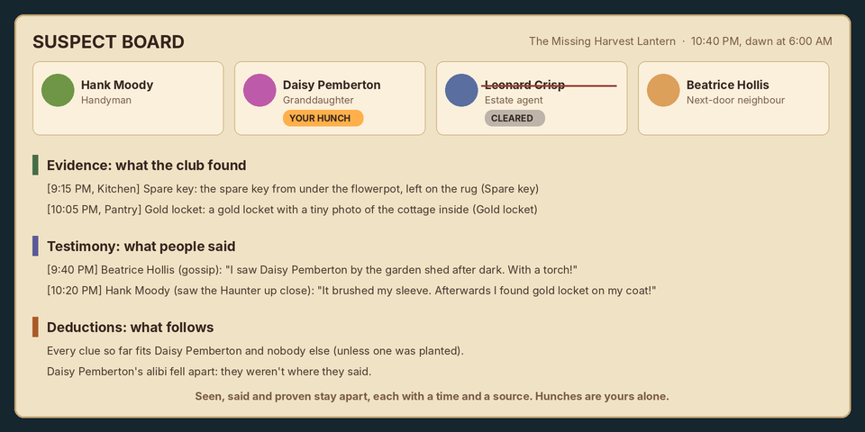</p>

#### Witnesses

<p align="center">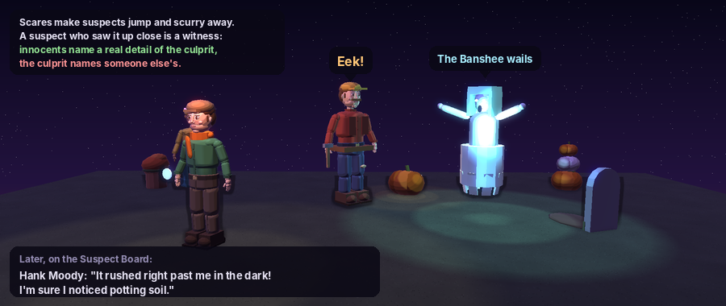</p>

Scares spook the suspects too: anyone nearby jumps ("Eek!") and scurries away. A suspect who **saw**
a scare up close becomes a witness, and when the club interviews them they describe a detail of the
Haunter instead of gossiping. Innocent witnesses name one of the culprit's real (shared) traits, which
narrows it to two suspects; the culprit, if it saw its own scare, names someone else's. So every scare
in front of a suspect is a risk for the Haunter.

#### Checking alibis

Every suspect's alibi names a place: a room in the house ("in the Library reading all night") or
somewhere in town ("at the Bookshop until closing"). Stand there, open the Suspect Board (**Tab**) and
press **Check alibi**. Innocent alibis hold up; the culprit's falls apart. You only get two checks a
night (three at the cottage), so choose well, and a town alibi means a drive. The catch: the Haunter
can **fake its alibi** once a night (**H**, 35 ectoplasm) by sneaking into that room first. A broken
alibi is proof; one that holds up might not be.

## Tonight's legends: the villains

<p align="center">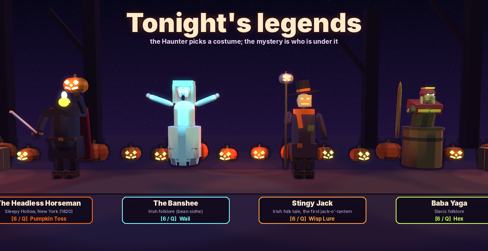</p>

In setup the Haunter picks one of the festival's folklore masks. Everyone can see which mask is in
play tonight ("Someone took the Headless Horseman mask from the festival and is haunting Blackwood
Manor..."), but nobody knows which suspect is wearing it. Each legend changes how the Haunter plays:

| Villain | From | Signature power (6 or Q) | In costume |
|---|---|---|---|
| 🎃 **The Headless Horseman** | *The Legend of Sleepy Hollow* (1820), the Irish dullahan | **Pumpkin Toss**: a flaming jack-o'-lantern arcs at the nearest Solver in sight and bursts | fastest on foot |
| 👻 **The Banshee** | Irish folklore (*bean sidhe*) | **Wail**: heard through walls, scares everyone near, kills flashlights and lamps | floats |
| 🏮 **Stingy Jack** | The Irish tale of the first jack-o'-lantern | **Wisp Lure**: three will-o'-the-wisps hunt Solvers; flashlights pop them | carries a turnip lantern |
| 🧹 **Baba Yaga** | Slavic folklore | **Hex**: the nearest Solver gets a fear spike and a dying flashlight | flies in her mortar |

At the unmasking, the mask comes off the costume (the Horseman's pumpkin head, the Banshee's shroud,
Jack's grinning mask, Baba Yaga's headscarf) and the suspect underneath is revealed.

<p align="center">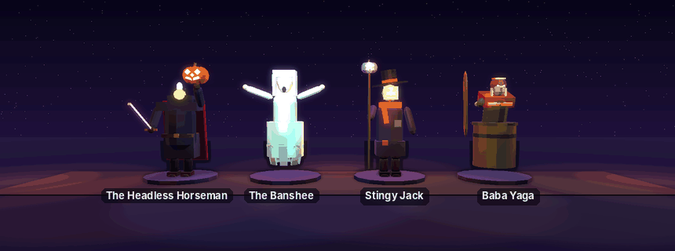</p>

<p align="center">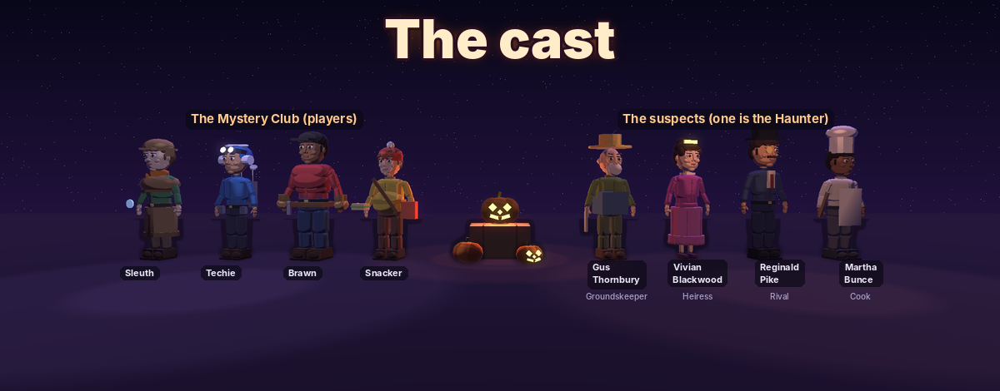</p>

<p align="center">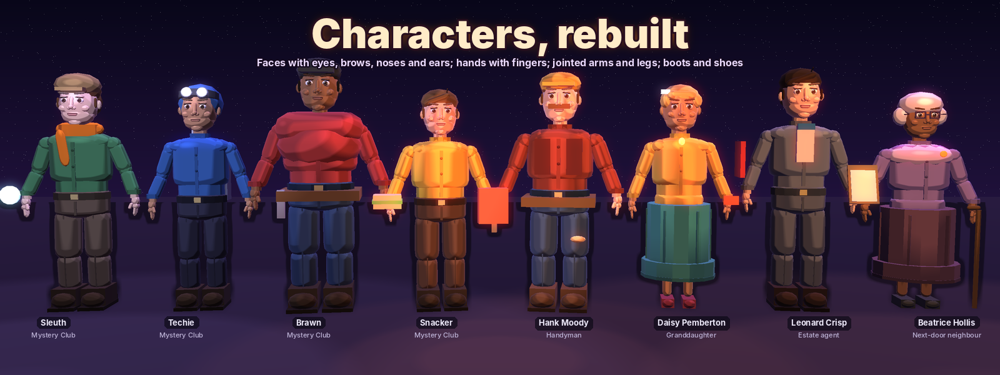</p>

Every character has a proper face, hands with fingers and a thumb, arms that bend at the elbow,
legs with thighs, shins and boots or shoes, a waist, hips, a collar and buttons.

<p align="center">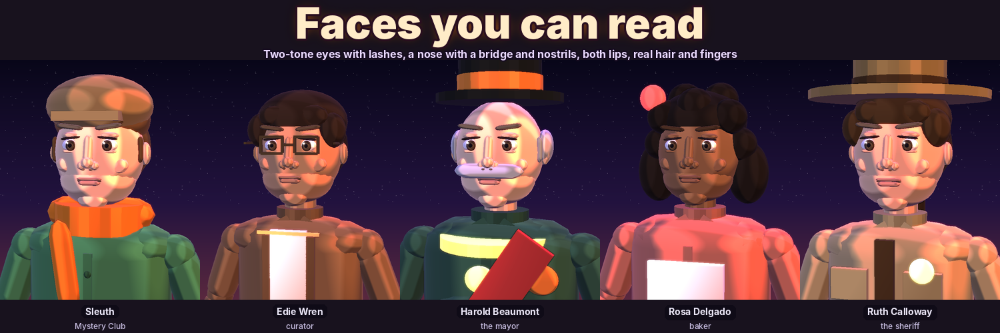</p>

The character pass in round 21 went over everyone again, up close. Eyes now have a two-tone iris,
lashes and a lower lid. Noses have a bridge, a tip, wings and nostrils, mouths have both lips, and
there's a chin, cheekbones and an inner fold to each ear. Hair frames the face (a crown, the back of
the head, then sideburns, a fringe, side curtains, a fall down the back or curls) instead of sitting
on top like a helmet. Spectacles are wire frames you can see the eyes through. The four fingers are
separate and curl a little, the shoulders slope, trouser legs have a pressed crease and skirts have
pleats.

<p align="center">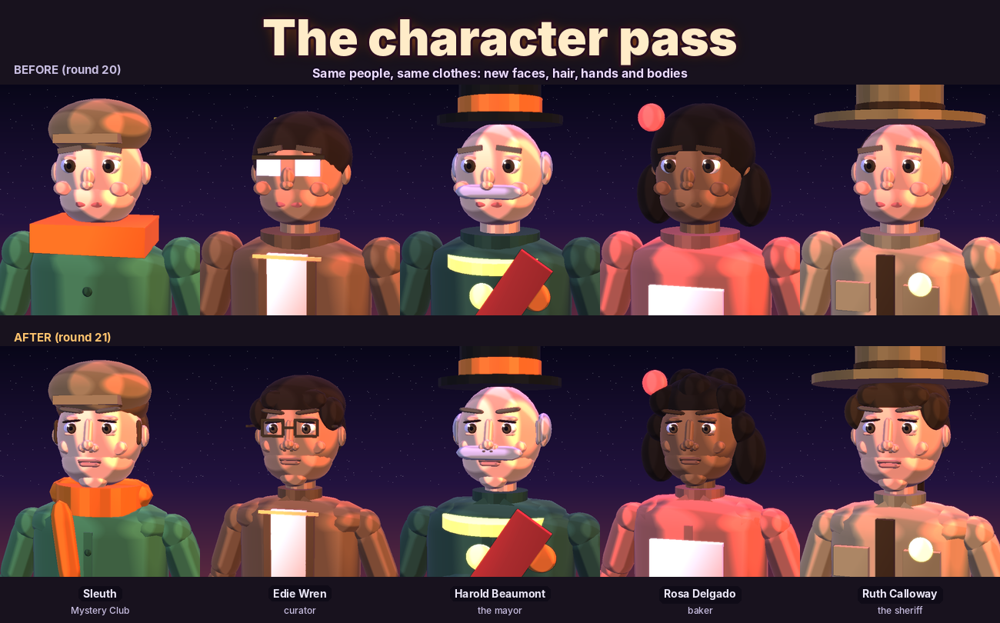</p>

<p align="center">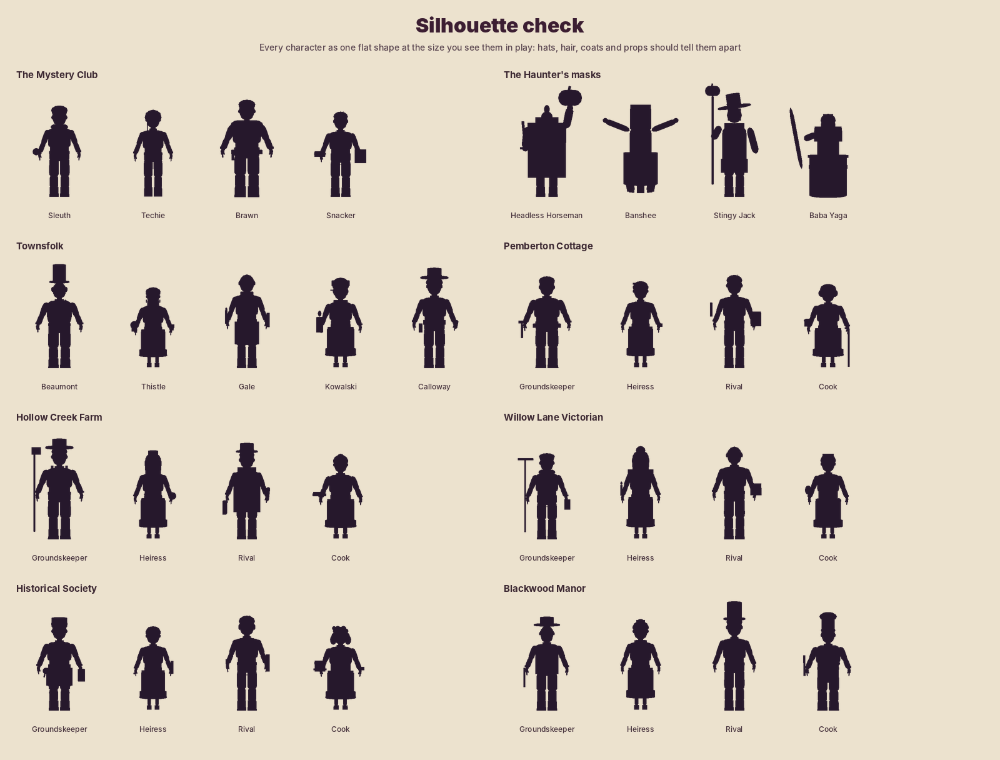</p>

Round 22 added a silhouette check: every character as one flat shape at gameplay size, so hats,
hair, coats and props have to tell people apart without colour or a face. It caught one pair, the
two Pemberton Cottage ladies, so Beatrice Hollis now has a shawl and a walking cane.

<p align="center">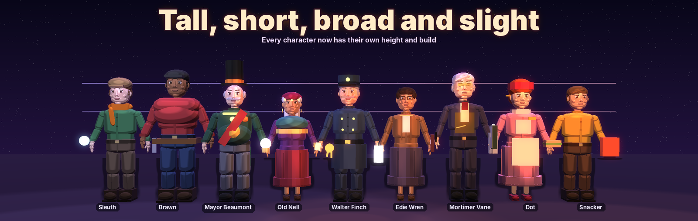</p>

Nobody is the same size any more. Each person has their own height and build in `CHARACTERS` in
[`make_costumes.py`](tools/make_costumes.py): the Reverend and Mortimer Vane are tall and thin,
the Brawn and the Mayor are broad, Old Nell and Rosa are short. Builds widen the body but not the
face, so nobody's head gets stretched. The README pictures are rendered with smooth shading now too,
the way Unity draws its spheres and capsules. (These are renders from the project's own software
renderer, not Unity screenshots.)

<p align="center">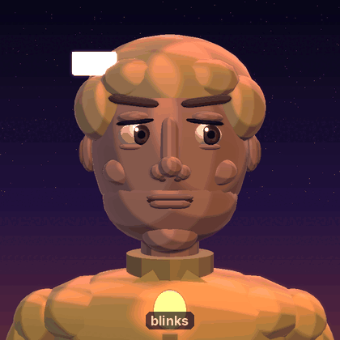</p>

And the faces move: everyone blinks every few seconds, glances around and looks at you when you
come close, and a suspect's lips move while they answer your questions
([`Animation/FaceLife.cs`](../Assets/Unmasked/Scripts/Animation/FaceLife.cs)).

The Mystery Club dress for their roles (the Sleuth's deerstalker and magnifier, the Techie's
goggles and antenna backpack, the Brawn's toolbelt, the Snacker's sandwich) and the four suspects
are dressed for their jobs. Every character and prop is built from simple shapes in
[`Docs/tools/make_costumes.py`](tools/make_costumes.py) and saved to
[`Assets/Unmasked/Resources/Costumes.json`](../Assets/Unmasked/Resources/Costumes.json), which Unity and
the README renderer both read.

---

## Hollow Creek: the town

<p align="center">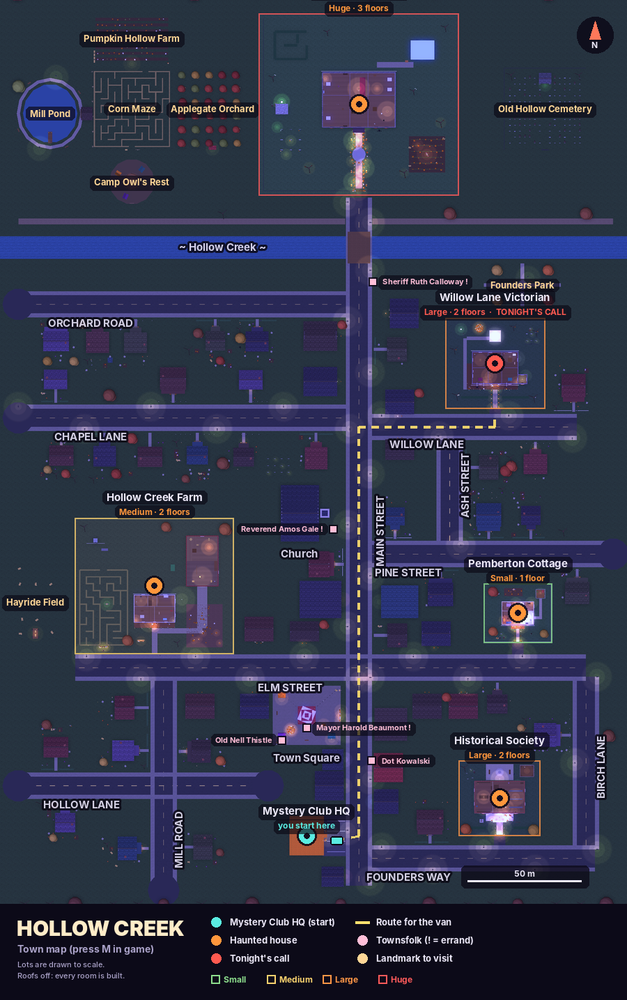</p>

Every night starts at **Mystery Club HQ** at the south end of Main Street. A call comes in, the club
piles into the van and drives through town (past the diner, the town square with the Harvest
Festival stalls, the church and its churchyard, over the creek bridge) to tonight's haunted house.
It's a semi-open world: every house is fully built on its own lot all the time, so you can drive
past the others, and the Haunter, the suspects, the clues and the trap only exist at the house the
call is about.

<p align="center">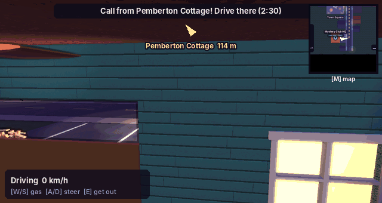</p>

**The map (M)** works like the phone map in *Schedule I*: a top-down view of the whole town with
each house fully loaded, pins for HQ, every haunted house, the van and your friends. Click a house
for its card: a live 3D view circling the house, its size, floors, rooms and spookiness, a
**Set waypoint** button and, at HQ, **Take this call**. A minimap and a waypoint arrow stay on screen
while you drive.

**The Club Book (K)** is the club's scrapbook: 48 challenges in seven chapters (one at every house, the
eight landmarks, casework, playing the Haunter, trick-or-treat, the four legends), 24 lost lanterns hidden around
town, the stories you've heard, and a wardrobe of 19 hats, backpieces and torch colours bought with candy you earn by playing.
Each house challenge has a **Play** button that makes that house tonight's call. Nothing costs
money, there are no daily streaks, and after every third night a card says it's a good place to stop.

**Trick or treat.** Every house on the new streets has a family behind the door. Where the porch
light is on, press **E** at the door: it opens a crack, a bowl of candy comes out, and they say
something. Each door gives one treat a night (more candy the first time), and which families are
home changes from night to night. Some point you at the nearest lost lantern. Twelve tell one of
the **Stories of Hollow Creek**; a family with a story you haven't heard is always home, and the
Club Book's Stories tab says which street to try.

### Beyond the edge of town

<p align="center">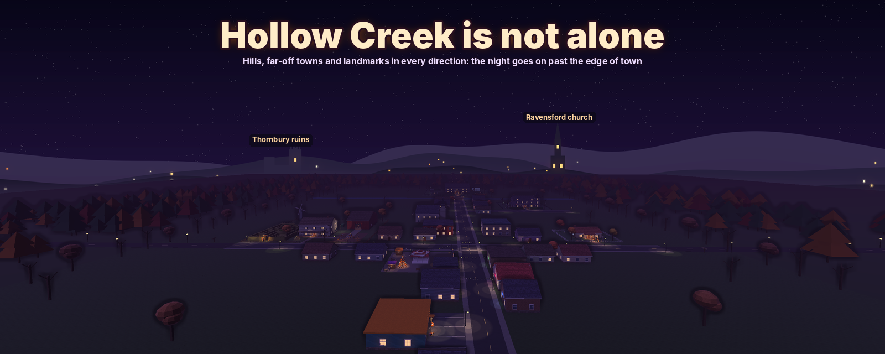</p>

Hollow Creek sits in a valley, and the world doesn't stop at the town line. Three ridges of hills
ring the horizon in every direction, with the lights of farms and far-off towns scattered across
them and mist lying in the valley. Landmarks stand on the ridges: the **Ravensford church** steeple,
**Hatcher's old windmill** turning, the
**Ravensford water tower** with its red light, and the **Thornbury ruins**. The hills follow the
camera, so they always stay on the horizon however far you drive.

<p align="center">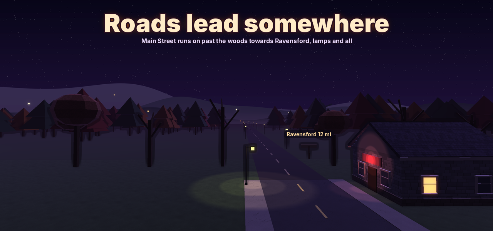</p>

Closer in, every road carries on past the edge of town with lamps and signposts ("Ravensford 12 mi",
"Thornbury 6 mi", "Old Mill Road"), and a band of pines and autumn trees fills
the gap between the town and the hills. It's all built when the town loads by
[`Town/Horizon.cs`](../Assets/Unmasked/Scripts/Town/Horizon.cs) from the `horizon` block in
[`HollowCreek.json`](../Assets/Unmasked/Resources/HollowCreek.json).

<p align="center">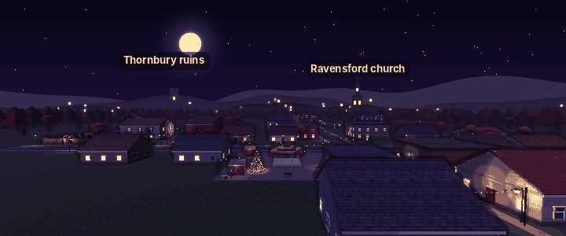</p>

### The haunted places

<p align="center">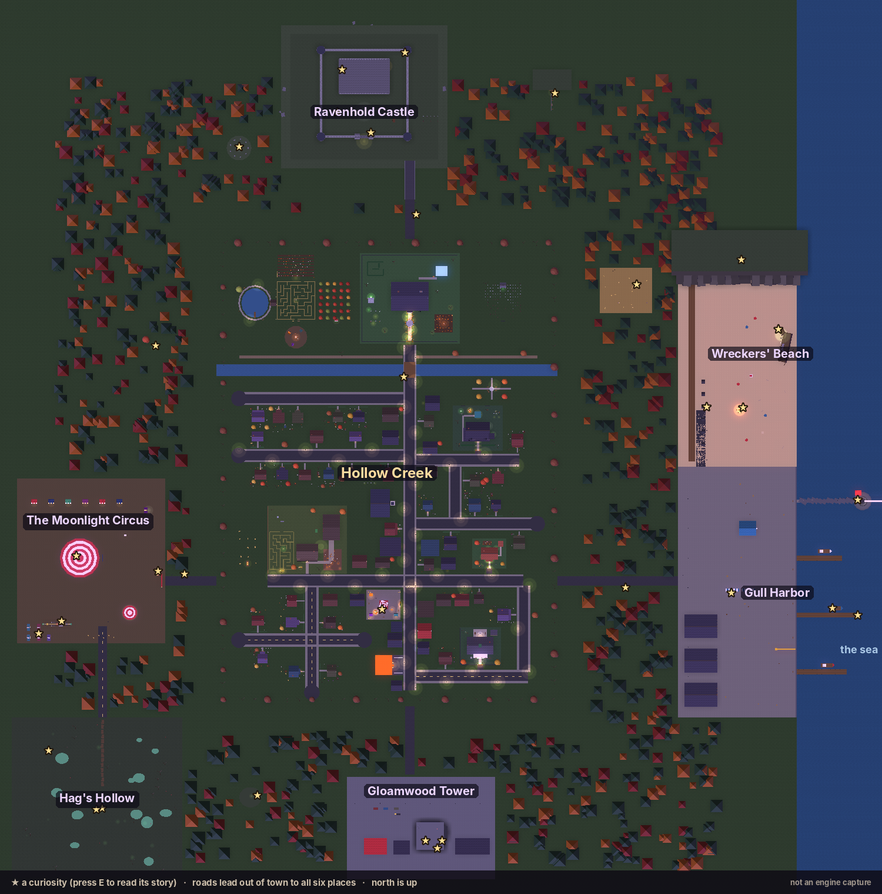</p>

Before the hills, six roads lit by street lamps lead out of town to six haunted places, each one a
proper place to explore rather than a picture on the horizon:

| Place | Where | What's there |
|---|---|---|
| **Ravenhold Castle** | north, in the Blackthorn Hills | a road up the hill, gatehouse, battlements, four towers with flags, the great hall (feast table, throne, armour, chandelier), a well, graves and crows |
| **The Moonlight Circus** | west, on the fairground | big top with ring, bleachers and trapeze, a turning carousel, a Ferris wheel, booths, caravans, the fortune teller's wagon |
| **Gloamwood Tower** | south, past HQ | a fourteen-storey high rise with a neon sign, a diner and launderette, and a fire escape to the roof |
| **Gull Harbor** | east, on the sea | quay, warehouses, fish market, crane, piers and boats, and the breakwater out to **Saltmarsh Lighthouse** (climb the outside stair to the gallery) |
| **Wreckers' Beach** | north-east | sand, huts, a lifeguard tower, a bonfire, the ghost ship *Mary Grey*, and **Smugglers' Cave** in the cliff |
| **Hag's Hollow** | south-west | swamp pools, dead trees, green lights over the water, a rowboat and Old Mother Gloam's cottage |

Off the roads there are smaller spots for wanderers: the **Nine Widows** standing stones, a
**scarecrow field**, a **wishing well** under a crooked oak, **Whisker Hill** pet cemetery and an
**old mine**. Reach a haunted place for the first time and you hear its story (+15 candy). The castle
flags flutter, the carousel and Ferris wheel turn, the lighthouse beam sweeps, the tower beacon
blinks, and the crane hook and the wreck's lantern sway
([`Town/WorldLife.cs`](../Assets/Unmasked/Scripts/Town/WorldLife.cs)). It's all built from the
`regions` and `curios` blocks of `HollowCreek.json` by
[`Docs/tools/regions.py`](tools/regions.py).

<p align="center">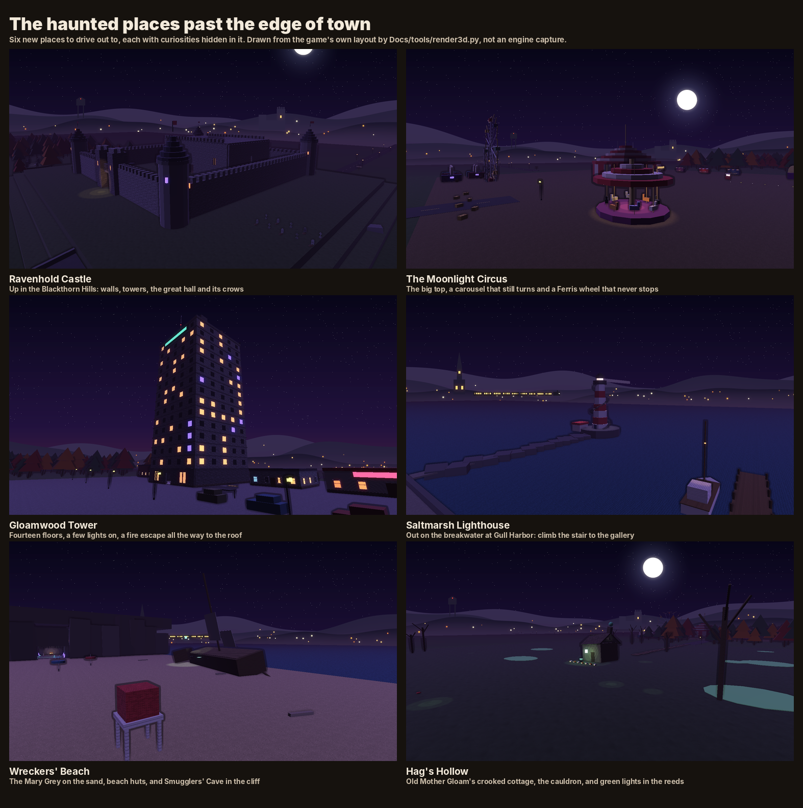</p>

**Curiosities.** 32 curiosities are hidden across the world and back in town, each twinkling until
you've found it. Press **E** to examine one and read its little story (+10 candy). Found ones stay
put, so you can show friends. The Club Book's Curiosities page lists them, with the place each one
is near; find them all for the Explorer's hat. Challenges: reach one haunted place, then all six;
find one curiosity, ten, then all; climb the lighthouse; reach the tower roof. The album has a frame
for each haunted place.

### Someone's always out tonight

<p align="center">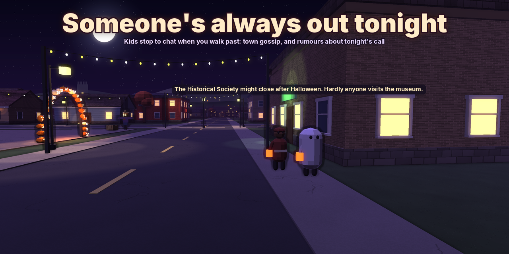</p>

Hollow Creek is out trick-or-treating. Groups of two to four kids (ghosts in sheets, witches,
pumpkins, skeletons, cats, vampires and pirates, each with a glowing candy bucket) walk the
sidewalks of Main Street, Elm Street and Willow Lane, stop now and then to knock, and turn to talk
when you walk up. They pass on the town's gossip (the museum might close, someone borrowed the old
festival masks, a light at the old windmill) and, once a call comes in, rumours about tonight's
house. It's all scenery: rumours are never clues, and the kids are never in anyone's way.

<p align="center">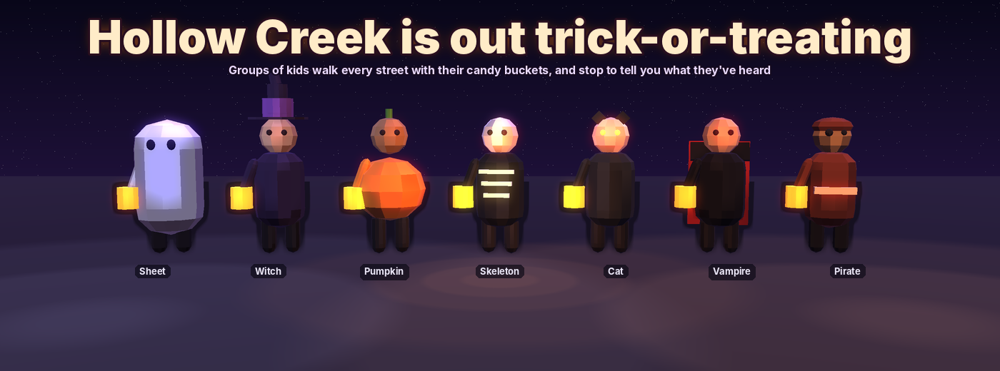</p>

Out past the edge of town, cars come and go on the roads to Ravensford and Thornbury with their
headlights on, and now and then the late train crosses the valley in front of the hills, its
windows lit. Built by [`Town/TownLife.cs`](../Assets/Unmasked/Scripts/Town/TownLife.cs) from the
`life` block in [`HollowCreek.json`](../Assets/Unmasked/Resources/HollowCreek.json).

<p align="center">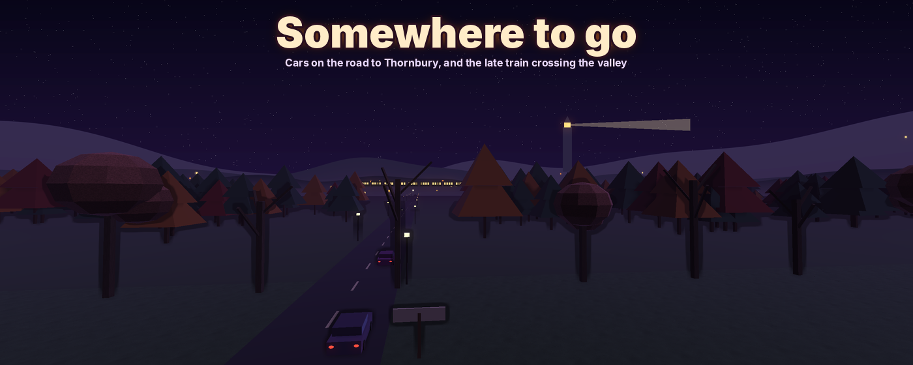</p>

### Haunts in town

<p align="center">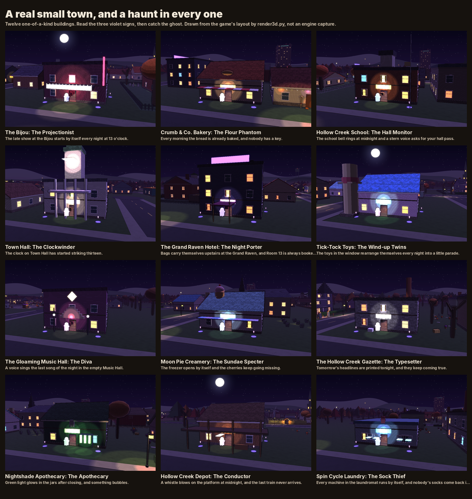</p>

Hollow Creek isn't just houses. Twelve one-of-a-kind buildings stand on its streets, each with a
shape of its own (the Bijou's marquee, the town hall's clock tower, the depot's long platform
canopy, the laundromat's round windows) and each with a haunt. Walk up to a haunt and look for its
**three violet signs**: little wisps over a ring of light, each telling a piece of the story when you
press **E**. Once all three are read, the ghost comes out. Press **E** to catch it, and it hops away
to its next hiding spot; catch it **three times** and the haunt is busted, with the twist explained.
The signs go dark, the building goes quiet, and its name on the map (**M**) turns from violet to green.

| Building | Ghost | The haunt |
|---|---|---|
| The Bijou | The Projectionist | The late show at the Bijou starts by itself every night at 13 o'clock. |
| Crumb & Co. Bakery | The Flour Phantom | Every morning the bread is already baked, and nobody has a key. |
| Hollow Creek School | The Hall Monitor | The school bell rings at midnight and a stern voice asks for your hall pass. |
| Town Hall | The Clockwinder | The clock on Town Hall has started striking thirteen. |
| The Grand Raven Hotel | The Night Porter | Bags carry themselves upstairs at the Grand Raven, and Room 13 is always booked. |
| Tick-Tock Toys | The Wind-up Twins | The toys in the window rearrange themselves every night into a little parade. |
| The Gloaming Music Hall | The Diva | A voice sings the last song of the night in the empty Music Hall. |
| Moon Pie Creamery | The Sundae Specter | The freezer opens by itself and the cherries keep going missing. |
| The Hollow Creek Gazette | The Typesetter | Tomorrow's headlines are printed tonight, and they keep coming true. |
| Nightshade Apothecary | The Apothecary | Green light glows in the jars after closing, and something bubbles. |
| Hollow Creek Depot | The Conductor | A whistle blows on the platform at midnight, and the last train never arrives. |
| Spin Cycle Laundry | The Sock Thief | Every machine in the laundromat runs by itself, and nobody's socks come back in pairs. |

**Step inside.** Each haunt's ground floor is a room you can walk into, furnished for its haunt
(cinema seats and a screen, a bakery counter and oven, a stage and piano, shelves of glowing jars,
a wall of washing machines). After your second catch the ghost flees indoors, so the last catch
always happens inside.

<p align="center">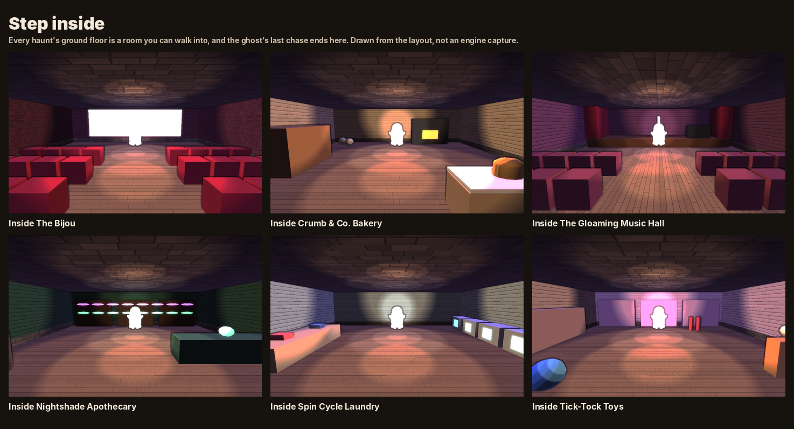</p>

Busts are saved, and the Club Book's "Haunts in town" chapter has three challenges: your first bust,
six, and all twelve, which earns the **Haunt Buster's cap**. Laid out by
[`Docs/tools/haunts.py`](tools/haunts.py), played by
[`Town/HauntBust.cs`](../Assets/Unmasked/Scripts/Town/HauntBust.cs).

### Softer people

<p align="center">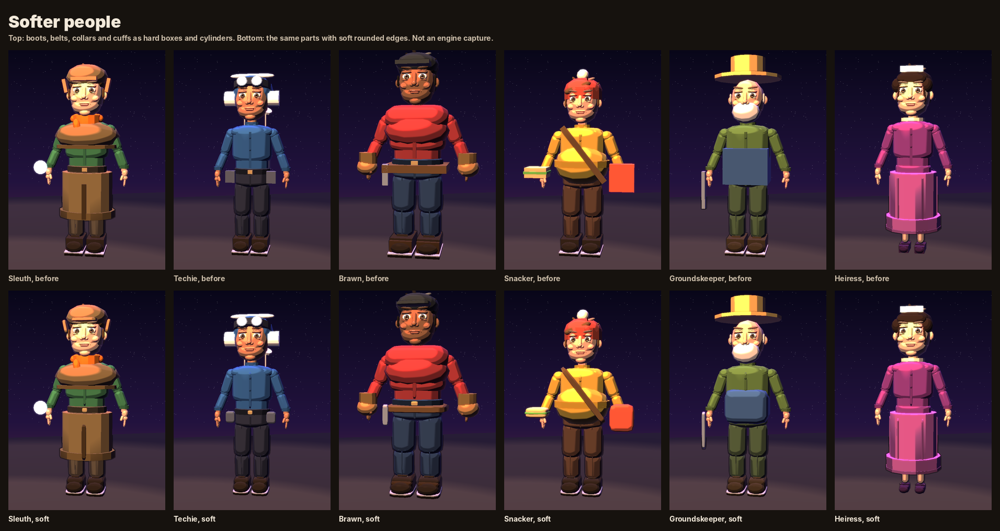</p>

The parts of a character that used to be hard cubes and tubes (boots, shoes, soles, aprons, belts,
bibs, satchels, collars, cuffs and socks) now have rounded edges and smooth shading.
`Costumes.json` marks them `rbox` or `rcyl`; the builders make a plain cube or cylinder and add
[`Spooky/SoftBox.cs`](../Assets/Unmasked/Scripts/Spooky/SoftBox.cs), which swaps in a rounded mesh made
once in code and shared by everyone, so there's no model file to ship.

**Storybook hands and flaring skirts (round 44).** Hands are chunky now (a round palm, plump fingers
held together and curled in, a thumb resting forward), so they read as hands rather than claws from
across a street. Skirts and long coats flare toward the hem in seven soft tiers with a darker trim,
instead of one straight tube.

<p align="center">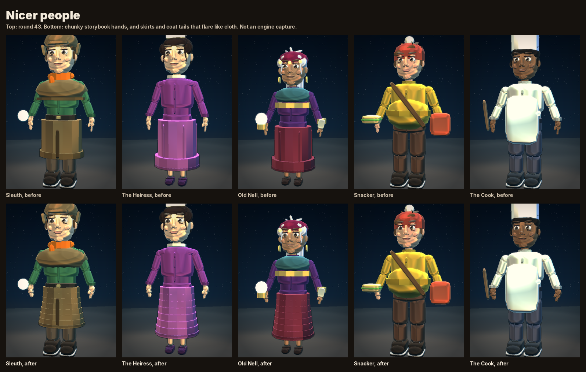</p>

**One smooth skin (round 45).** A person's body parts (torso, shoulders, arms, legs, neck, head,
jaw, cheeks, ears and skirt) are melted into one skin, so joints flow into each other instead of
showing a seam like a toy figure. Each limb only melts into its own joints and the torso, so a hand
resting by a hip or an arm hanging by a skirt stays separate. Every bit of the skin takes the
colour of the part it's nearest, so clothes keep their colours. It's built in code by
[`Spooky/SmoothBody.cs`](../Assets/Unmasked/Scripts/Spooky/SmoothBody.cs) when a character appears
and shared by everyone in the same outfit; the original parts stay in place with their renderers
off, so taking the script off brings the old look back.

<p align="center">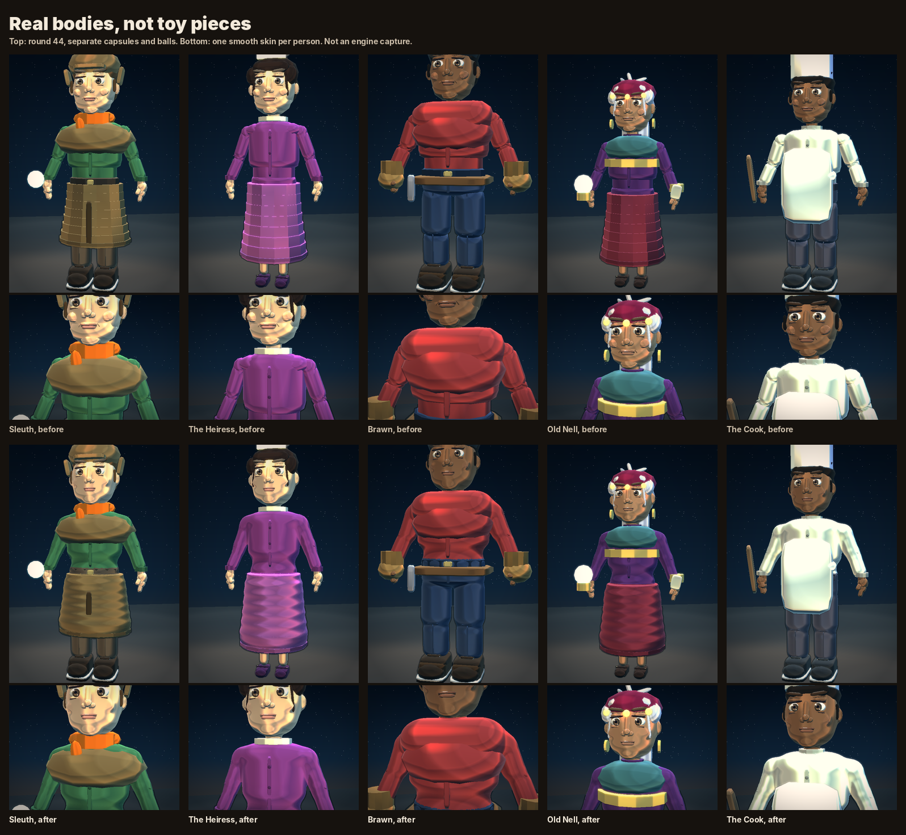</p>

**Faces and hands (round 46).** The nose, the palm and thumb, and the hair melt into the skin too,
each with its own gentle blend, so a nose grows out of the face instead of sitting on it like a
ball. Every limb is meshed on its own grid, and the head, hair and hands use one twice as fine as
the body's. Eyes, brows, mouths, fingers and shoes still sit on top as their own parts.

<p align="center">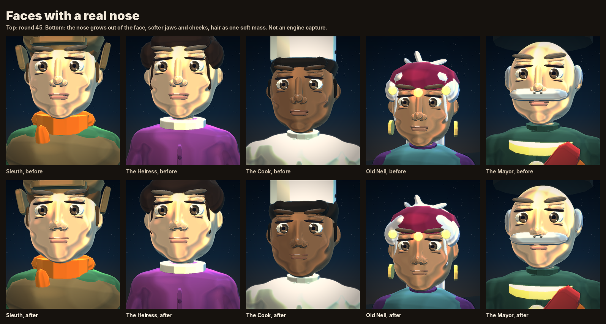</p>

**One smooth body (round 47).** A second chest shape (the Brawn's barrel chest) melts into the
torso, and beards, mutton chops and the ring of hair round a bald head melt into the hair. After
each limb is meshed, its skin is relaxed with Taubin smoothing: every corner is pulled towards the
middle of its neighbours, then pushed back out by a little more, ten times over. That irons out
the ripples the grid leaves on cheeks, chests and skirts while the volume stays the same (within
0.1%), and the lighting then uses normals from the relaxed surface itself.

<p align="center">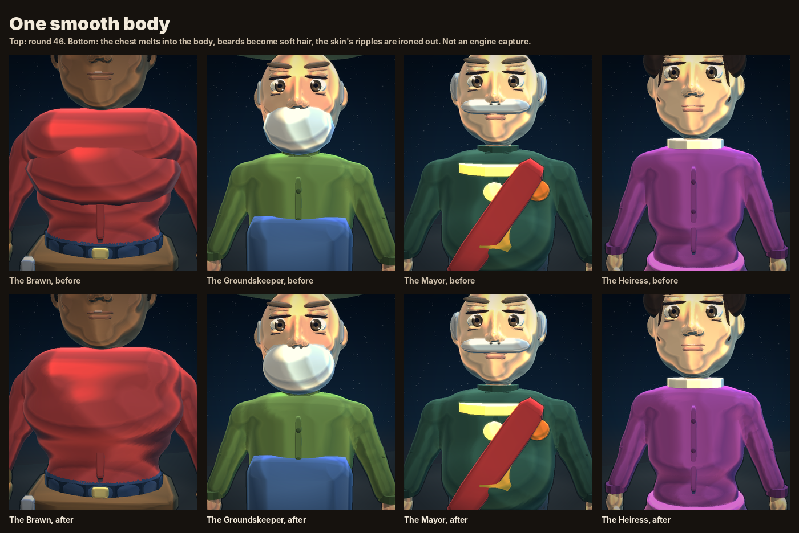</p>

### Rooms full of things

<p align="center">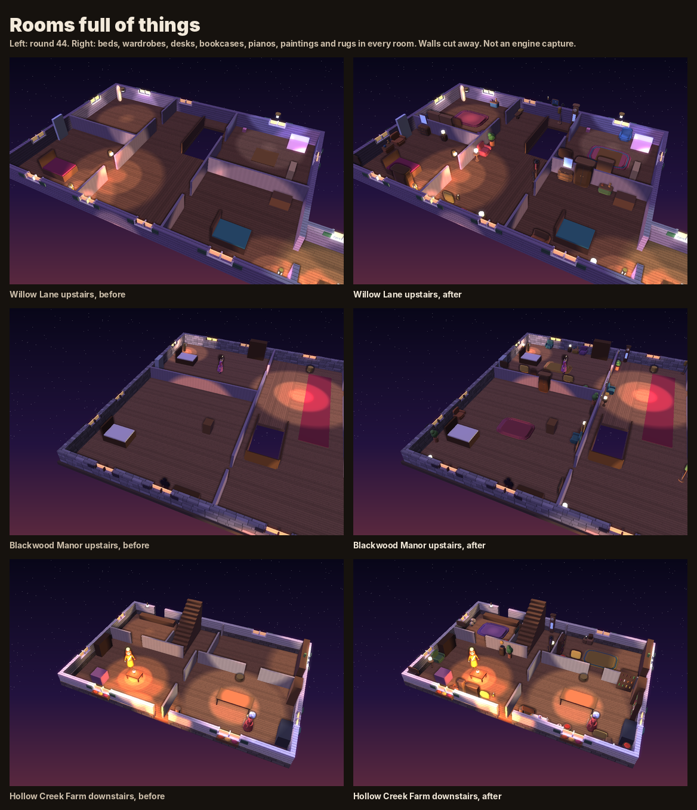</p>

Since round 45 every room in the houses, the manor and the HQ is dressed for what it is (bedrooms,
studies, kitchens, pantries, cellars, music rooms, nurseries, sewing rooms, dining rooms, halls,
galleries, the gift shop). A piece only goes against solid wall, standing on floor, clear of other
furniture, stairs, doors, doorways, trapdoors, clue spots and suspects, with a walkway left in front;
a room never gets a second bed or piano, or one it already has. Paintings and little wall lamps
hang on bare wall, and a rug goes in the middle when the floor is clear. Placed by
[`Docs/tools/roomdetail.py`](tools/roomdetail.py), which `dressing.finish()` runs whenever a layout is saved.

Since round 46 every window that looks into a room has curtains on a brass rod, with a valance and
tie-backs in one of seven fabrics, and every table, desk, counter and sideboard at table height gets
a little still life (teacups, books, candles, flowers, a pie, a teapot, a letter and pen, a small
pumpkin) wherever nothing already stands on it.

<p align="center">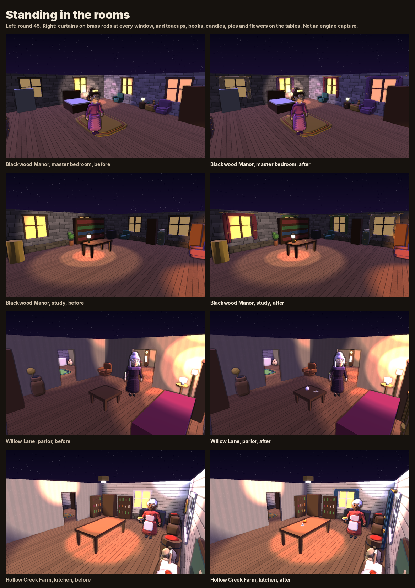</p>

### Along the streets

<p align="center">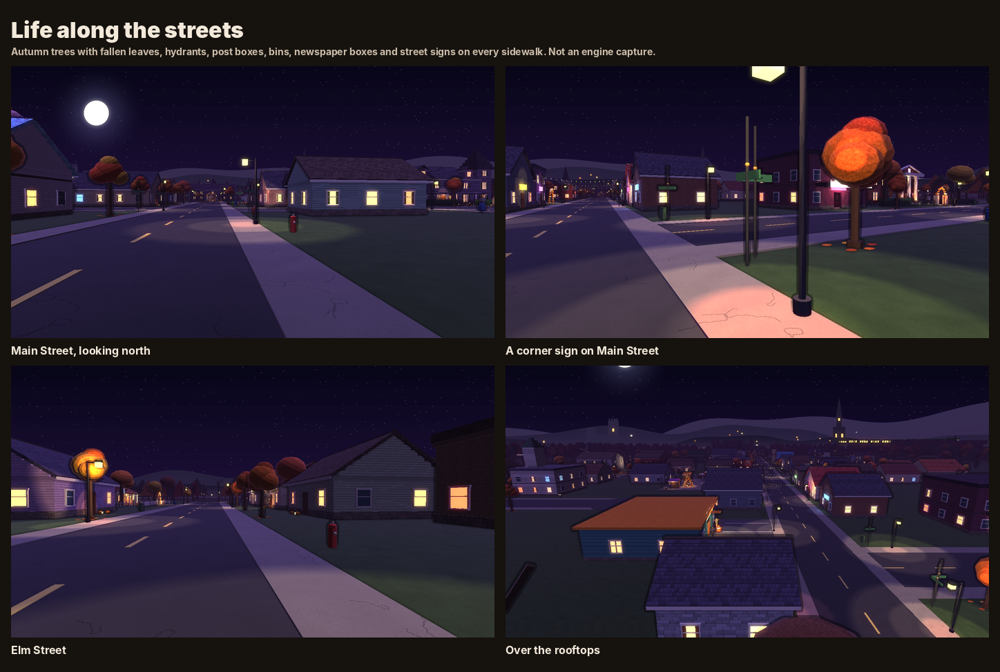</p>

Every sidewalk in town has a grass verge, and since round 44 it's lived in: autumn street trees in
orange, red and gold with leaves fallen round their feet, red fire hydrants, blue post boxes, green
bins, yellow newspaper boxes, and a green signpost near the end of each street. Nothing is placed
where a building, path, fence, lamp or another prop already stands, and the same town comes out
every build. Placed by [`Docs/tools/streetlife.py`](tools/streetlife.py).

Since round 47 the front gardens of the 23 homes are planted too: a window box of mums and ivy
under every front window, rounded shrubs along the front wall (or along the porch where a porch
covers it), a border of flowers and stone edging down each side of the path with two lantern stakes
at the gate, a soft clipped crown on every box hedge, a rocking chair on most porches (with a
lantern on a side table when the porch is wide), and either a raked leaf pile with its rake or a
wheelbarrow of pumpkins on the lawn. [`Docs/tools/frontyard.py`](tools/frontyard.py) runs after the
street life in `make_town.py` and only adds pieces where nothing already stands.

<p align="center">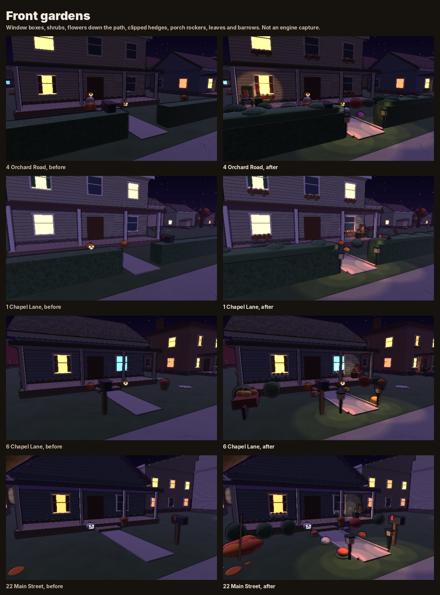</p>

### The people of Hollow Creek

<p align="center">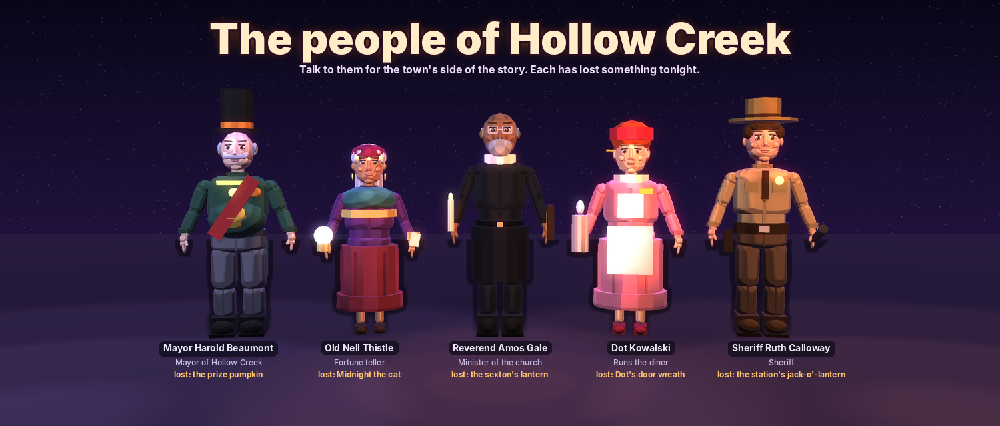</p>

Five grown-ups are out in town tonight, and you can walk up to any of them and press **E** to talk:
**Mayor Harold Beaumont** by the bandstand, **Old Nell Thistle** reading fortunes at her festival
stall, **Reverend Amos Gale** outside the church, **Dot Kowalski** at the diner door, and **Sheriff
Ruth Calloway** keeping watch on the bridge. They turn to face you, their lips move as they talk, and
what they say fills in the town's side of the Mask Keeper story: whose idea it was to lend out the
masks, who meets a collector in the diner's back booth, where the oldest mask came from.

<p align="center">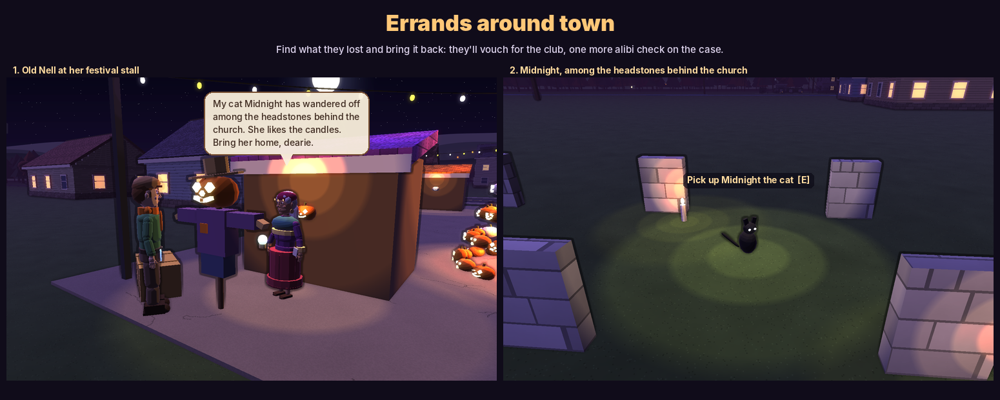</p>

Each of them has lost something tonight: the prize pumpkin, Nell's cat Midnight, the sexton's
lantern, Dot's door wreath, the jack-o'-lantern from the sheriff's station steps. Once they've asked,
it shows up somewhere in town with a soft glow, and their pin on the map (**M**) gets a "!". Bring it
back and they put in a word for the club: **one more alibi check**, tonight if you're on a case or
on the next one if you're between calls. Errands carry on from night to night, and the HQ panel
keeps count. Built by [`Town/Townsperson.cs`](../Assets/Unmasked/Scripts/Town/Townsperson.cs) and
[`Town/ErrandItem.cs`](../Assets/Unmasked/Scripts/Town/ErrandItem.cs) from the `folk` block in
[`HollowCreek.json`](../Assets/Unmasked/Resources/HollowCreek.json).

### The Lantern Watch: a costume the town makes for you

<p align="center">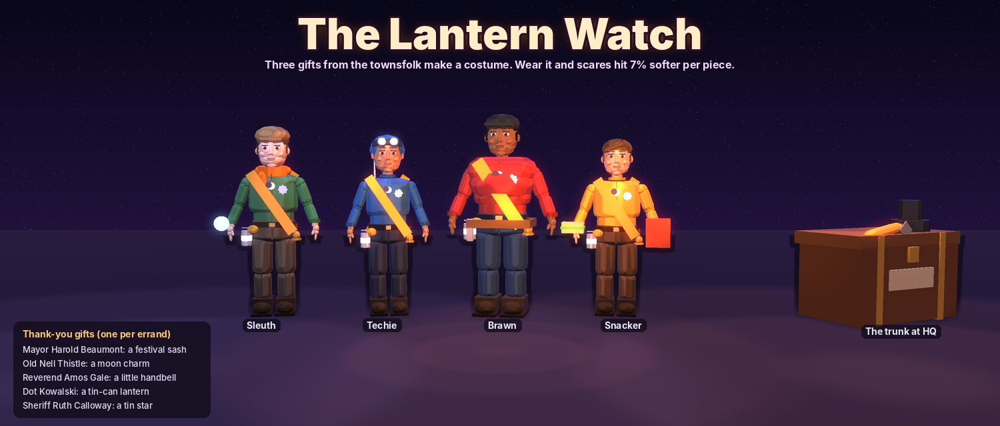</p>

Each townsperson also says thank you with something homemade: the Mayor's old festival sash, a
tin moon charm from Old Nell, the Sunday-school handbell, a tin-can lantern from Dot's diner and a
tin star from the sheriff. Three pieces make a costume. Open the **dressing-up trunk at HQ** (E)
between cases to put it on or take it off. While the club wears it, every piece shows on all four
Solvers and **scares hit 7% softer per piece** (21% with three, 35% with all five). The costume is
data in [`make_costumes.py`](tools/make_costumes.py) (`WATCH`), fitted to each Solver's height
and build, and switched on by [`Spooky/WatchCostume.cs`](../Assets/Unmasked/Scripts/Spooky/WatchCostume.cs)
and [`Town/CostumeTrunk.cs`](../Assets/Unmasked/Scripts/Town/CostumeTrunk.cs).

### The street remembers

<p align="center">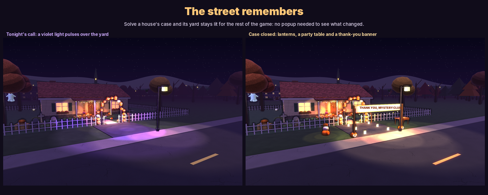</p>

Every house shows where its story stands. While its call is open, a violet light pulses over the
front yard. Once its case is in the case book, the neighbours throw a little party that stays for
the rest of the game: paper-bag lanterns up the walk, jack-o'-lanterns at the gate, a party table
and a **THANK YOU, MYSTERY CLUB!** banner. You can see which houses you've helped from the van,
without opening a menu. It reads the same networked case book as the keepsake shelf
([`Town/HouseMood.cs`](../Assets/Unmasked/Scripts/Town/HouseMood.cs), from the `afterglow` block of
each lot in `HollowCreek.json`).

### Saved progress, and starting over

The host's game remembers the case book, every errand (asked, found or done), favours still owed,
costume pieces and whether the club is wearing the costume, so quitting and coming back picks up
the same town. Rewards can't be collected twice: a finished errand stays finished. The host has a
**Start over** button at HQ that wipes it all, and it needs a second press within a few seconds.

### The Club Handbook: hints for your first night

New players get a small card the first time each moment comes up: arriving at HQ, the drive, the
first clue, the Suspect Board, being able to accuse, the first panic, the trap, playing the
Haunter, the townsfolk's errands and closing a case. Each card shows once, and **F1** opens the
handbook with every hint seen so far (and a button to show them all again). The hints live on
each player's own computer, so nothing extra goes over the network
([`UI/Handbook.cs`](../Assets/Unmasked/Scripts/UI/Handbook.cs)).

<p align="center">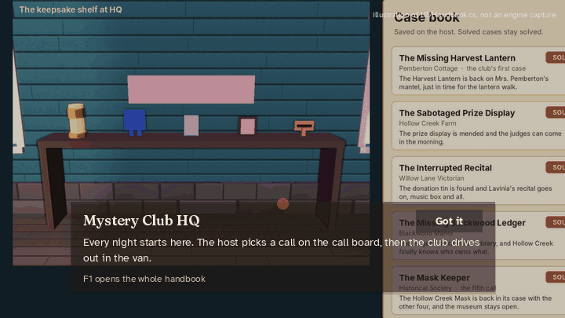</p>

### The houses

<p align="center">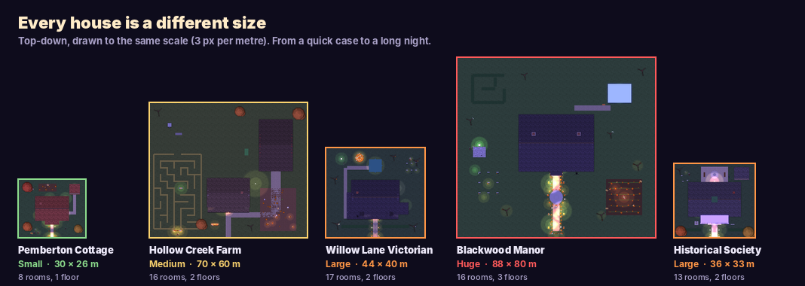</p>

| House | Size | What's there |
|---|---|---|
| **Pemberton Cottage**, 14 Elm Street | Small: 30 x 26 m lot, 1 floor | A tidy cottage behind a white picket fence: living room, kitchen, bedroom, bathroom, study, a garden shed and a vegetable patch. A quick case. |
| **Hollow Creek Farm**, Old Mill Road | Medium: 70 x 60 m lot, 2 floors | A farmhouse, a red barn with a hayloft trapdoor, a corn maze with a scarecrow in the middle, a windmill and a pumpkin patch. |
| **Willow Lane Victorian**, 3 Willow Lane | Large: 44 x 40 m lot, 2 floors and a tower | A wraparound porch, a music room under a nursery with a trapdoor, a tower lookout, a gazebo (the trap site) and a family plot. |
| **Blackwood Manor**, the end of Main Street | Huge: 88 x 80 m lot, cellar, 2 floors, roof | The big one, over the creek (below). |
| **Historical Society**, 1 Founders Way | Large: 36 x 33 m lot, 2 floors | The fifth call, locked until the other four are solved: a museum with a portico, a Mask Gallery, an Archive, a courtyard fountain and a Restoration Workshop. |

<p align="center">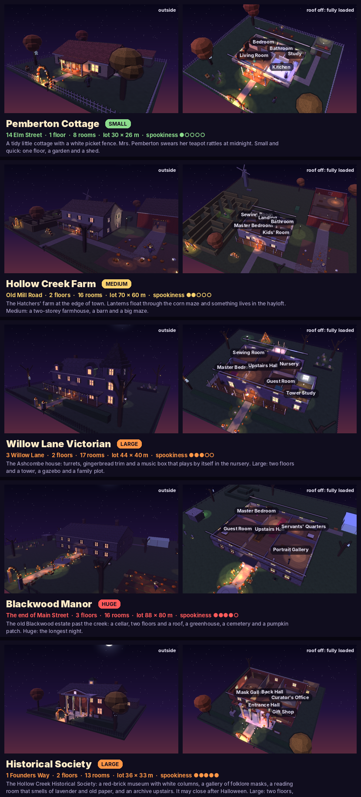</p>

### A case for every house

<p align="center">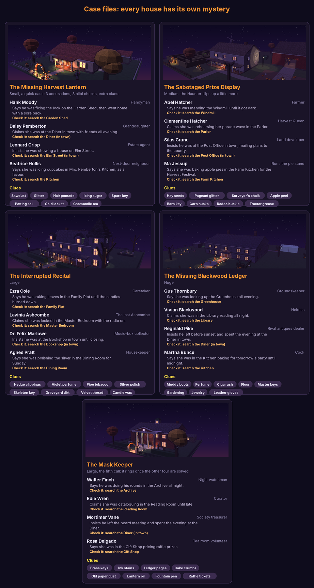</p>

Every call is its own mystery. The house you drive to decides who the four suspects are, what they
claim they were doing, what they gossip about, and what the clues look like: sawdust and icing sugar
at the cottage, hay seeds and tractor grease at the farm, candle wax and graveyard dirt on Willow Lane.
The rules underneath are the same everywhere (any two true clues name exactly one suspect), so every
case is solvable. Pemberton Cottage is the gentle one: an extra clue hidden at the start, the Haunter
slips up more, and you get three accusations instead of two.

<p align="center">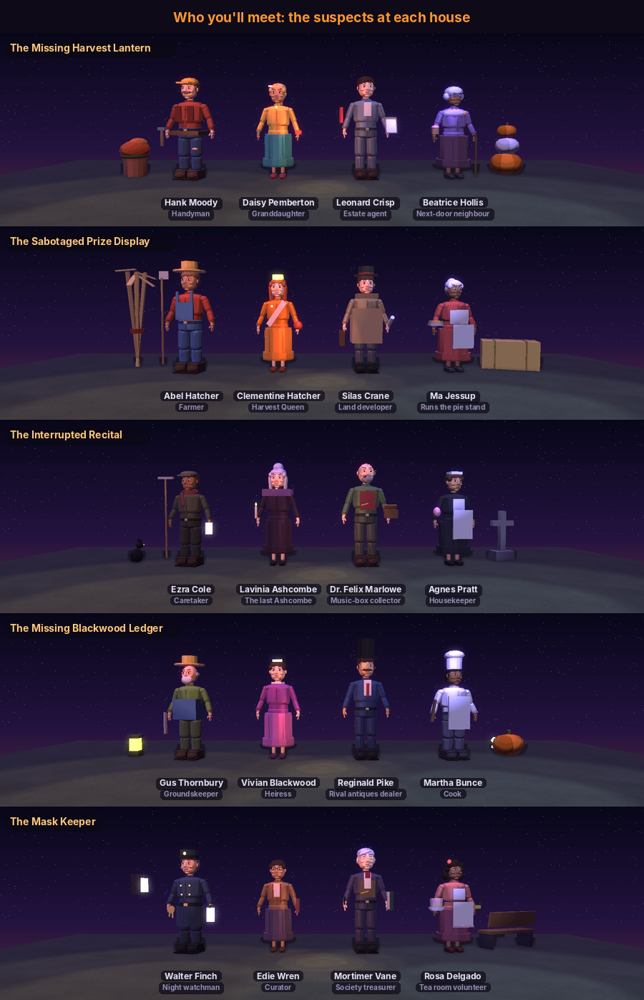</p>

Each cast dresses the part: Hank the handyman has his hammer and toolbelt, the Harvest Queen her
crown and sash, Dr. Marlowe carries the music box he keeps trying to buy. The four suspects follow the
club from call to call and change into tonight's cast when a call comes in. While you investigate
they don't stand frozen: they stroll around near their spot, so you'll have to find them.

#### Return visits

<p align="center"></p>

Solve a house's case and, a night or two later, it calls again with a **new mystery**. It's the same
neighbours in the same outfits, but they have new alibis, new clues, new gossip and new reasons to
wear the mask. At Pemberton Cottage, Mr. Pemberton's old love letters have gone from the desk and the
garden gnomes all face the window. At the farm, the hundred-year-old seed corn is stolen and the
scarecrow turns its head. On Willow Lane, the Ashcombe christening cup is gone and the empty cradle
rocks. At Blackwood Manor, Lady Blackwood's portrait has vanished and the organ in the cellar plays at
midnight. The call board marks them **RETURN VISIT**, and houses with an unsolved case call first, so
there are nine cases in the book now.

All nine cases live in [`Cases.cs`](../Assets/Unmasked/Scripts/Mystery/Cases.cs). A case set on the
`MysteryGameManager` in the Inspector still overrides them.

### Special nights

<p align="center"></p>

| Event | What changes |
|---|---|
| **Blood Moon** | A red moon. Scares hit 25% harder and the Haunter's ectoplasm refills 50% faster. |
| **Thunderstorm** | Rain and lightning flashes. Now and then a lamp in the house blows out. Flashlights drain a bit faster. |
| **Pea-Soup Fog** | Thick fog off the creek: you can barely see past your flashlight. |
| **Power Outage** | Every lamp in the house starts off and flashlights drain 60% faster. |
| **Harvest Festival** | The town is celebrating: Solvers are braver (20% less fear), but dawn comes 20% sooner. |

The town is data too: [`Docs/tools/make_town.py`](tools/make_town.py) writes
[`HollowCreek.json`](../Assets/Unmasked/Resources/HollowCreek.json) and
[`Docs/tools/make_houses.py`](tools/make_houses.py) writes each house into
[`Resources/Houses/`](../Assets/Unmasked/Resources/Houses). **Unmasked > Build Hollow Creek (town)**
builds the whole thing in Unity, and the pictures above are drawn from the same files.

---

## The 3D world: Blackwood Manor

<p align="center"></p>

A two-storey manor with a cellar, eleven rooms and spooky grounds: an iron gate under an arch of
jack-o'-lanterns, a pumpkin trail around the fountain, the groundskeeper's greenhouse, a pumpkin
patch with a scarecrow, a cemetery with candles and a witch's cauldron, a hedge garden and dead
trees hung with jack-o'-lanterns. Walk in through
the front door, take the grand staircase up, or the back-hall stairs down to the cellar. Three
trapdoors drop unlucky Solvers a floor.

<p align="center"></p>

### The look: Halloween night

<p align="center"></p>

The whole town is dressed like LA's [Nights of the Jack](https://secretlosangeles.com/nights-of-the-jack/)
trail, but kept to what a town that loves Halloween would really put out: carved pumpkins on every
porch and path, an arch of jack-o'-lanterns here and there, string lights, cornstalks and mums, one
ghost in a tree. The game uses a cel-shaded toon shader, bloom so every jack-o'-lantern glows,
ground mist, fireflies and bats. [Docs/ART_DIRECTION.md](ART_DIRECTION.md) has the references,
palette and rules.

**The storybook light (round 33).** The colours mean something. The night is **teal**: teal in the
shadows, a low creek mist along the ground, a grade with teal shadows and amber highlights.
**Amber** is lamplight and welcome: windows in a few warm shades, porch lamps, and a warmer picture
near HQ. **Violet** only ever means a haunting: it creeps into rims, mist and the picture as you get
scared or step onto the haunted lot, and the Haunter always sees a little of it. **Gold** is the
unmasking, when the mist lifts. `Spooky/StoryLight.cs` sets the moods; the ToonSpooky shader draws them.

<p align="center"></p>

**The storybook cast (round 34).** Heads are 1.3 times bigger (they grow from the top of the neck,
so collars and scarves stay put), eyes 1.18 times and hands 1.14 times, all in
`Docs/tools/make_costumes.py` (`storybook()`), so suspects, townsfolk and the club all match.
Earned hats fit themselves to the bigger heads. Each role has its own outline: the Sleuth a
capelet, long coat and ear flaps; the Techie headphones, a second aerial with a dish and pouches;
the Brawn big work gloves and boots; the Snacker a round shape, a bobble hat and a satchel strap.

<p align="center"></p>

**The Hook Board (round 34).** In front of the Historical Society, on the grass left of the path,
stands a board with twenty-four hooks named for the 1823 lantern families. Walk up with lost
lanterns you've found and press **E**: they go up one by one, +5 candy each. Your Club Book keeps
the hooks, and every filled hook lowers the creek mist across town (`StoryLight` reads it). With
all twenty-four home the board reads THE LANTERN WATCH and the mist lies low for good. Two new
challenges: *Back on its hook* (Around town) and *The new Lantern Watch* (Legend of Hollow Creek).

<p align="center"></p>

**Will-o'-the-wisps (round 35).** After your third lost lantern, a green light sometimes rises off
the creek when you're near it between cases (never during an investigation, a trap or the
unmasking). Walk within 5 metres and it sets off towards the nearest lantern you haven't found,
keeping about 7 metres ahead, slowing when you lag and stopping if you're more than 13 metres
behind. It floats up over anything in its way, so you find your own route. At the lantern it circles
and goes out; the next one rises a little over a minute later. With every lantern found but some not
yet hung, it leads to the Hook Board. `Town/Wisp.cs`; challenge *Follow the light* (Around town).
A new rumour in town hints at it.

<p align="center"></p>

**Moods (round 35).** `Animation/FaceLife.cs` can show Calm, Happy, Worried, Surprised or Cross
for a few seconds (`Feel`): brows tilt and lift, lids open wider or narrow, the mouth opens or
widens, the cheeks rise. Suspects look worried while answering an interview, all of them the same
way. Townsfolk look worried asking for an errand and happy otherwise. Everyone looks surprised at
the unmasking.

<p align="center"></p>

**The carving bench (round 36).** Outside HQ's east door, on the parking-lot side. Press **E** to
open a small panel on the left: Eyes (Triangles, Round, Angry, Sleepy), Nose (Triangle, Button,
None) and Mouth (Grin, Toothy, Oh!, Wobbly). The pumpkin on the bench turns gently and shows your
choice; **‹ ›** or the arrow keys change it, **Enter** carves, **Esc** closes. A carved
jack-o'-lantern goes on the porch along the HQ wall, lit; the porch keeps your last six. One
carving a night (+10 candy), saved in your Club Book. Challenges *Jack of all trades* and *A porch
full of faces* (Trick or treat chapter). `Town/CarvingBench.cs`.

<p align="center"></p>

**The trick-or-treaters (round 36).** `TownLife.BuildKid` gives the kids storybook heads (0.42 m
instead of 0.32), eyes with whites, pupils and a glint, rosy cheeks and a smile; hats sit higher to
fit. Two new costumes come from HollowCreek.json `life.costumes`: the mummy and the bat.

<p align="center"></p>

**The club camera (round 37).** **P** takes a snapshot whenever you're on foot and no menu is open.
The screen flashes (not with reduced motion), and a 320 by 180 photo develops on a cream instant-photo
card in the bottom-right corner. If an album sight is near the middle of the picture, close enough
and not behind a wall, the photo is saved under that sight (the one nearest the middle wins; a newer
photo replaces the old). The sights: the eight landmarks (70 m), a neighbour (10 m), a wisp (25 m),
the Hook Board (25 m) and your porch once you've carved something (15 m). Neighbours in the frame
turn and smile for three seconds first; any suspect in the frame looks startled, all alike, so the
camera never gives the culprit away. The Club Book's **Snapshots** tab shows the album; empty frames
say where to look. Photos are PNGs in the game's save folder. Challenges *Say cheese* and *The whole
album* (Around town). `UI/Snapshots.cs`. Photos come out looking printed: colours settle onto a few
ink steps with a fine dot pattern, blacks are warm ink, whites are cream paper, and the corners
darken a little like an instant camera.

<p align="center"></p>

<p align="center"></p>

**The lamplighter (round 38).** Twelve gas lamps stand on the creek bank 9 m north of the creek's
middle, just off the Creekside Path: six west of the bridge (x -138 to -18, every 24 m) and six east
(x 18 to 108, every 18 m). Tobias Wick waits by his bench at the west end of the bridge, north of
the path. Talk to him (**E**) and he lends you his lighting pole, which you carry on your right side
(hidden while you ride the van). Press **E** at a dark lamp to light it: the little door clicks, the
flame catches and sputters for under a second, and the lamp glows amber (a 10 m point light) with two
moths circling the head. Each lamp is lit once, for good, +5 candy; the Club Book keeps them. Without
the pole a dark lamp tells you who has one. Talk to Tobias while you carry it and he tells you how
many are left; bring it back with all twelve lit and he gives you the **Lamplighter's cap** (+30
candy), a Wardrobe look marked "A gift" that can't be bought. After that he tells old stories of the
bank. With the whole path lit, wisps rest 50 seconds between rising instead of 75. He's on the map
with his lamp count, and lit lamps show as amber dots; the album gets a thirteenth frame ("The
lamplighter", 12 m); the Handbook mentions him after three nights if no lamp is lit; challenge
*Lamplighter's apprentice* (Around town). Tobias is Costumes.json "Folk.Lamplighter" (make_costumes.py:
a person() with a greatcoat, muffler, cap, spectacles and mutton chops, white brows on face()'s own
BrowL and BrowR so moods still move them, and a stoop: a shear above the waist after storybook()),
built at runtime; his face blinks, talks and smiles through FaceLife. Everything happens on your own
computer. `Town/Lamplighter.cs`.

<p align="center"></p>

<p align="center"></p>

<p align="center"></p>

No two jack-o'-lanterns are alike: every one in town picks from seven carvings.

<p align="center"></p>

**Detail.** Every wall, roof and lawn has a surface: clapboard siding, shingles, brick, cut stone,
floorboards, grass, asphalt, gravel. They're small greyscale patterns laid over each colour in world
space by the toon shader, so a board is the same size on every wall. Houses get window casings,
shutters, flower boxes full of mums, a stone foundation and fascia boards along the eaves, and every
front door has a harvest wreath.

<p align="center"></p>

<p align="center"></p>

<p align="center"></p>

<p align="center"></p>

| Floor | Rooms | Who's there |
|---|---|---|
| Upstairs | Master Bedroom, Guest Room, Portrait Gallery, Servants' Quarters, Upstairs Hall | the Heiress, the Rival |
| Ground floor | Foyer (trap site), Library, Study, Dining Room, Kitchen, Back Hall | the Cook |
| Cellar | Wine cellar, boiler, barrels | trap piece |
| Outside | Gate, pumpkin trail, fountain, greenhouse, pumpkin patch, cemetery, hedge garden | the Groundskeeper |

The HUD tells you which room you're in, and clue announcements say where a clue was found. The ghost
drifts straight through walls and floors; in costume the Haunter has to use doors and stairs like
everyone else.

**One file, three uses.** The whole level is data in
[`Assets/Unmasked/Resources/BlackwoodManor.json`](../Assets/Unmasked/Resources/BlackwoodManor.json),
written by [`Docs/tools/make_manor.py`](tools/make_manor.py). Unity builds the 3D scene from it
(**Unmasked > Build Blackwood Manor (3D)**), the game reads room names from it, and
[`Docs/tools/render3d.py`](tools/render3d.py), a tiny software 3D renderer, draws every manor
picture on this page from it. Characters and Halloween props work the same way with
[`Costumes.json`](../Assets/Unmasked/Resources/Costumes.json) and `make_costumes.py`. To change the
house or the costumes, edit those scripts and run `unmasked world`.

---

## The sound

<p align="center"></p>

The town is no longer silent. Wind and crickets are always there, with rain on Thunderstorm nights
and a low drone under the Blood Moon. Crows and owls call from somewhere nearby, and the Willow Lane
music box plays by itself in the empty nursery. Each legend has a signature sound (the Banshee's wail,
the Horseman's hoofbeats, Stingy Jack's wisps, Baba Yaga's hex), possessed furniture rattles, slams
and buzzes, doors creak, and suspects yelp when they're startled. Your own heartbeat speeds up as
your fear rises. Clues, alibis, the trap and the unmasking each get a sting, and the van's engine
revs with its speed.

Every sound is synthesized by [`Docs/tools/make_sounds.py`](tools/make_sounds.py) (no
recordings, nothing to license) into
[`Resources/Sounds/`](../Assets/Unmasked/Resources/Sounds). Double-click any `.wav` there to hear it.
The game plays them through [`Sfx.cs`](../Assets/Unmasked/Scripts/Spooky/Sfx.cs) and
[`Ambience.cs`](../Assets/Unmasked/Scripts/Spooky/Ambience.cs), which sets itself up, so the scenes
don't need rebuilding.

#### Swapping in free recorded sounds and models

Put a downloaded pack (zip or folder) in the project's `Incoming` folder and run:

```bash
unmasked import            # shows which files would replace which sounds and props
unmasked import --apply    # copies them in and writes Resources/CC0/CREDITS.md
```

Only packs with a CC0 or public-domain licence file are taken, plus packs it knows (Arno Faure's
Free SFX Package, CC BY 4.0, which it credits). For anything else you've checked yourself, add
`--trust "<folder name>"` or `--trust "<folder name>=<licence>"`. A dropped-in sound lands in
`Resources/Sounds/CC0/` and plays instead of the synthesized one with the same name; a model lands in
`Resources/Models/CC0/` and replaces that decor prop the next time you run **Unmasked > Build Hollow
Creek**. Delete a file to go back to the original.

---

## How it's built

<p align="center"></p>


| Folder (`Assets/Unmasked/Scripts`) | What's inside |
|---|---|
| `Core` | Match flow (`MysteryGameManager`), per-player state (`PlayerAgent`), camera, shared types |
| `Solvers` | `SolverController`, `FearMeter`, `Flashlight` |
| `Haunter` | `HaunterController` (possession, costume), `HaunterPowers`, `Ectoplasm`, fog, phantom |
| `Mystery` | Case, suspect and clue data, `Cases` (one case per house), and `MysteryServer` (the secret half) |
| `House` | Possessable furniture and lamps, doors, trapdoors |
| `Traps` | Trap pieces and the trap site |
| `AI` | `AIDirector` and the interviewable `SuspectNPC` |
| `Animation` | `PawnAnimator`: walk bob, panic scramble, ghost float, dizzy stun, mask pop |
| `UI` | Placeholder IMGUI HUD and Suspect Board |
| `Town` | Hollow Creek: `TownLayout` (the town data), `HouseSite` (one house on its lot), `TownDirector`, the `MysteryVan`, the `TownMap` (M, minimap, waypoints), `NightEventFX`, the `LostLantern` pickups, the `Doorstep` front doors and the `Tales` they tell |
| `Editor` | **Build Hollow Creek (town)** and **Build Blackwood Manor (3D)** builders, the small test room, and the player `BuildScript` |

Networking is Netcode for GameObjects (host, join or dedicated server). The van is driven on the
driver's machine (ownership moves to whoever is at the wheel) so it feels instant, and the server
checks arrival at the house. The town, houses, characters, prefabs, materials, sky and
post-processing are generated by **Unmasked > Build Hollow Creek (town)**, so the project needs no
hand-made assets yet. The look uses the built-in render pipeline
with a custom toon shader and the Post Processing package (`com.unity.postprocessing`).

---
