<p align="center">
  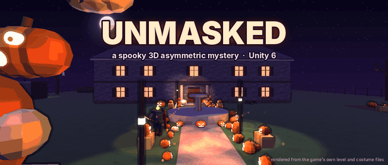
</p>

# Unmasked

**Solve the haunting. Unmask the person.**

**[Play a case in your browser](https://normansrule.github.io/unmasked/)** (once the site is switched on)

[Overview](#overview) · [Key features](#key-features) · [Screenshots](#screenshots-and-animations) ·
[Progress](#progress) · [Setup and usage](#setup-and-usage) · [Project structure](#project-structure) ·
[Design](#design) · [The full tour](Docs/GUIDE.md)

## Overview

Unmasked is an online Halloween mystery for up to five friends, made in Unity 6. It's for people
who like the "meddling kids" kind of cartoon mystery, and who'd rather work out whodunit together
than shoot at anything. Up to four **Solvers** start at Mystery Club HQ (headquarters) in the little
town of Hollow Creek, take a call, drive the van to a haunted house, and search it by flashlight for
clues while they interview the suspects. One **Haunter** dresses up as a folklore legend (the
Headless Horseman, the Banshee, Stingy Jack or Baba Yaga), possesses the furniture and tries to scare
them off before dawn, and is secretly one of the suspects. Name the right person, build a trap,
catch them and pull off the mask to find out why they did it. Nobody to play the Haunter? An AI
(artificial intelligence) Director haunts the house instead.

There's also a **website** for the game, built with GitHub Pages. It explains how a night goes, shows
the houses and the legends, tracks progress, and lets you play every case from the game on a
corkboard Suspect Board right in the browser, no install needed.

> **Where it stands:** everything below is built and compiles against Unity's own libraries, and a
> checker proves all nine cases can be solved. **Nobody has pressed Play in the Unity editor yet**,
> so treat this as a design that's ready for its first playtest. [See the progress](#progress).

## Key features

- **One night, start to finish.** Take a call at HQ, drive across town, search the house, read the
  clues, survive the scares, accuse, trap and unmask. Then drive back to HQ for the next call.
- **Five houses, nine cases.** A cottage, a farm with a corn maze, a Victorian with a tower, the huge
  Blackwood Manor, and the Historical Society, which only calls once the other four are solved. Each
  house has its own suspects, motives and clues, and four of them call back with a second case.
- **Deduction that plays fair.** The Suspect Board keeps evidence, testimony and your own hunches
  apart. Alibis can be checked by standing in the room they name, witnesses remember details about
  the Haunter, and a case checker proves that two true clues always point at one person.
- **A Haunter worth playing.** Possess chairs and lamps, slam doors, fog the halls, open
  trapdoors under the Solvers, plant fake clues and fake your own alibi. Each legend has a signature power.
- **A town that remembers.** Solved houses keep their party lights on, tonight's call glows violet,
  townsfolk have errands that earn favours and pieces of the Lantern Watch costume, and the host's
  game saves all of it.
- **People with faces.** Every character has a face that blinks, glances and talks, real hands and
  hair, and their own height and build, so you can tell suspects apart by their silhouette.
- **Friendly to new players.** The Club Handbook shows a short hint the first time each moment comes
  up, and has settings for text size and reduced motion.
- **A case you can play on the website.** The site's Suspect Board loads the real case files: search
  the house, cross people off, check an alibi and accuse, with two tries. Your browser remembers
  which cases you've solved. It works with a keyboard, on a phone, in light or dark mode, and calms
  its motion down if you've asked your device to.
- **One look, everywhere.** The game's interface, the website, the mockups and the progress tracker
  all come from the same Case Book design: case-file paper, a corkboard, pins and red string.

## Screenshots and animations

The game pictures are drawn from the game's own files by the project's scripts, not captured in
Unity. Real screenshots (press **F12** in the game) will replace the interface mockups after the
first Unity session. The website pictures are real screenshots, taken in a browser.

### The website

**The front page.** Two clues pinned to the cork, and red string running from each one to the only
suspect they share:

<p align="center">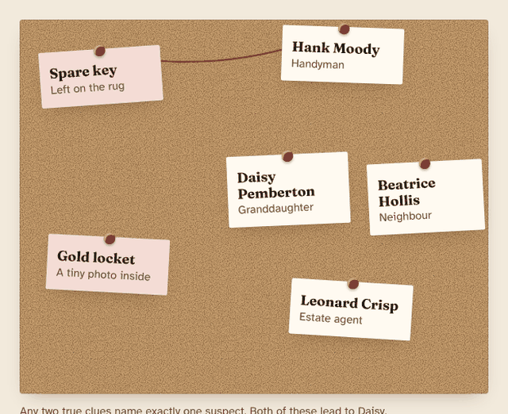</p>

<p align="center">
  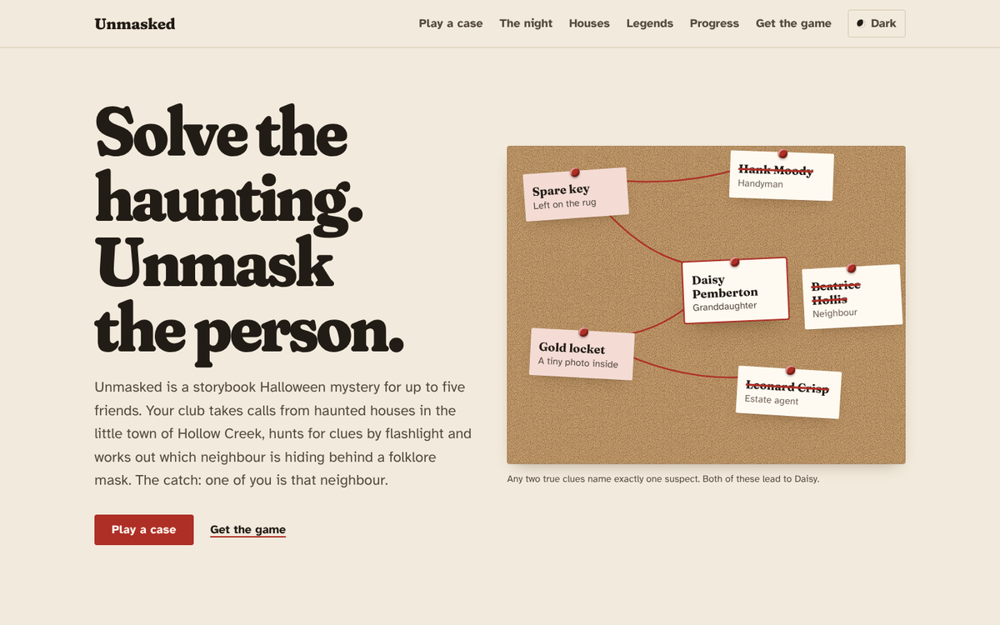
  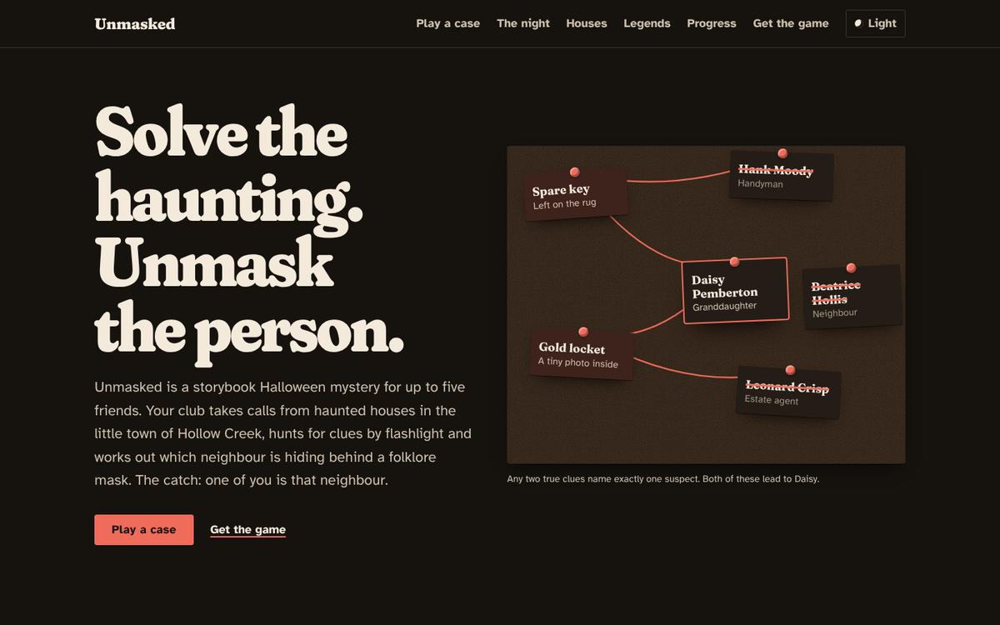
</p>

**Playing a case.** Search twice, cross off someone who fits neither clue, then accuse the one who
fits both:

<p align="center">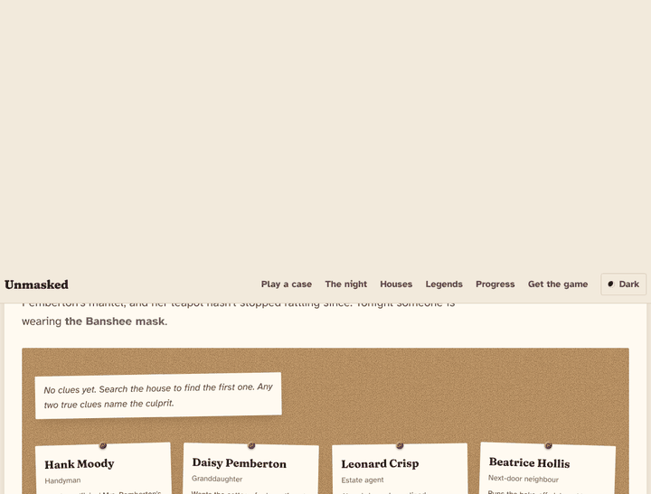</p>

<p align="center">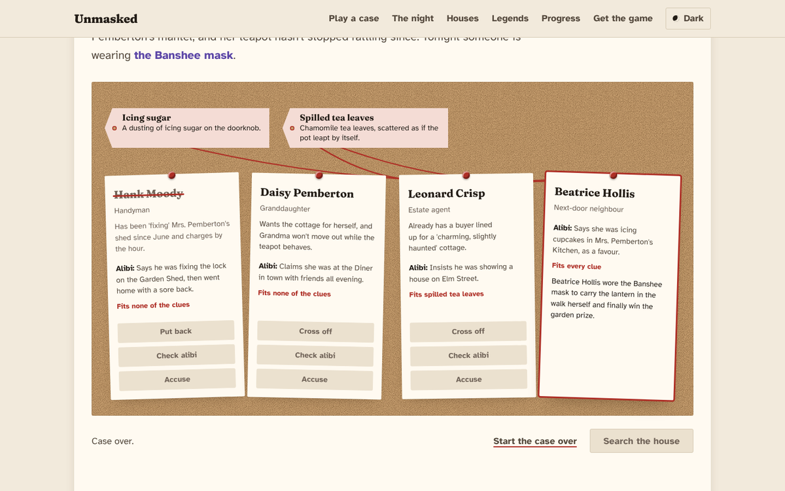</p>

**On a phone**, light and dark. The strings step aside and the Search button sits at the bottom
where your thumb is:

<p align="center">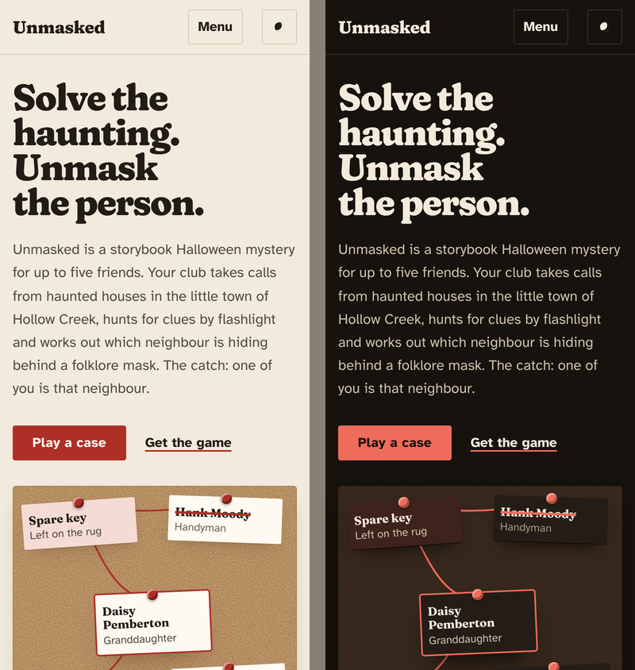</p>

### The game

**The interface.** The phase bar up top with the time left (it turns red under a minute), your panel
bottom left, news bottom right, and hint cards pinned in the middle.

<p align="center">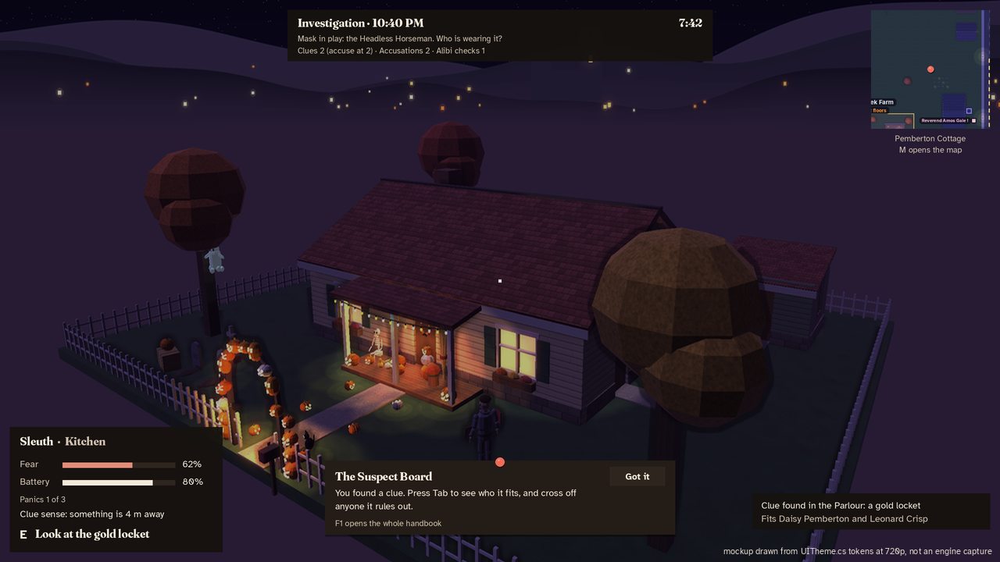</p>

**The Suspect Board** is a corkboard now: clue tags along the top, red string to the suspects they
fit, and cards that swing when you push them.

<p align="center">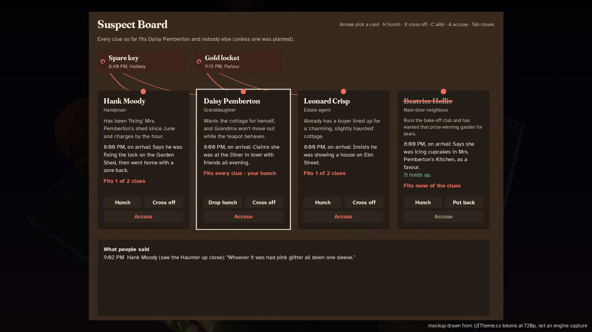</p>

**First-night hints**, which ease in by themselves and step aside when you're done with them:

<p align="center">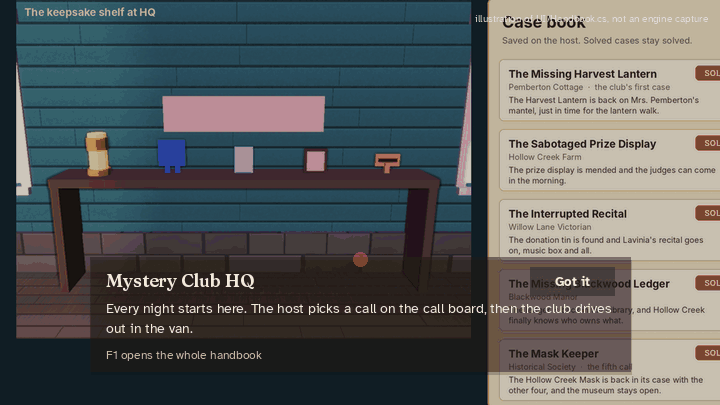</p>

**One night, start to finish:**

<p align="center">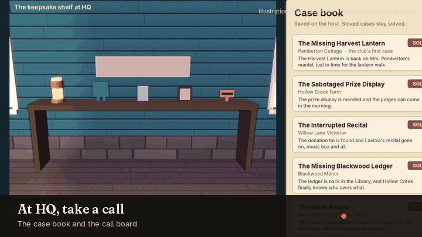</p>

**The people of Hollow Creek** and **tonight's legends:**

<p align="center">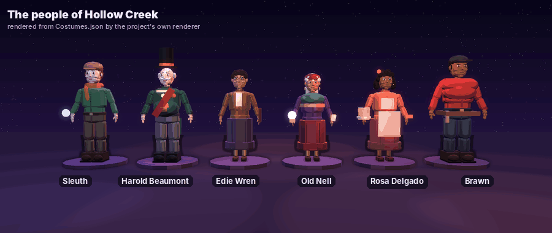</p>

<p align="center">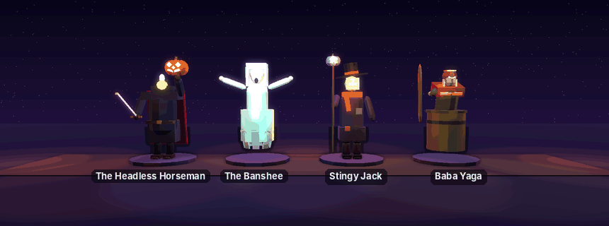</p>

Want to look around without GitHub or Unity? The `Reference renders` folder has big stills of every
house and `gameplay-tour.mp4`, a short video tour of a night.

## Progress

The tracker reads [`Docs/PROGRESS.md`](Docs/PROGRESS.md) every time the pictures are rebuilt, so it
always matches the checklist.

<p align="center">
  <picture>
    <source media="(prefers-color-scheme: dark)" srcset="Docs/images/progress-tracker.svg">
    
  </picture>
</p>

<!-- tracker:start (written by Docs/tools/make_readme_anim.py from Docs/PROGRESS.md) -->

**Overall: `████████████████████░░░░` 83%**, 129 of 156 tasks. 3 milestones done, 18 in progress, 1 not started. Built means the code and data exist and compile; **nothing has been played in Unity yet**.

| Milestone | Progress | Tasks | State | Played in Unity |
|---|---|---|---|---|
| Milestone 1: Core | `████████████` 100% | 5/5 | ✅ Built, compiles | Not yet |
| Milestone 2: Haunter toolkit | `████████████` 100% | 3/3 | ✅ Built, compiles | Not yet |
| Milestone 3: Solve it | `████████████` 100% | 3/3 | ✅ Built, compiles | Not yet |
| Milestone 4: Play without a full lobby | `█████████░░░` 75% | 3/4 | 🟡 In progress | Not yet |
| Milestone 5: The 3D world | `█████████░░░` 75% | 6/8 | 🟡 In progress | Not yet |
| Milestone 6: Halloween night | `███████████░` 89% | 8/9 | 🟡 In progress | Not yet |
| Milestone 7: Hollow Creek, the town | `██████████░░` 80% | 8/10 | 🟡 In progress | Not yet |
| Milestone 8: The Nights of the Jack look | `██████████░░` 83% | 5/6 | 🟡 In progress | Not yet |
| Milestone 9: A case for every house | `███████████░` 91% | 10/11 | 🟡 In progress | Not yet |
| Milestone 10: Storybook direction | `██████████░░` 85% | 17/20 | 🟡 In progress | Not yet |
| Milestone 11: A bigger world | `███████████░` 89% | 8/9 | 🟡 In progress | Not yet |
| Milestone 12: A living town | `██████████░░` 83% | 5/6 | 🟡 In progress | Not yet |
| Milestone 13: The fifth call | `██████████░░` 86% | 6/7 | 🟡 In progress | Not yet |
| Milestone 14: The people of Hollow Creek | `██████████░░` 83% | 5/6 | 🟡 In progress | Not yet |
| Milestone 15: Return visits | `██████████░░` 80% | 4/5 | 🟡 In progress | Not yet |
| Milestone 16: The character pass | `██████████░░` 86% | 6/7 | 🟡 In progress | Not yet |
| Milestone 17: A town that remembers (inspiration pack) | `██████████░░` 88% | 7/8 | 🟡 In progress | Not yet |
| Milestone 18: The Club Handbook and a README you can watch | `█████████░░░` 75% | 3/4 | 🟡 In progress | Not yet |
| Milestone 19: The design pass | `██████████░░` 80% | 4/5 | 🟡 In progress | Not yet |
| Milestone 20: The Case Book | `███████████░` 89% | 8/9 | 🟡 In progress | Not yet |
| Release pipeline | `█████████░░░` 71% | 5/7 | 🟡 In progress | Not yet |
| Later | `░░░░░░░░░░░░` 0% | 0/4 | ⬜ Not started | Not yet |

<details><summary><b>What's left</b> (every unticked task)</summary>

- **Milestone 4: Play without a full lobby**: AI Haunter wears the costume and dodges the trap
- **Milestone 5: The 3D world**: Real 3D models and textures for the manor; Baked lighting and occlusion culling for speed
- **Milestone 6: Halloween night**: Hand-made models to replace the shape-built characters
- **Milestone 7: Hollow Creek, the town**: Sitting and steering animations; More houses and calls that chain into a bigger case
- **Milestone 8: The Nights of the Jack look**: Check the look in Unity and tune light counts for frame rate
- **Milestone 9: A case for every house**: A short search animation and a clue-style prop in the alibi room
- **Milestone 10: Storybook direction**: First playable slice played start to finish in Unity; Storybook lighting pass (amber, teal, violet) on the cottage first; Original van look with keepsakes from solved cases
- **Milestone 11: A bigger world**: Check the horizon in Unity (draw order, fog, far clip) and tune it
- **Milestone 12: A living town**: Check the crowd and the train in Unity and tune counts for frame rate
- **Milestone 13: The fifth call**: Playtest the whole arc in Unity, five calls in one sitting
- **Milestone 14: The people of Hollow Creek**: Check the townsfolk in Unity (bubbles readable, items easy to spot)
- **Milestone 15: Return visits**: Playtest a return visit in Unity
- **Milestone 16: The character pass**: Check in Unity that ~100 shapes per person stays fast with a full town
- **Milestone 17: A town that remembers (inspiration pack)**: Playtest the slice in Unity and fill in Docs/TEST_REPORT.md
- **Milestone 18: The Club Handbook and a README you can watch**: See the hints on screen in Unity and adjust the wording after a first playtest
- **Milestone 19: The design pass**: Check the new look in Unity at 720p, 1080p and 4K
- **Milestone 20: The Case Book**: Check the board's swing and string in Unity, and turn the site on once the repo is public
- **Release pipeline**: First compile in Unity and fix errors; First real in-game screenshots (F12) in the README
- **Later**: Real characters, house art, audio; Styled UI (UI Toolkit) to replace the debug HUD; Several cases per house, campaign; Lobby and online matchmaking (Unity Relay)

</details>

<!-- tracker:end -->

**Round by round**, from the first match to this design pass:

<p align="center">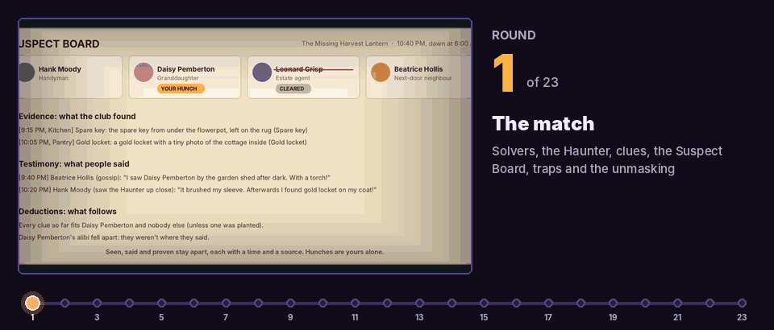</p>

The current playable slice, what has and hasn't been tested, and where every asset comes from:
[`Docs/SLICE_PLAN.md`](Docs/SLICE_PLAN.md), [`Docs/TEST_REPORT.md`](Docs/TEST_REPORT.md) and
[`Docs/ASSET_MANIFEST.md`](Docs/ASSET_MANIFEST.md). In a terminal, `unmasked status` shows the same
checklist with the last compile check and recent commits.

**Next up:** the first open in Unity and a playtest of the first case, switching the website on once
the repo is public, then real screenshots here,
an AI Haunter that wears the costume and dodges the trap, and an online lobby through Unity Relay so
friends can join without port forwarding.

## Setup and usage

### Play a build

| Your computer | Steps |
|---|---|
| **Windows** | Download `Unmasked-Windows.zip` from [the latest release](../../releases/latest). Unzip it and run `Unmasked.exe`. If SmartScreen appears, click *More info* and then *Run anyway*. |
| **macOS** | Download `Unmasked-macOS.zip`, unzip it, then run `xattr -cr Unmasked.app` in Terminal and open the app. |
| **Linux** | Download `Unmasked-Linux.zip`, unzip it, then run `chmod +x Unmasked.x86_64 && ./Unmasked.x86_64`. |

Downloads appear on the Releases page once a version is tagged (`unmasked release v0.1.0`, below).
Until then, build it yourself with `unmasked build`. Once the repo is public, Linux players can do
it in one line:

```bash
mkdir -p ~/Unmasked && cd ~/Unmasked && curl -fL -o game.zip https://github.com/Normansrule/unmasked/releases/latest/download/Unmasked-Linux.zip && unzip -oq game.zip && chmod +x Unmasked.x86_64 && ./Unmasked.x86_64
```

### Play on the website

Open **https://normansrule.github.io/unmasked/** and click **Play a case**. Pick a house from the
tabs, then:

- **Search the house** finds a clue (three searches per case). Each clue fits one or two suspects.
- **Cross off** anyone who doesn't fit, or **Check alibi** to see if their story holds (two checks).
- **Accuse** whoever fits every clue. You get two tries, and a wrong name makes the Haunter braver.

Everything works with the keyboard: **Tab** moves between buttons, the arrow keys switch cases, and
**Enter** or **Space** presses. Solved cases are remembered in your browser; **Clear it**, next to
the case tabs, starts your case book over. The site goes live after `unmasked pages` (below).

### Play together

One person clicks **Host a game**. Friends click **Join** and type the host's Internet Protocol (IP)
address. On the same Wi-Fi, use the host's local IP address. Over the internet, the host forwards
port 7777 for the User Datagram Protocol (UDP) on their router.

### Controls

<p align="center">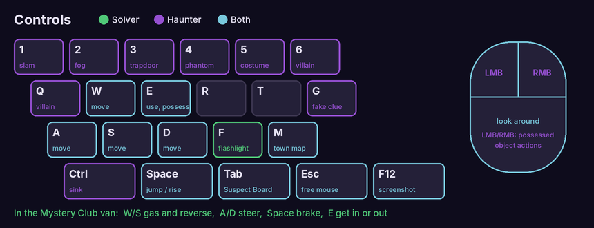</p>

**Click** the game window to look around, **Esc** frees the mouse. **E** interacts (and gets you in
and out of the van; **W/S** and **A/D** drive it). **Tab** opens the Suspect Board, **M** the town
map and **F1** the Club Handbook. On the Suspect Board, the **arrow keys** (or **1** to **4**) pick
a card, **H** marks a hunch, **X** crosses someone off, **C** checks their alibi and **A** accuses
(press it twice, so you can't accuse by accident). As the Haunter, **1** to **5** use your powers, **6** or **Q** your
legend's signature power, **G** plants a fake clue and **H** fakes your alibi. **F12** saves a
screenshot.

### Open it in Unity

1. Open **Unity Hub**, click **Add** > **Add project from disk** and pick the `Unmasked Game` folder.
2. Open it with Unity **6000.0.32f1** (Hub offers to install it). The first open takes a few minutes.
3. If Unity asks to restart for the Input System, click **Restart Unity**.
4. When **Welcome to UNMASKED** appears, click **Build Hollow Creek**.
5. Choose **Unmasked > Play Hollow Creek**, then click **Host a game** in the game window.

### Terminal commands (Ubuntu or WSL)

The project comes with a small command-line tool, `unmasked`, that installs what you need, uploads
to GitHub, builds and checks the game. Every block below can be pasted into a **fresh Ubuntu
terminal from any folder**. On Windows, open **Ubuntu** through the Windows Subsystem for Linux
(WSL): it sees your desktop at `/mnt/c/Users/<you>/Desktop`.

#### First time: install the tools and upload to GitHub

```bash
# Find the game folder (Windows desktop through WSL, or ~/Desktop on Ubuntu)
P="/mnt/c/Users/aleks/Desktop/Unmasked Game"; [ -d "$P" ] || P="$HOME/Desktop/Unmasked Game"; [ -d "$P" ] || echo "Game folder not found: set P to where it is."

# Install git, Git Large File Storage (git-lfs), the GitHub command-line tool (gh) and `unmasked`
bash "$P/tools/unmasked.sh" setup && export PATH="$HOME/.local/bin:$PATH"

# Create a new PRIVATE GitHub repo called "unmasked" and upload everything (opens a browser to log in)
unmasked publish unmasked
#   ...or create it PUBLIC straight away, so anyone can see this page and download the game:
#   unmasked publish unmasked --public
```

The repo ends up at `https://github.com/Normansrule/unmasked`. After that, `unmasked save "message"`
pushes each new round. The `_to_delete` folder (old delivery zips) is in `.gitignore`, so it never uploads.

To let anyone download the game, make the repo public:
`gh repo edit Normansrule/unmasked --visibility public --accept-visibility-change-consequences`

#### Day to day

```bash
export PATH="$HOME/.local/bin:$PATH"   # only needed if a new terminal says "unmasked: command not found"
unmasked status                 # milestones, last compile check, commits, cloud builds
unmasked save "Add new clue"    # commit everything and push to GitHub
```

#### See the game in Unity

**Straight from the desktop folder (Windows, no terminal):**

1. Open **Unity Hub**, click **Add** > **Add project from disk** and pick the `Unmasked Game` folder.
2. Open it with Unity **6000.0.32f1** (Hub offers to install it if you don't have it). The first
   open takes a few minutes while Unity imports everything.
3. If Unity asks to restart for the Input System, click **Restart Unity**.
4. When **Welcome to UNMASKED** appears, click **Build Hollow Creek**.
5. Press **Unmasked > Play Hollow Creek**, then click **Host** in the game window.

**From a terminal:**

```bash
unmasked open     # opens the project in Unity (it offers to build the town; then Unmasked > Play Hollow Creek, Host)
unmasked check    # compiles headless and lists any errors (log: Logs/check.log)
unmasked world    # regenerates the town, houses and manor and rebuilds both Unity scenes headless
unmasked build    # builds Windows/macOS/Linux players into Builds/ and zips them
unmasked play 2   # opens two game windows: click Host in one, Join 127.0.0.1 in the other
```

No Unity yet? On Windows, install [Unity Hub](https://unity.com/download) and add Unity
**6000.0.32f1** with the *Windows, Mac and Linux Build Support* modules. On native Ubuntu run
`unmasked install-unity`. If Unity is installed somewhere unusual: `export UNITY_PATH=/path/to/Unity`.

#### The website

```bash
unmasked site     # rebuilds the case data and serves the site at http://localhost:8000 (Ctrl+C stops it)
unmasked pages    # one time: turns on GitHub Pages; the repo must be public on a free GitHub account
```

After that, every push that changes `site/` redeploys it to https://normansrule.github.io/unmasked/
(watch it in the **Actions** tab). `unmasked publish` runs `unmasked pages` for you.

#### Publish downloads for players

```bash
unmasked secrets           # one time: lets GitHub Actions use your Unity license
unmasked release v0.1.0    # tags a version; GitHub builds all 3 platforms and attaches the zips
```

Watch cloud builds with `gh run watch`, or open the **Actions** tab on GitHub.

#### Working on another computer

```bash
gh repo clone Normansrule/unmasked ~/unmasked && bash ~/unmasked/tools/unmasked.sh setup
```

#### Change the world and redraw the pictures

```bash
nano "$(unmasked where)/Docs/tools/make_town.py"             # roads, HQ, shops, the square, where each house's lot is
nano "$(unmasked where)/Docs/tools/make_houses.py"           # the cottage, the farm and the Victorian, room by room
nano "$(unmasked where)/Docs/tools/make_manor.py"            # Blackwood Manor: walls, rooms, furniture, pumpkins, clue spots...
nano "$(unmasked where)/Docs/tools/make_costumes.py"         # villains, outfits, Halloween props, the van
nano "$(unmasked where)/Docs/tools/dressing.py"              # window trim, shutters, foundations, jack-o'-lantern arches and trees, string lights
nano "$(unmasked where)/Docs/tools/make_textures.py"         # surface patterns: siding, shingles, brick, stone, grass...
unmasked world                                               # regenerate every file and rebuild both Unity scenes
python3 -m pip install --user numpy pillow                   # once, for the renderer
python3 "$(unmasked where)/Docs/tools/make_images.py"         # redraw every picture (3D ones take a few minutes)
python3 "$(unmasked where)/Docs/tools/make_images_town.py"    # just the town pictures: map, houses, sizes, drive, events
python3 "$(unmasked where)/Docs/tools/make_images_look.py"    # the carvings and the Nights of the Jack set pieces
python3 "$(unmasked where)/Docs/tools/make_sounds.py"          # remake every sound (wind, wails, thunder...)
python3 "$(unmasked where)/Docs/tools/make_images_sounds.py"   # the sounds picture
python3 "$(unmasked where)/Docs/tools/make_images_cases.py"   # case files (with alibi rooms), return visits, suspects-by-house and witness pictures
python3 "$(unmasked where)/Docs/tools/make_images_story.py"   # the story card, the Suspect Board and the anticipation animation
python3 "$(unmasked where)/Docs/tools/make_images_world.py"   # the horizon, the roads out of town, the character close-ups and the Mask Keeper
python3 "$(unmasked where)/Docs/tools/make_images_life.py"    # trick-or-treaters, the street, the valley train, the face animation
python3 "$(unmasked where)/Docs/tools/make_images_museum.py"  # the Historical Society from Founders Way and its Mask Gallery
python3 "$(unmasked where)/Docs/tools/make_images_folk.py"    # the townsfolk and an errand
python3 "$(unmasked where)/Docs/tools/make_images_people.py"  # character portraits and heights/builds
python3 "$(unmasked where)/Docs/tools/make_images_hub.py"     # the street remembers, the Lantern Watch, the silhouette check
python3 "$(unmasked where)/Docs/tools/make_readme_anim.py"    # this page's animations, the tracker and the interface mockups (hud-refresh.png, hud-board.png)
python3 "$(unmasked where)/Docs/tools/make_site_data.py"      # the website's case data (site/data/game.json), read from Cases.cs
python3 "$(unmasked where)/Docs/tools/make_site_pictures.py"  # the website screenshots and GIFs (needs Node and Playwright: npm i playwright)
python3 "$(unmasked where)/Docs/tools/make_reference.py"      # "Reference renders": big house stills and gameplay-tour.mp4 (needs ffmpeg)
```

#### Check every case can be solved

```bash
python3 "$(unmasked where)/tools/casecheck/casecheck.py"       # two true clues always name one suspect; every alibi room exists
```

#### Check the C# compiles without opening Unity

```bash
sudo apt-get install -y dotnet-sdk-8.0                         # once
bash "$(unmasked where)/tools/compilecheck/check.sh"           # builds every script against Unity's libraries (DLLs); prints errors with file:line
```

## Project structure

```text
Unmasked Game/
├── Assets/Unmasked/
│   ├── Scripts/
│   │   ├── Core/        the match: MysteryGameManager (phases, rules, saves), PlayerAgent, CameraRig
│   │   ├── Mystery/     cases, suspects and clues (Cases.cs holds all nine), the server-only MysteryServer
│   │   ├── Solvers/     Solver movement, the flashlight and the fear meter
│   │   ├── Haunter/     the Haunter, possession, powers, fog and phantoms
│   │   ├── House/       doors, trapdoors and furniture that can be possessed
│   │   ├── Traps/       trap pieces and the trap site
│   │   ├── Town/        Hollow Creek: the van, the map, townsfolk, the horizon, house moods
│   │   ├── AI/          the AI Director and the suspects' behaviour
│   │   ├── Animation/   procedural animation and faces
│   │   ├── Spooky/      costumes, sound, ambience and Halloween effects
│   │   ├── UI/          the heads-up display (HUD), the Handbook and UITheme, the shared look
│   │   ├── Net/         spawn points and networked movement
│   │   └── Editor/      builders that turn the level files into Unity scenes, plus the build script
│   ├── Resources/       the level, town, house and costume files (JSON, JavaScript Object Notation), the sounds
│   │   └── Fonts/       Fraunces and Atkinson Hyperlegible, with their licences
│   ├── Shaders/         the toon shader
│   └── Textures/        generated surface patterns
├── Docs/
│   ├── GUIDE.md         the full tour of the game
│   ├── ART_DIRECTION.md the story and the look
│   ├── PROGRESS.md      the checklist the tracker reads
│   ├── SLICE_PLAN.md, TEST_REPORT.md, ASSET_MANIFEST.md
│   ├── images/          every picture on this page
│   └── tools/           Python scripts that write the level files, draw the pictures and export the site data
├── Reference renders/   big stills and a video tour
├── site/                the website: index.html, styles.css, app.js, fonts, house pictures, data/game.json
├── tools/
│   ├── unmasked.sh      the `unmasked` command
│   ├── casecheck/       proves every case can be solved
│   └── compilecheck/    compiles the C# against Unity's libraries without opening Unity
└── .github/workflows/   builds Windows, macOS and Linux versions on GitHub, and deploys the site (pages.yml)
```

Everything in the world is data. The Python scripts in `Docs/tools` write the level files in
`Resources`, Unity's editor builders turn them into scenes, and the same files feed the pictures
here, so the game and its documentation never drift apart. The website works the same way: its
cases come from `Cases.cs` through `make_site_data.py`, so the site can't disagree with the game. The game uses Netcode for GameObjects
with the host as the authority: the culprit and which clues are real never leave the host's
computer. [The full tour](Docs/GUIDE.md#how-its-built) has the diagrams.

## Design

**The world: a storybook Halloween, kept restrained.** Hollow Creek takes its mood from Nights of
the Jack: carved pumpkins on every porch, string lights and mist, but always a lived-in town first.
Warm amber light means welcome (HQ, porches, a solved house), cool night fills the streets, and violet
means a haunting. Characters are built to read by silhouette alone, and every scare has a beat of
warning, the surprise, then a moment to recover. More in [`Docs/ART_DIRECTION.md`](Docs/ART_DIRECTION.md).

### The interface: the Case Book

The game is about a club of kids solving cases, so the interface looks like the club's own
paperwork: case-file paper, a corkboard, pinned index cards, evidence tags and red string. The same
design runs through the game ([`UITheme.cs`](Assets/Unmasked/Scripts/UI/UITheme.cs)), the website
([`site/styles.css`](site/styles.css)), the mockups and the tracker.

- **One red, used sparingly.** Evidence-tag red is the only accent: the main button, the key to
  press, the timer when it's low, and the string that links a clue to a suspect. Violet is kept for
  the Haunter, so it always means "haunted". Green only says yes (an alibi holds, a task is done).
  Everything else is paper and ink, with every text colour at a contrast of at least 4.5 to 1.
- **Light and dark.** By day it's paper on cork; at night it's the same desk under a lamp. The game
  uses the dark version, the website follows your device and remembers if you switch.
- **Two typefaces with jobs.** Fraunces, a soft old-style serif, for names, headings and numbers.
  Atkinson Hyperlegible, designed by the Braille Institute for low-vision readers, for everything
  you read. Both are free under the SIL Open Font License (OFL). Sizes follow a fixed scale, and
  spacing comes in steps of 4, 8, 12, 16, 24, 32, 48, 72 and 112 pixels.
- **The layout is the board.** Clues pin along the top, suspects below, and red string sags from a
  clue's pin to every suspect it fits. Two true clues always lead to one card, so you can see the
  answer form.
- **Motion with weight.** Pinned cards are damped pendulums: push one and it swings, then settles
  in about a second. String draws in over half a second with a strong ease-out. A crossed-off name
  gets a pen stroke. Things you open yourself (Tab, M, F1) appear instantly. With reduced motion,
  cards stop swinging, string appears without drawing, and a wrong guess is marked with a red
  outline instead of a shake.
- **Nothing generic.** No gradients, glows, stock icons or card grids. The cork texture is generated
  noise, the pins are drawn, and the empty, loading and error states are written like the club
  would say them ("Opening the case file…", "The case file wouldn't open.").
- **Accessible on purpose.** The website works by keyboard with visible focus, announces each clue
  and verdict to screen readers, has 44 pixel touch targets on phones, and passes an automated
  accessibility check (axe) in both modes. The in-game Suspect Board works from the keyboard too,
  and accusing takes two presses because it's the one move you can't take back.

**These pages follow the same rules.** Every game picture says it's an illustration until real
screenshots exist, and animation is used where it shows how the game moves, not for decoration.
