<p align="center">
  
</p>

<p align="center">
  <a href="../../releases/latest"><b>⬇ Download the game</b></a> ·
  <a href="#-how-a-match-plays">How it plays</a> ·
  <a href="#-hollow-creek-the-town">The town</a> ·
  <a href="#-tonights-legends-the-villains">Villains</a> ·
  <a href="#-controls">Controls</a> ·
  <a href="#-developer-terminal-commands-ubuntu--wsl">Terminal commands</a> ·
  <a href="#-where-the-game-is-right-now">Where it is now</a> ·
  <a href="Docs/PROGRESS.md">Progress</a>
</p>

<p align="center">
  
  
  
  
  
</p>

**UNMASKED** is an online, asymmetric "meddling kids" mystery made in Unity 6, set in **Hollow
Creek**, a little 3D town on Halloween night. Two to four **Solvers** start at Mystery Club HQ, take
a call, drive the van across town to a haunted house (a tidy cottage, a farm with a corn maze, a
Victorian with a tower, or the huge Blackwood Manor), then explore it with flashlights, hunt for
clues and interview suspects. One **Haunter** dresses as a legend (the **Headless Horseman**, the **Banshee**,
**Stingy Jack** or **Baba Yaga**), possesses furniture, slams doors and hurls flaming pumpkins to
scare them away, and is secretly one of the suspects. Name the right suspect, build a trap, catch
the Haunter and pull off the mask before dawn.

> **Note on the pictures:** every image and animation on this page is drawn from the game's design
> and code by [`Docs/tools/make_images.py`](Docs/tools/make_images.py), using the same level and
> costume files Unity builds from. They're illustrations, not screenshots from the engine. Press **F12** in the game to save real screenshots into
> `Docs/screenshots/`.

<p align="center">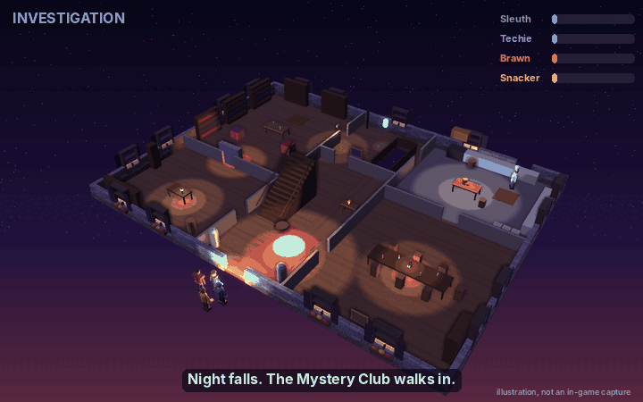</p>

### Solve the haunting. Unmask the person.

Hollow Creek's old folklore masks were brought out for the Halloween festival, and whoever wears
one can really haunt a house. Tonight a resident is using one to cover up something ordinary: a
stolen lantern, a wrecked prize display, a missing ledger. Everyone knows **which mask** is in play;
**who is wearing it** is the case. At the unmasking you find out why they did it. The full story
and art direction is in [`Docs/ART_DIRECTION.md`](Docs/ART_DIRECTION.md).

<p align="center">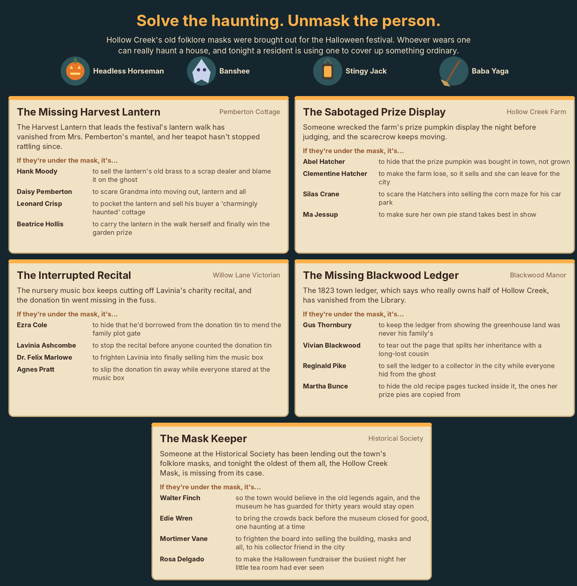</p>

Every scare has a beat of warning, the surprise, then a moment to recover. A chair leans back
before it hops, a lamp pauses and turns to look at you, a suspect swallows before answering (guilty
or not), and the trap wobbles before it snaps:

<p align="center">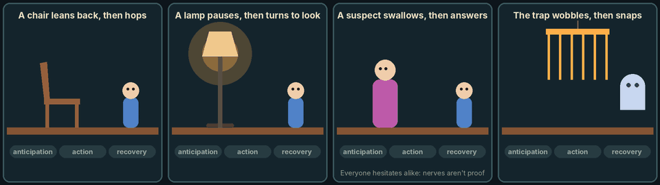</p>

Want to look around without GitHub or Unity? The **`Reference renders`** folder has big stills of
every house (outside and roof off) and `gameplay-tour.mp4`, a short tour of a night. They're
drawn from the game's level files by the project's own renderer, not captured in Unity.

---

## 📍 Where the game is right now

Everything below is built and compiles against Unity's own libraries, but **nobody has pressed
Play in the Unity editor yet**. That first open is the next step. The tracker reads
[`Docs/PROGRESS.md`](Docs/PROGRESS.md) each time the pictures are rebuilt, so it always matches the checklist.

<p align="center"></p>

<!-- tracker:start (written by Docs/tools/make_readme_anim.py from Docs/PROGRESS.md) -->

**Overall: `████████████████████░░░░` 82%**, 117 of 142 tasks. 3 milestones done, 16 in progress, 1 not started. Built means the code and data exist and compile; **nothing has been played in Unity yet**.

| Milestone | Progress | Tasks | State | Played in Unity |
|---|---|---|---|---|
| Milestone 1: Core | `████████████` 100% | 5/5 | ✅ Built, compiles | Not yet |
| Milestone 2: Haunter toolkit | `████████████` 100% | 3/3 | ✅ Built, compiles | Not yet |
| Milestone 3: Solve it | `████████████` 100% | 3/3 | ✅ Built, compiles | Not yet |
| Milestone 4: Play without a full lobby | `█████████░░░` 75% | 3/4 | 🟡 In progress | Not yet |
| Milestone 5: The 3D world | `█████████░░░` 75% | 6/8 | 🟡 In progress | Not yet |
| Milestone 6: Halloween night | `███████████░` 89% | 8/9 | 🟡 In progress | Not yet |
| Milestone 7: Hollow Creek, the town | `██████████░░` 80% | 8/10 | 🟡 In progress | Not yet |
| Milestone 8: The Nights of the Jack look | `██████████░░` 83% | 5/6 | 🟡 In progress | Not yet |
| Milestone 9: A case for every house | `███████████░` 91% | 10/11 | 🟡 In progress | Not yet |
| Milestone 10: Storybook direction | `██████████░░` 85% | 17/20 | 🟡 In progress | Not yet |
| Milestone 11: A bigger world | `███████████░` 89% | 8/9 | 🟡 In progress | Not yet |
| Milestone 12: A living town | `██████████░░` 83% | 5/6 | 🟡 In progress | Not yet |
| Milestone 13: The fifth call | `██████████░░` 86% | 6/7 | 🟡 In progress | Not yet |
| Milestone 14: The people of Hollow Creek | `██████████░░` 83% | 5/6 | 🟡 In progress | Not yet |
| Milestone 15: Return visits | `██████████░░` 80% | 4/5 | 🟡 In progress | Not yet |
| Milestone 16: The character pass | `██████████░░` 86% | 6/7 | 🟡 In progress | Not yet |
| Milestone 17: A town that remembers (inspiration pack) | `██████████░░` 88% | 7/8 | 🟡 In progress | Not yet |
| Milestone 18: The Club Handbook and a README you can watch | `█████████░░░` 75% | 3/4 | 🟡 In progress | Not yet |
| Release pipeline | `█████████░░░` 71% | 5/7 | 🟡 In progress | Not yet |
| Later | `░░░░░░░░░░░░` 0% | 0/4 | ⬜ Not started | Not yet |

<details><summary><b>What's left</b> (every unticked task)</summary>

- **Milestone 4: Play without a full lobby**: AI Haunter wears the costume and dodges the trap
- **Milestone 5: The 3D world**: Real 3D models and textures for the manor; Baked lighting and occlusion culling for speed
- **Milestone 6: Halloween night**: Hand-made models to replace the shape-built characters
- **Milestone 7: Hollow Creek, the town**: Sitting and steering animations; More houses and calls that chain into a bigger case
- **Milestone 8: The Nights of the Jack look**: Check the look in Unity and tune light counts for frame rate
- **Milestone 9: A case for every house**: A short search animation and a clue-style prop in the alibi room
- **Milestone 10: Storybook direction**: First playable slice played start to finish in Unity; Storybook lighting pass (amber, teal, violet) on the cottage first; Original van look with keepsakes from solved cases
- **Milestone 11: A bigger world**: Check the horizon in Unity (draw order, fog, far clip) and tune it
- **Milestone 12: A living town**: Check the crowd and the train in Unity and tune counts for frame rate
- **Milestone 13: The fifth call**: Playtest the whole arc in Unity, five calls in one sitting
- **Milestone 14: The people of Hollow Creek**: Check the townsfolk in Unity (bubbles readable, items easy to spot)
- **Milestone 15: Return visits**: Playtest a return visit in Unity
- **Milestone 16: The character pass**: Check in Unity that ~100 shapes per person stays fast with a full town
- **Milestone 17: A town that remembers (inspiration pack)**: Playtest the slice in Unity and fill in Docs/TEST_REPORT.md
- **Milestone 18: The Club Handbook and a README you can watch**: See the hints on screen in Unity and adjust the wording after a first playtest
- **Release pipeline**: First compile in Unity and fix errors; First real in-game screenshots (F12) in the README
- **Later**: Real characters, house art, audio; Styled UI (UI Toolkit) to replace the debug HUD; Several cases per house, campaign; Lobby and online matchmaking (Unity Relay)

</details>

<!-- tracker:end -->

**Round by round.** Each build round so far, from the first match to this one:

<p align="center"></p>

**One night, start to finish.** This is the loop the whole game is built around:

<p align="center"></p>

**The people you'll meet.** The Mystery Club and the townsfolk, rebuilt in round 21 with faces,
hands, hair, heights and builds:

<p align="center"></p>

| | What | Where it stands |
|---|---|---|
| ✅ | A full night: HQ, the van, a haunted house, clues, the Suspect Board, alibis, accusing, the trap, the unmasking | Built, compiles, not yet played in Unity |
| ✅ | Hollow Creek: five houses, nine cases, townsfolk errands, the Lantern Watch, saved progress | Built, compiles; the case checker proves all 9 cases can be solved |
| ✅ | Four Haunter legends with their own powers, an AI Director when nobody plays the Haunter | Built, compiles, not yet played in Unity |
| ✅ | First-time hints (the Club Handbook) | New in round 23 |
| 🟡 | Characters and houses | Built from shapes in code, not hand-made models yet |
| 🟡 | HUD | Works, but it's the plain debug style until the styled UI arrives |
| ⬜ | First open and playtest in Unity, real screenshots | Next |
| ⬜ | Online lobby without port forwarding (Relay) | Planned |

---

## ⬇ Download and play

| Your computer | Steps |
|---|---|
| **Windows** | Download `Unmasked-Windows.zip` from [the latest release](../../releases/latest). Unzip it and run `Unmasked.exe`. If SmartScreen appears, click *More info* and then *Run anyway*. |
| **macOS** | Download `Unmasked-macOS.zip`, unzip it, then run `xattr -cr Unmasked.app` in Terminal and open the app. |
| **Linux** | Download `Unmasked-Linux.zip`, unzip it, then run `chmod +x Unmasked.x86_64 && ./Unmasked.x86_64`. |

Linux one-liner (works once the repo is public):

```bash
mkdir -p ~/Unmasked && cd ~/Unmasked && curl -fL -o game.zip https://github.com/Normansrule/unmasked/releases/latest/download/Unmasked-Linux.zip && unzip -oq game.zip && chmod +x Unmasked.x86_64 && ./Unmasked.x86_64
```

**Playing together:** one person clicks **Host**. Friends click **Join** and type the host's IP
address. On the same Wi-Fi, use the host's local IP. Over the internet, the host forwards **UDP
port 7777** on their router. (A Relay lobby that avoids port forwarding is on the roadmap.)

Downloads appear on the Releases page after a version is tagged (`unmasked release v0.1.0`, below).
Until then, build it yourself with `unmasked build`.

---

## 🎭 How a match plays

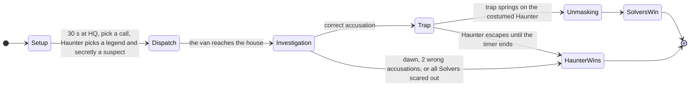

1. **Setup, at HQ.** Everyone picks a side. Solvers pick a role and tonight's call on the call
   board (or get a random one). The Haunter picks tonight's legend (the costume everyone will see)
   and secretly chooses which suspect they really are.
2. **Dispatch.** Pile into the Mystery Club van and drive across town to the house, following the
   map (**M**) and the arrow. A special night may be rolled: Blood Moon, Thunderstorm, Pea-Soup Fog,
   Power Outage or Harvest Festival. The suspects and the Haunter are already there.
3. **Investigation.** Glowing clues are hidden around the house. Each clue points at every suspect
   who shares one of its traits, so you deduce instead of guess. Suspects can be interviewed once;
   the culprit lies.
4. **The Haunter fights back.** Every power costs Ectoplasm, and every scare risks **leaking a real
   clue**. The Haunter can also plant fake clues to frame an innocent.
5. **Accuse.** Once you have 2 clues, accuse from the Suspect Board. Get it wrong and that suspect is
   cleared, but the Haunter powers up. Two wrong guesses and the Haunter wins.
6. **Trap.** Get it right and the Haunter is forced into costume. Grab 3 trap pieces, build the trap
   (Brawn builds twice as fast), and lure the Haunter in.
7. **Unmask!**

<p align="center"></p>

### The Solvers

| Role | Ability |
|---|---|
| **Sleuth** | Clue sense: clues within 9 m pulse on your screen, and the HUD says how close the nearest one is. |
| **Techie** | Ecto-detector beeps near possessed objects, fog and phantoms. The flashlight drains 40% slower. |
| **Brawn** | Builds the trap twice as fast. |
| **Snacker** | Suspects open up more. Interviews point at the real culprit more often. |

Scares fill your **Fear Meter**. At 100% you panic and run screaming. Teammates nearby calm you
faster, and any teammate can calm you with **E**. Panic three times and you flee the house for good.

<p align="center">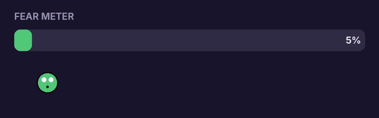</p>

### The Haunter

As a ghost, the Haunter is invisible and isn't even sent to the Solvers' computers. Possess
furniture (**E**) and use its two actions (**LMB/RMB**), or use the five spectral powers, plus
tonight's villain power on **6** or **Q**:

<p align="center">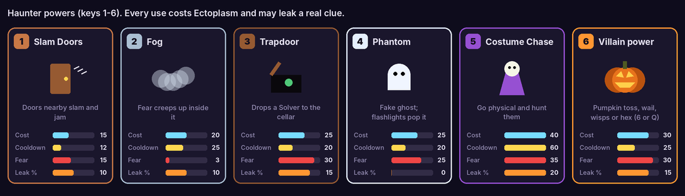</p>

In costume the Haunter is visible and can tag Solvers for big scares, but leaves footprints, and a
flashlight held on the costume stuns them. Nobody playing the Haunter? The **AI Director** haunts the
house instead, using the same tools and leaking clues the same way.

#### The case book

A new club's first call is always **The Missing Harvest Lantern** at Pemberton Cottage, the gentle
intro case. Solve a case and what was taken is put right (the lantern goes back on the mantel in
time for the lantern walk), and a keepsake appears on the shelf at HQ. The host's game remembers
solved cases between sessions, and the call board marks them **SOLVED**.

<p align="center">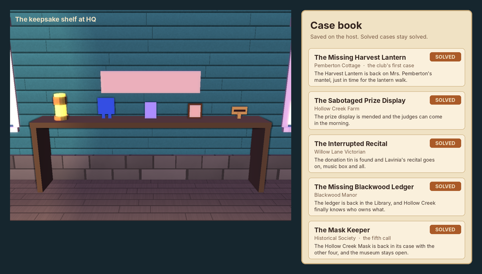</p>

#### Another night: back to HQ

When a case ends, the host presses **Next night: back to HQ**. Nobody restarts: the van is back in
the HQ driveway, every house is put back the way it was (lamps on, doors shut, traps packed away),
everyone's fear, batteries and ectoplasm start full, and the call board is waiting for the next call.
The case book carries on, so a club can play through the whole town in one sitting.

#### The Mask Keeper: the story behind every case

None of the culprits took a folklore mask on their own. Each solved case gives the club one clue
about who has been lending the masks out (a museum loan tag, inky fingers and a note on a porch, a
smell of lavender and old paper, a brass key to a back door marked "STAFF ONLY"), and the clues fill
a page in the case book at HQ. Solve all four and every clue points to the same place: a fifth call
appears on the board.

<p align="center">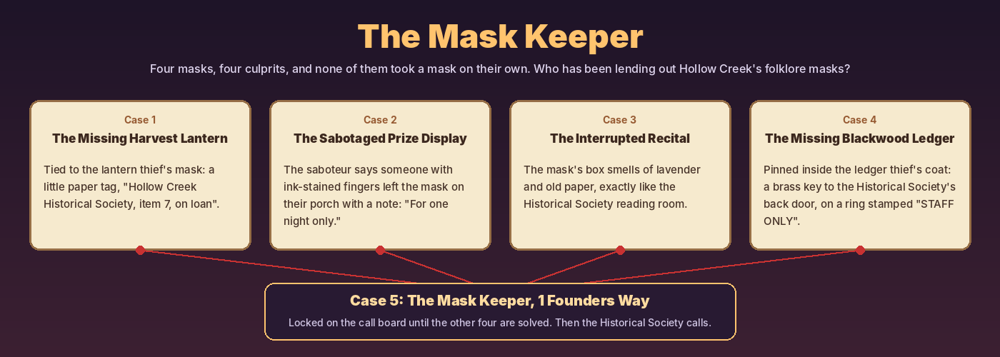</p>

#### The fifth call: 1 Founders Way

<p align="center">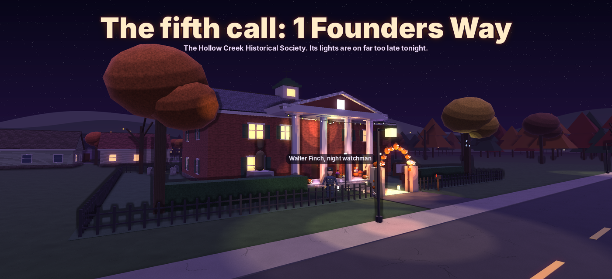</p>

The **Hollow Creek Historical Society** stands on its own street, Founders Way, across town from
HQ: a red-brick museum with a white-columned portico, a clock in the pediment and a cupola on the
roof. Its call stays locked on the call board ("solve the other four cases and this one will call")
until the four clues are in. Then the museum's lights are on far too late, and the oldest mask of
all, the **Hollow Creek Mask**, is missing from its case.

<p align="center">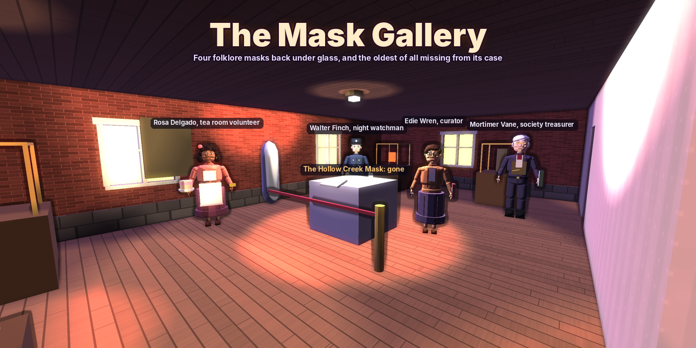</p>

It's the biggest case so far: two floors (the Mask Gallery, the Entrance Hall, the Gift Shop, the
Curator's Office, the Reading Room and the Archive), a courtyard with a fountain where the trap
goes, and a Restoration Workshop out back. The suspects are the people who keep the place running:
**Walter Finch**, the night watchman with his keys and lantern; **Edie Wren**, the curator with ink on
her fingers; **Mortimer Vane**, the treasurer who'd sell the building to a collector; and
**Rosa Delgado**, who runs the tea room at the fundraiser. Only two accusations, only two alibi
checks. Unmask the Mask Keeper and the case book closes the story, and a little brass plaque goes on
the keepsake shelf at HQ.

#### The Suspect Board

Press **Tab**. The board keeps what the club **found**, what people **said** and what **follows**
apart, and stamps every clue and statement with the time of night (the night runs 8 PM to dawn at
6 AM) and where it came from. A nervous suspect is character, not proof. Each player can mark
their own **hunch** without changing anyone else's board.

<p align="center">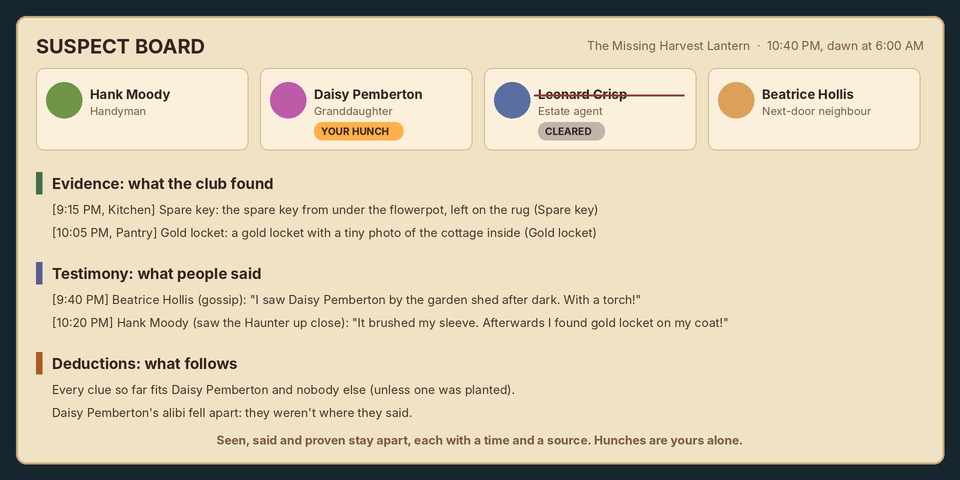</p>

#### Witnesses

<p align="center">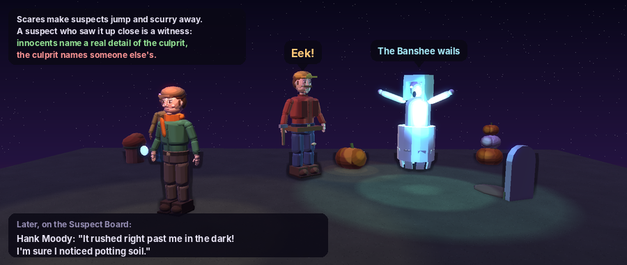</p>

Scares spook the suspects too: anyone nearby jumps ("Eek!") and scurries away. A suspect who **saw**
a scare up close becomes a witness, and when the club interviews them they describe a detail of the
Haunter instead of gossiping. Innocent witnesses name one of the culprit's real (shared) traits, which
narrows it to two suspects; the culprit, if it saw its own scare, names someone else's. So every scare
in front of a suspect is a risk for the Haunter.

#### Checking alibis

Every suspect's alibi names a place: a room in the house ("in the Library reading all night") or
somewhere in town ("at the Bookshop until closing"). Stand there, open the Suspect Board (**Tab**) and
press **Check alibi**. Innocent alibis hold up; the culprit's falls apart. You only get two checks a
night (three at the cottage), so choose well, and a town alibi means a drive. The catch: the Haunter
can **fake its alibi** once a night (**H**, 35 ectoplasm) by sneaking into that room first. A broken
alibi is proof; one that holds up might not be.

## 🎃 Tonight's legends: the villains

<p align="center">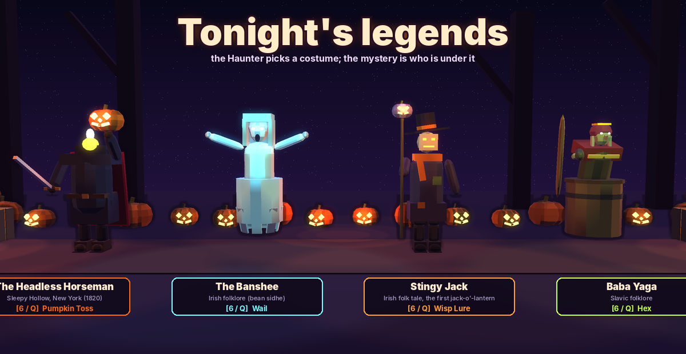</p>

In setup the Haunter picks one of the festival's folklore masks. Everyone can see which mask is in
play tonight ("Someone took the Headless Horseman mask from the festival and is haunting Blackwood
Manor..."), but nobody knows which suspect is wearing it. Each legend changes how the Haunter plays:

| Villain | From | Signature power (6 or Q) | In costume |
|---|---|---|---|
| 🎃 **The Headless Horseman** | *The Legend of Sleepy Hollow* (1820), the Irish dullahan | **Pumpkin Toss**: a flaming jack-o'-lantern arcs at the nearest Solver in sight and bursts | fastest on foot |
| 👻 **The Banshee** | Irish folklore (*bean sidhe*) | **Wail**: heard through walls, scares everyone near, kills flashlights and lamps | floats |
| 🏮 **Stingy Jack** | The Irish tale of the first jack-o'-lantern | **Wisp Lure**: three will-o'-the-wisps hunt Solvers; flashlights pop them | carries a turnip lantern |
| 🧹 **Baba Yaga** | Slavic folklore | **Hex**: the nearest Solver gets a fear spike and a dying flashlight | flies in her mortar |

At the unmasking, the mask comes off the costume (the Horseman's pumpkin head, the Banshee's shroud,
Jack's grinning mask, Baba Yaga's headscarf) and the suspect underneath is revealed.

<p align="center"></p>

<p align="center">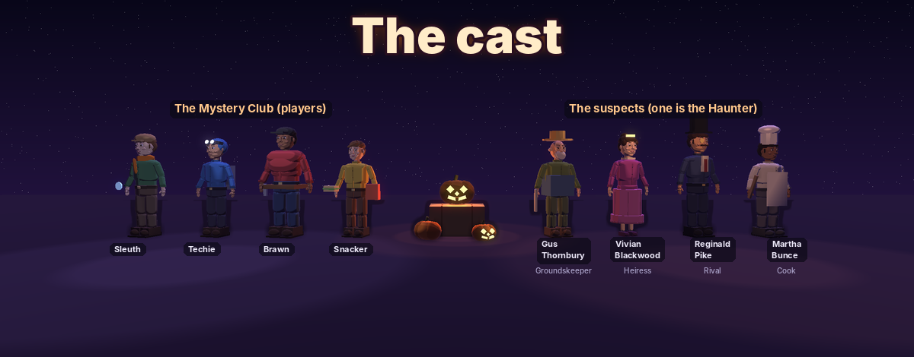</p>

<p align="center">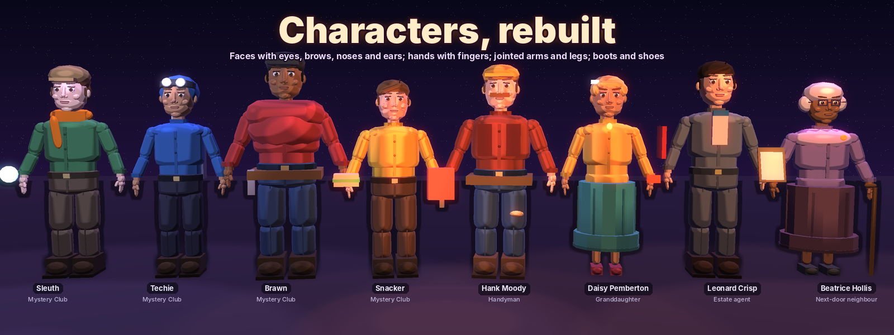</p>

Every character has a proper face, hands with fingers and a thumb, arms that bend at the elbow,
legs with thighs, shins and boots or shoes, a waist, hips, a collar and buttons.

<p align="center">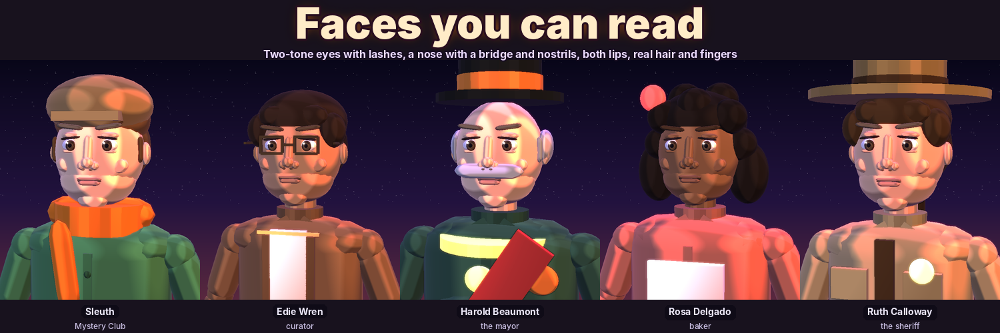</p>

The character pass in round 21 went over everyone again, up close. Eyes now have a two-tone iris,
lashes and a lower lid. Noses have a bridge, a tip, wings and nostrils, mouths have both lips, and
there's a chin, cheekbones and an inner fold to each ear. Hair frames the face (a crown, the back of
the head, then sideburns, a fringe, side curtains, a fall down the back or curls) instead of sitting
on top like a helmet. Spectacles are wire frames you can see the eyes through. The four fingers are
separate and curl a little, the shoulders slope, trouser legs have a pressed crease and skirts have
pleats.

<p align="center">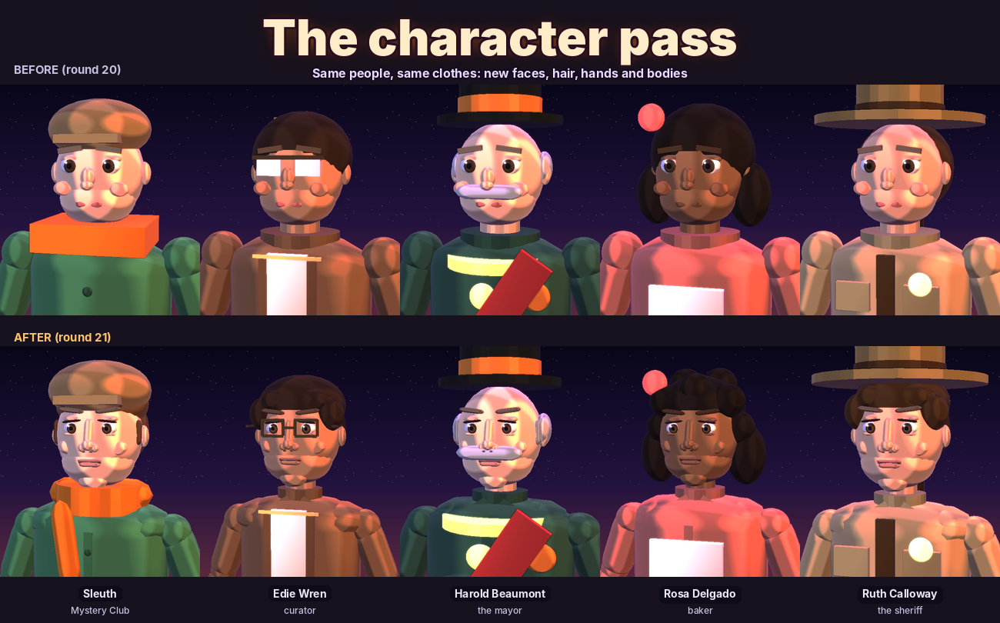</p>

<p align="center">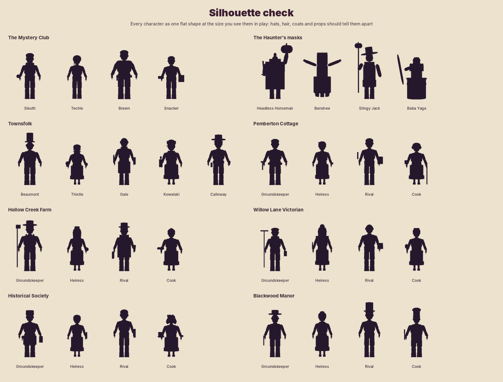</p>

Round 22 added a silhouette check: every character as one flat shape at gameplay size, so hats,
hair, coats and props have to tell people apart without colour or a face. It caught one pair, the
two Pemberton Cottage ladies, so Beatrice Hollis now has a shawl and a walking cane.

<p align="center">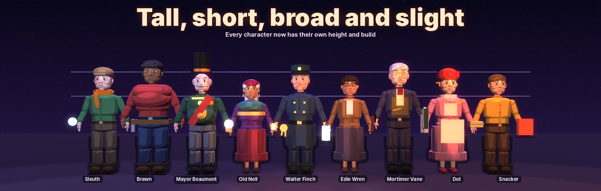</p>

Nobody is the same size any more. Each person has their own height and build in `CHARACTERS` in
[`make_costumes.py`](Docs/tools/make_costumes.py): the Reverend and Mortimer Vane are tall and thin,
the Brawn and the Mayor are broad, Old Nell and Rosa are short. Builds widen the body but not the
face, so nobody's head gets stretched. The README pictures are rendered with smooth shading now too,
the way Unity draws its spheres and capsules. (These are renders from the project's own software
renderer, not Unity screenshots.)

<p align="center">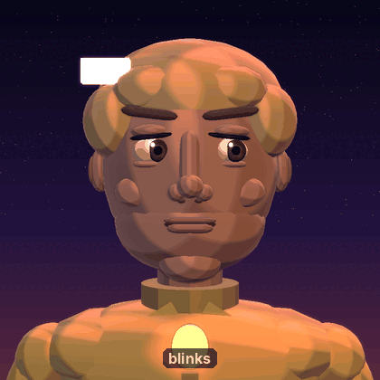</p>

And the faces move: everyone blinks every few seconds, glances around and looks at you when you
come close, and a suspect's lips move while they answer your questions
([`Animation/FaceLife.cs`](Assets/Unmasked/Scripts/Animation/FaceLife.cs)).

The Mystery Club dress for their roles (the Sleuth's deerstalker and magnifier, the Techie's
goggles and antenna backpack, the Brawn's toolbelt, the Snacker's sandwich) and the four suspects
are dressed for their jobs. Every character and prop is built from simple shapes in
[`Docs/tools/make_costumes.py`](Docs/tools/make_costumes.py) and saved to
[`Assets/Unmasked/Resources/Costumes.json`](Assets/Unmasked/Resources/Costumes.json), which Unity and
the README renderer both read.

---

## 🚐 Hollow Creek: the town

<p align="center">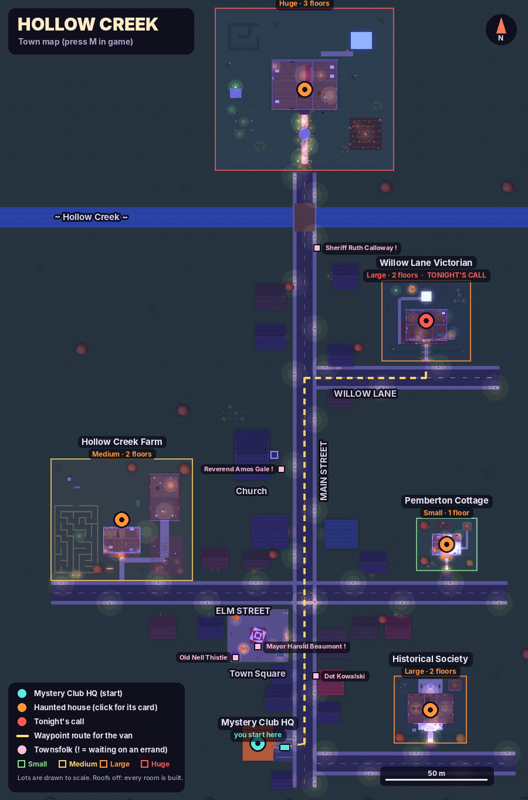</p>

Every night starts at **Mystery Club HQ** at the south end of Main Street. A call comes in, the club
piles into the van and drives through town (past the diner, the town square with the Harvest
Festival stalls, the church and its churchyard, over the creek bridge) to tonight's haunted house.
It's a semi-open world: every house is fully built on its own lot all the time, so you can drive
past the others, and the Haunter, the suspects, the clues and the trap only exist at the house the
call is about.

<p align="center">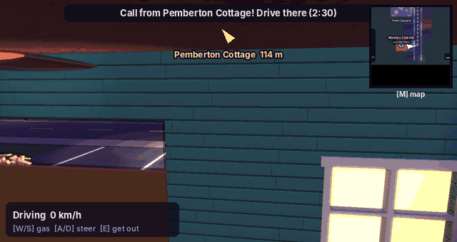</p>

**The map (M)** works like the phone map in *Schedule I*: a top-down view of the whole town with
each house fully loaded, pins for HQ, every haunted house, the van and your friends. Click a house
for its card: a live 3D view circling the house, its size, floors, rooms and spookiness, a
**Set waypoint** button and, at HQ, **Take this call**. A minimap and a waypoint arrow stay on screen
while you drive.

### Beyond the edge of town

<p align="center">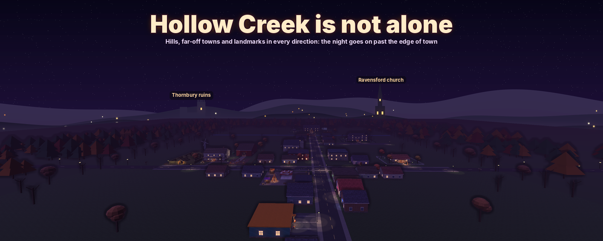</p>

Hollow Creek sits in a valley, and the world doesn't stop at the town line. Three ridges of hills
ring the horizon in every direction, with the lights of farms and far-off towns scattered across
them and mist lying in the valley. Landmarks stand on the ridges: the **Ravensford church** steeple,
the **Gull Point lighthouse** with its beam sweeping round, **Hatcher's old windmill** turning, the
**Ravensford water tower** with its red light, and the **Thornbury ruins**. The hills follow the
camera, so they always stay on the horizon however far you drive.

<p align="center">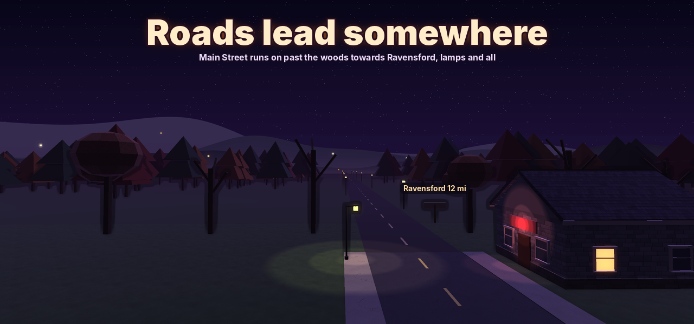</p>

Closer in, every road carries on past the edge of town with lamps and signposts ("Ravensford 12 mi",
"Gull Point 9 mi", "Thornbury 6 mi", "Old Mill Road"), and a band of pines and autumn trees fills
the gap between the town and the hills. It's all built when the town loads by
[`Town/Horizon.cs`](Assets/Unmasked/Scripts/Town/Horizon.cs) from the `horizon` block in
[`HollowCreek.json`](Assets/Unmasked/Resources/HollowCreek.json).

<p align="center">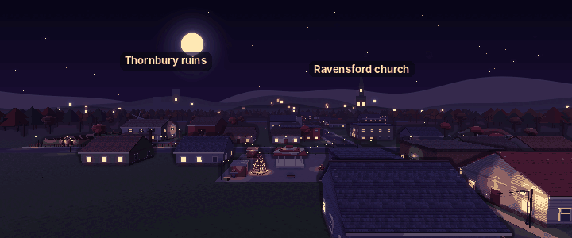</p>

### Someone's always out tonight

<p align="center">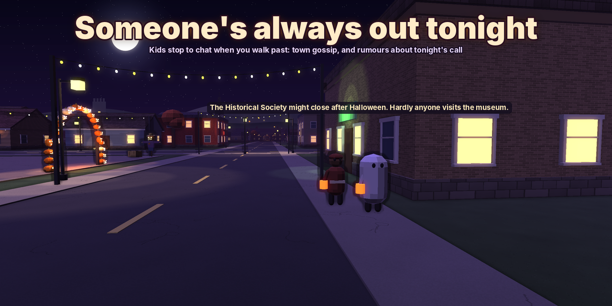</p>

Hollow Creek is out trick-or-treating. Groups of two to four kids (ghosts in sheets, witches,
pumpkins, skeletons, cats, vampires and pirates, each with a glowing candy bucket) walk the
sidewalks of Main Street, Elm Street and Willow Lane, stop now and then to knock, and turn to talk
when you walk up. They pass on the town's gossip (the museum might close, someone borrowed the old
festival masks, a light at the old windmill) and, once a call comes in, rumours about tonight's
house. It's all scenery: rumours are never clues, and the kids are never in anyone's way.

<p align="center">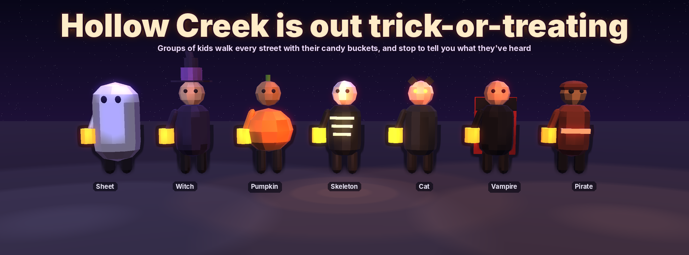</p>

Out past the edge of town, cars come and go on the roads to Ravensford and Thornbury with their
headlights on, and now and then the late train crosses the valley in front of the hills, its
windows lit. Built by [`Town/TownLife.cs`](Assets/Unmasked/Scripts/Town/TownLife.cs) from the
`life` block in [`HollowCreek.json`](Assets/Unmasked/Resources/HollowCreek.json).

<p align="center">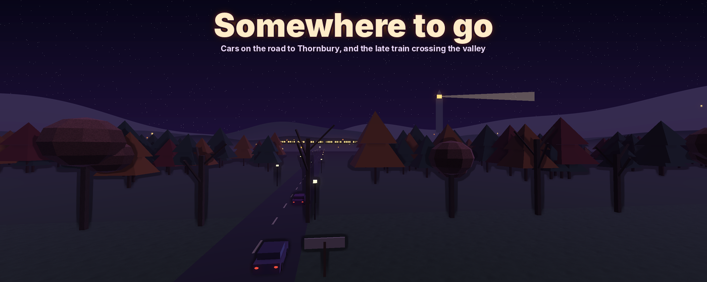</p>

### The people of Hollow Creek

<p align="center">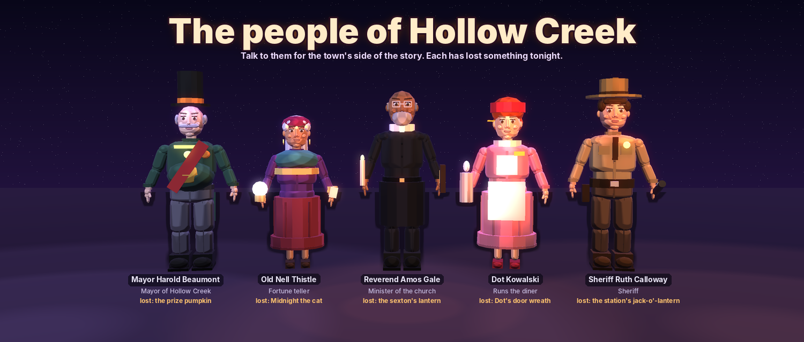</p>

Five grown-ups are out in town tonight, and you can walk up to any of them and press **E** to talk:
**Mayor Harold Beaumont** by the bandstand, **Old Nell Thistle** reading fortunes at her festival
stall, **Reverend Amos Gale** outside the church, **Dot Kowalski** at the diner door, and **Sheriff
Ruth Calloway** keeping watch on the bridge. They turn to face you, their lips move as they talk, and
what they say fills in the town's side of the Mask Keeper story: whose idea it was to lend out the
masks, who meets a collector in the diner's back booth, where the oldest mask came from.

<p align="center">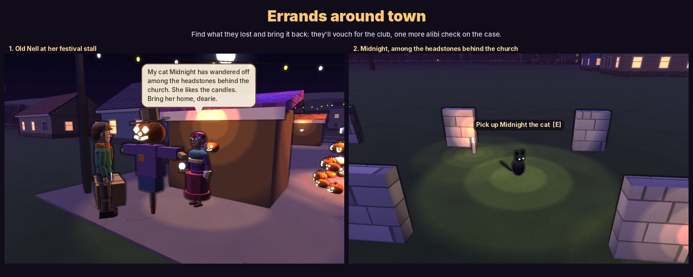</p>

Each of them has lost something tonight: the prize pumpkin, Nell's cat Midnight, the sexton's
lantern, Dot's door wreath, the jack-o'-lantern from the sheriff's station steps. Once they've asked,
it shows up somewhere in town with a soft glow, and their pin on the map (**M**) gets a "!". Bring it
back and they put in a word for the club: **one more alibi check**, tonight if you're on a case or
on the next one if you're between calls. Errands carry on from night to night, and the HQ panel
keeps count. Built by [`Town/Townsperson.cs`](Assets/Unmasked/Scripts/Town/Townsperson.cs) and
[`Town/ErrandItem.cs`](Assets/Unmasked/Scripts/Town/ErrandItem.cs) from the `folk` block in
[`HollowCreek.json`](Assets/Unmasked/Resources/HollowCreek.json).

### The Lantern Watch: a costume the town makes for you

<p align="center">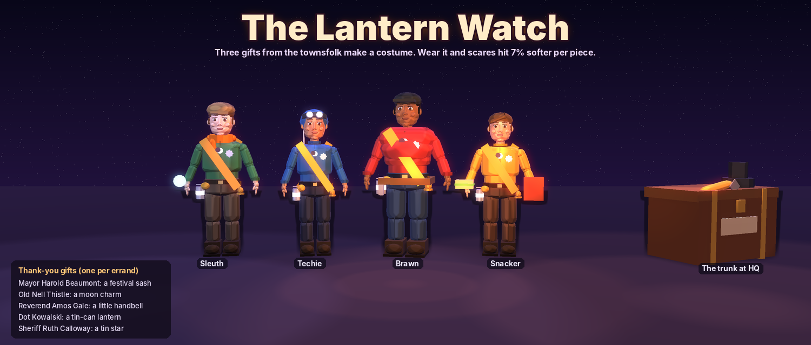</p>

Each townsperson also says thank you with something homemade: the Mayor's old festival sash, a
tin moon charm from Old Nell, the Sunday-school handbell, a tin-can lantern from Dot's diner and a
tin star from the sheriff. Three pieces make a costume. Open the **dressing-up trunk at HQ** (E)
between cases to put it on or take it off. While the club wears it, every piece shows on all four
Solvers and **scares hit 7% softer per piece** (21% with three, 35% with all five). The costume is
data in [`make_costumes.py`](Docs/tools/make_costumes.py) (`WATCH`), fitted to each Solver's height
and build, and switched on by [`Spooky/WatchCostume.cs`](Assets/Unmasked/Scripts/Spooky/WatchCostume.cs)
and [`Town/CostumeTrunk.cs`](Assets/Unmasked/Scripts/Town/CostumeTrunk.cs).

### The street remembers

<p align="center">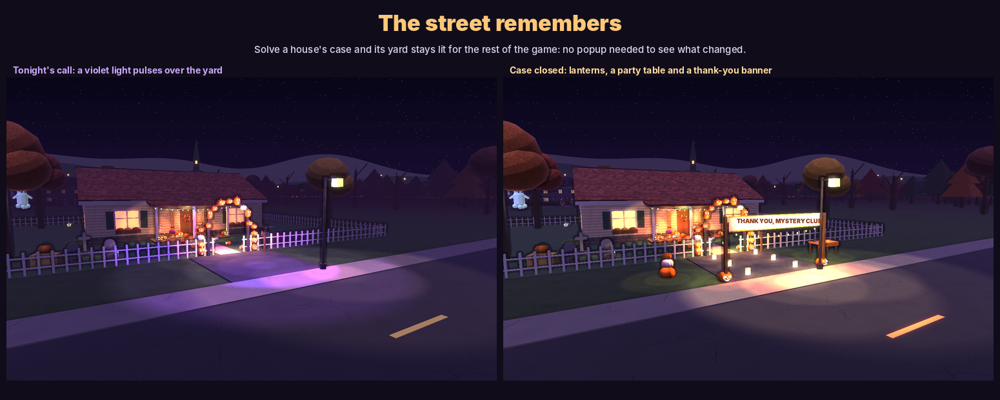</p>

Every house shows where its story stands. While its call is open, a violet light pulses over the
front yard. Once its case is in the case book, the neighbours throw a little party that stays for
the rest of the game: paper-bag lanterns up the walk, jack-o'-lanterns at the gate, a party table
and a **THANK YOU, MYSTERY CLUB!** banner. You can see which houses you've helped from the van,
without opening a menu. It reads the same networked case book as the keepsake shelf
([`Town/HouseMood.cs`](Assets/Unmasked/Scripts/Town/HouseMood.cs), from the `afterglow` block of
each lot in `HollowCreek.json`).

### Saved progress, and starting over

The host's game remembers the case book, every errand (asked, found or done), favours still owed,
costume pieces and whether the club is wearing the costume, so quitting and coming back picks up
the same town. Rewards can't be collected twice: a finished errand stays finished. The host has a
**Start over** button at HQ that wipes it all, and it needs a second press within a few seconds.

### The Club Handbook: hints for your first night

New players get a small card the first time each moment comes up: arriving at HQ, the drive, the
first clue, the Suspect Board, being able to accuse, the first panic, the trap, playing the
Haunter, the townsfolk's errands and closing a case. Each card shows once, and **F1** opens the
handbook with every hint seen so far (and a button to show them all again). The hints live on
each player's own computer, so nothing extra goes over the network
([`UI/Handbook.cs`](Assets/Unmasked/Scripts/UI/Handbook.cs)).

<p align="center"></p>

### The houses

<p align="center">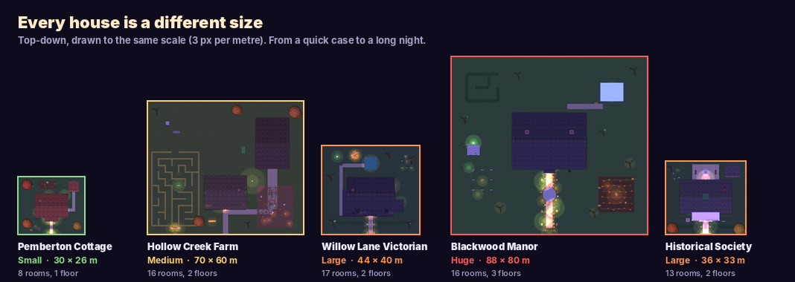</p>

| House | Size | What's there |
|---|---|---|
| **Pemberton Cottage**, 14 Elm Street | Small: 30 x 26 m lot, 1 floor | A tidy cottage behind a white picket fence: living room, kitchen, bedroom, bathroom, study, a garden shed and a vegetable patch. A quick case. |
| **Hollow Creek Farm**, Old Mill Road | Medium: 70 x 60 m lot, 2 floors | A farmhouse, a red barn with a hayloft trapdoor, a corn maze with a scarecrow in the middle, a windmill and a pumpkin patch. |
| **Willow Lane Victorian**, 3 Willow Lane | Large: 44 x 40 m lot, 2 floors and a tower | A wraparound porch, a music room under a nursery with a trapdoor, a tower lookout, a gazebo (the trap site) and a family plot. |
| **Blackwood Manor**, the end of Main Street | Huge: 88 x 80 m lot, cellar, 2 floors, roof | The big one, over the creek (below). |
| **Historical Society**, 1 Founders Way | Large: 36 x 33 m lot, 2 floors | The fifth call, locked until the other four are solved: a museum with a portico, a Mask Gallery, an Archive, a courtyard fountain and a Restoration Workshop. |

<p align="center">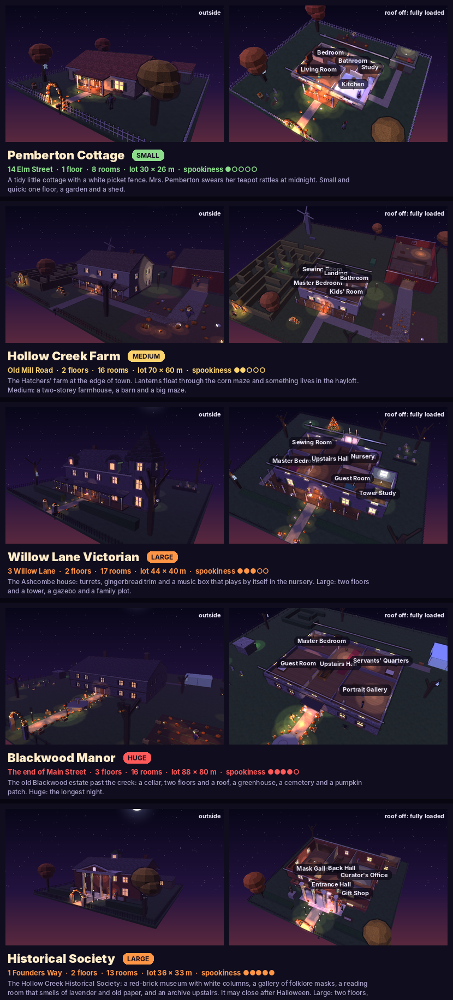</p>

### A case for every house

<p align="center">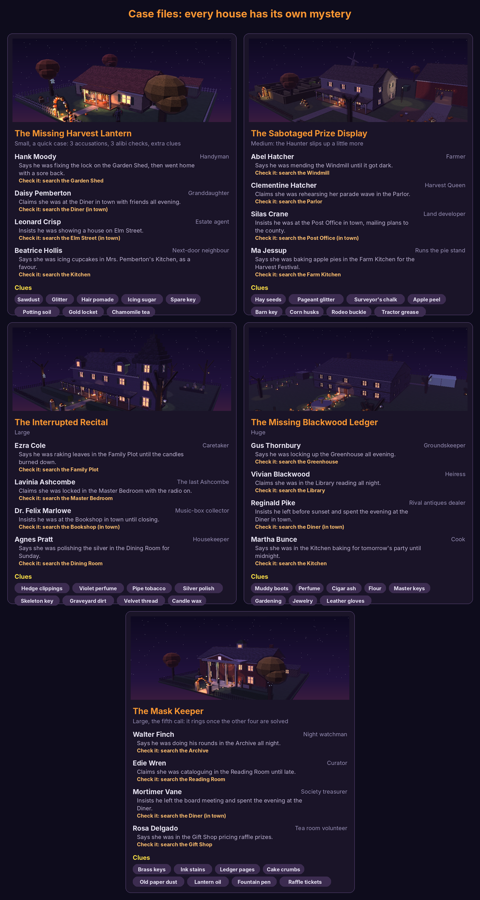</p>

Every call is its own mystery. The house you drive to decides who the four suspects are, what they
claim they were doing, what they gossip about, and what the clues look like: sawdust and icing sugar
at the cottage, hay seeds and tractor grease at the farm, candle wax and graveyard dirt on Willow Lane.
The rules underneath are the same everywhere (any two true clues name exactly one suspect), so every
case is solvable. Pemberton Cottage is the gentle one: an extra clue hidden at the start, the Haunter
slips up more, and you get three accusations instead of two.

<p align="center">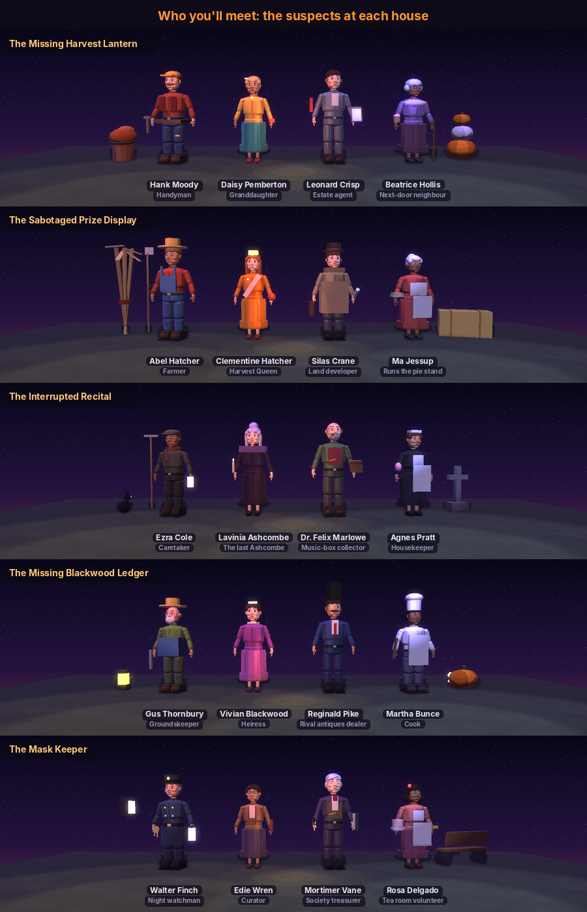</p>

Each cast dresses the part: Hank the handyman has his hammer and toolbelt, the Harvest Queen her
crown and sash, Dr. Marlowe carries the music box he keeps trying to buy. The four suspects follow the
club from call to call and change into tonight's cast when a call comes in. While you investigate
they don't stand frozen: they stroll around near their spot, so you'll have to find them.

#### Return visits

<p align="center">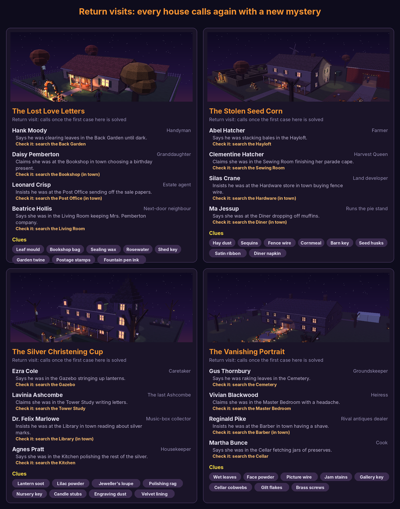</p>

Solve a house's case and, a night or two later, it calls again with a **new mystery**. It's the same
neighbours in the same outfits, but they have new alibis, new clues, new gossip and new reasons to
wear the mask. At Pemberton Cottage, Mr. Pemberton's old love letters have gone from the desk and the
garden gnomes all face the window. At the farm, the hundred-year-old seed corn is stolen and the
scarecrow turns its head. On Willow Lane, the Ashcombe christening cup is gone and the empty cradle
rocks. At Blackwood Manor, Lady Blackwood's portrait has vanished and the organ in the cellar plays at
midnight. The call board marks them **RETURN VISIT**, and houses with an unsolved case call first, so
there are nine cases in the book now.

All nine cases live in [`Cases.cs`](Assets/Unmasked/Scripts/Mystery/Cases.cs). A case set on the
`MysteryGameManager` in the Inspector still overrides them.

### Special nights

<p align="center">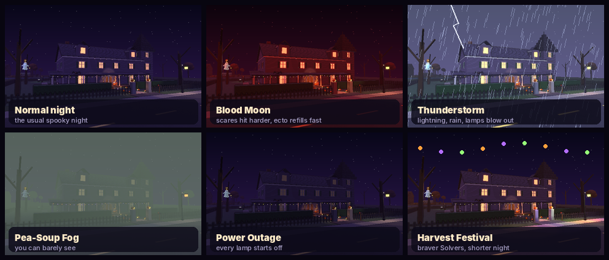</p>

| Event | What changes |
|---|---|
| **Blood Moon** | A red moon. Scares hit 25% harder and the Haunter's ectoplasm refills 50% faster. |
| **Thunderstorm** | Rain and lightning flashes. Now and then a lamp in the house blows out. Flashlights drain a bit faster. |
| **Pea-Soup Fog** | Thick fog off the creek: you can barely see past your flashlight. |
| **Power Outage** | Every lamp in the house starts off and flashlights drain 60% faster. |
| **Harvest Festival** | The town is celebrating: Solvers are braver (20% less fear), but dawn comes 20% sooner. |

The town is data too: [`Docs/tools/make_town.py`](Docs/tools/make_town.py) writes
[`HollowCreek.json`](Assets/Unmasked/Resources/HollowCreek.json) and
[`Docs/tools/make_houses.py`](Docs/tools/make_houses.py) writes each house into
[`Resources/Houses/`](Assets/Unmasked/Resources/Houses). **Unmasked > Build Hollow Creek (town)**
builds the whole thing in Unity, and the pictures above are drawn from the same files.

---

## 🏚 The 3D world: Blackwood Manor

<p align="center">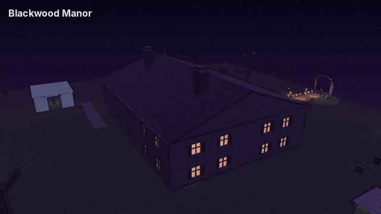</p>

A two-storey manor with a cellar, eleven rooms and spooky grounds: an iron gate under an arch of
jack-o'-lanterns, a pumpkin trail around the fountain, the groundskeeper's greenhouse, a pumpkin
patch with a scarecrow, a cemetery with candles and a witch's cauldron, a hedge garden and dead
trees hung with jack-o'-lanterns. Walk in through
the front door, take the grand staircase up, or the back-hall stairs down to the cellar. Three
trapdoors drop unlucky Solvers a floor.

<p align="center">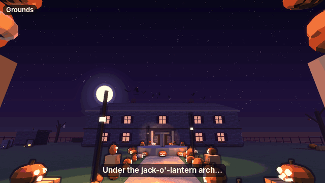</p>

### The look: Halloween night

<p align="center">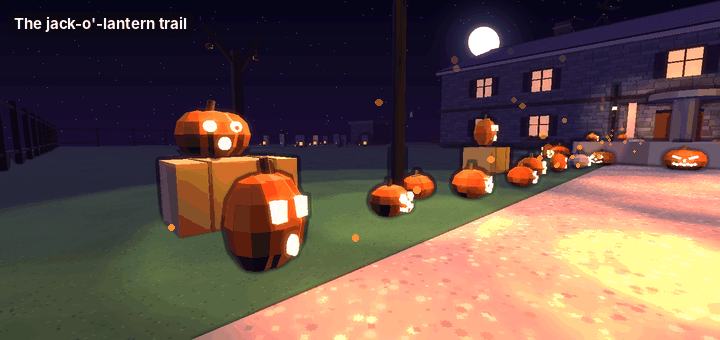</p>

The whole town is dressed like LA's [Nights of the Jack](https://secretlosangeles.com/nights-of-the-jack/)
trail, but kept to what a town that loves Halloween would really put out: carved pumpkins on every
porch and path, an arch of jack-o'-lanterns here and there, string lights, cornstalks and mums, one
ghost in a tree. The game uses a cel-shaded toon shader with a violet rim light, bloom so every
jack-o'-lantern glows, a purple-and-orange colour grade, ground mist, fireflies and bats.
[Docs/ART_DIRECTION.md](Docs/ART_DIRECTION.md) has the references, palette and rules.

<p align="center">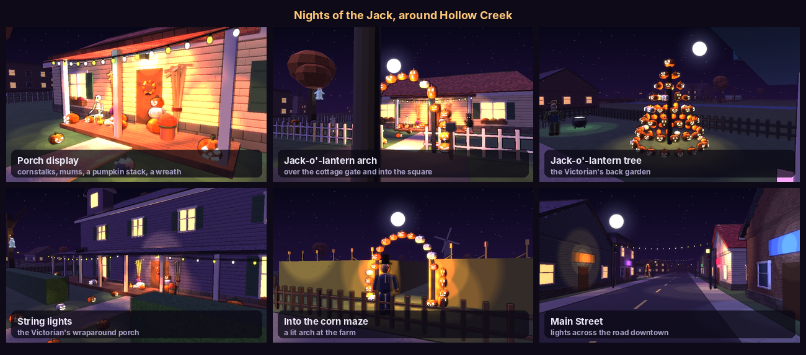</p>

No two jack-o'-lanterns are alike: every one in town picks from seven carvings.

<p align="center">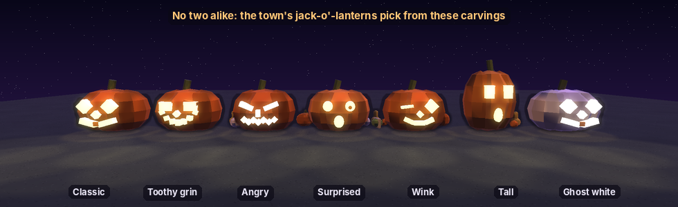</p>

**Detail.** Every wall, roof and lawn has a surface: clapboard siding, shingles, brick, cut stone,
floorboards, grass, asphalt, gravel. They're small greyscale patterns laid over each colour in world
space by the toon shader, so a board is the same size on every wall. Houses get window casings,
shutters, flower boxes full of mums, a stone foundation and fascia boards along the eaves, and every
front door has a harvest wreath.

<p align="center">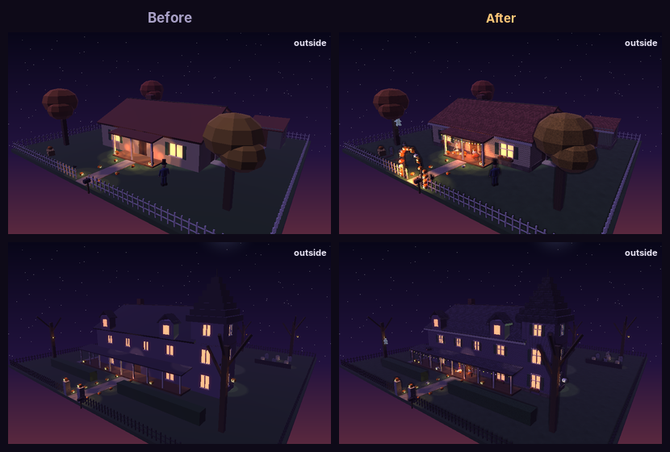</p>

<p align="center">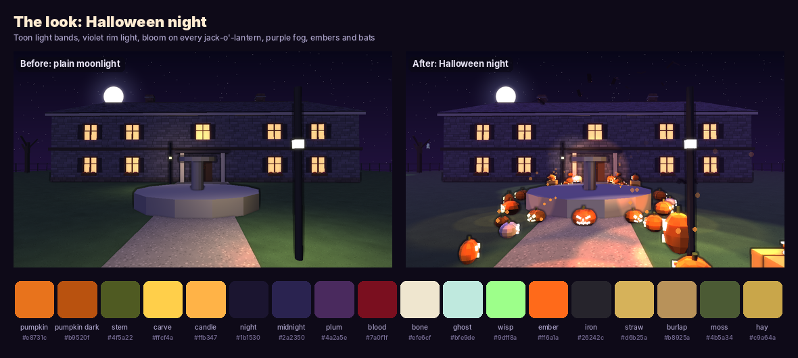</p>

<p align="center">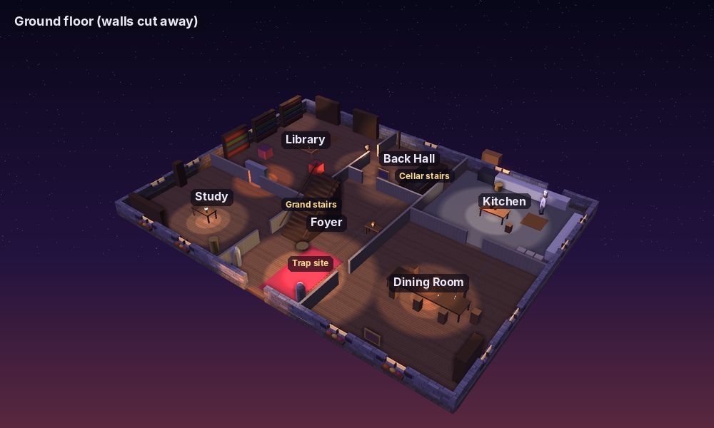</p>

<p align="center">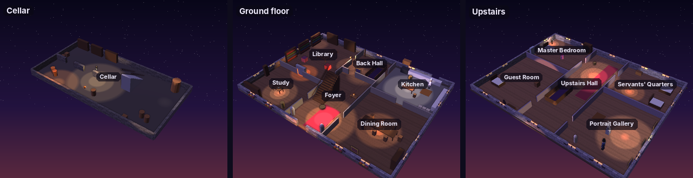</p>

| Floor | Rooms | Who's there |
|---|---|---|
| Upstairs | Master Bedroom, Guest Room, Portrait Gallery, Servants' Quarters, Upstairs Hall | the Heiress, the Rival |
| Ground floor | Foyer (trap site), Library, Study, Dining Room, Kitchen, Back Hall | the Cook |
| Cellar | Wine cellar, boiler, barrels | trap piece |
| Outside | Gate, pumpkin trail, fountain, greenhouse, pumpkin patch, cemetery, hedge garden | the Groundskeeper |

The HUD tells you which room you're in, and clue announcements say where a clue was found. The ghost
drifts straight through walls and floors; in costume the Haunter has to use doors and stairs like
everyone else.

**One file, three uses.** The whole level is data in
[`Assets/Unmasked/Resources/BlackwoodManor.json`](Assets/Unmasked/Resources/BlackwoodManor.json),
written by [`Docs/tools/make_manor.py`](Docs/tools/make_manor.py). Unity builds the 3D scene from it
(**Unmasked > Build Blackwood Manor (3D)**), the game reads room names from it, and
[`Docs/tools/render3d.py`](Docs/tools/render3d.py), a tiny software 3D renderer, draws every manor
picture on this page from it. Characters and Halloween props work the same way with
[`Costumes.json`](Assets/Unmasked/Resources/Costumes.json) and `make_costumes.py`. To change the
house or the costumes, edit those scripts and run `unmasked world`.

---

## 🔊 The sound

<p align="center"></p>

The town is no longer silent. Wind and crickets are always there, with rain on Thunderstorm nights
and a low drone under the Blood Moon. Crows and owls call from somewhere nearby, and the Willow Lane
music box plays by itself in the empty nursery. Each legend has a signature sound (the Banshee's wail,
the Horseman's hoofbeats, Stingy Jack's wisps, Baba Yaga's hex), possessed furniture rattles, slams
and buzzes, doors creak, and suspects yelp when they're startled. Your own heartbeat speeds up as
your fear rises. Clues, alibis, the trap and the unmasking each get a sting, and the van's engine
revs with its speed.

Every sound is synthesized by [`Docs/tools/make_sounds.py`](Docs/tools/make_sounds.py) (no
recordings, nothing to license) into
[`Resources/Sounds/`](Assets/Unmasked/Resources/Sounds). Double-click any `.wav` there to hear it.
The game plays them through [`Sfx.cs`](Assets/Unmasked/Scripts/Spooky/Sfx.cs) and
[`Ambience.cs`](Assets/Unmasked/Scripts/Spooky/Ambience.cs), which sets itself up, so the scenes
don't need rebuilding.

---

## 🎮 Controls

<p align="center"></p>

**Click** the game window to capture the mouse. **Esc** frees it. **Tab** opens the Suspect Board.
**M** opens the town map. **E** gets you in and out of the van; **W/S** and **A/D** drive it.
As the Haunter, **G** plants a fake clue and **H** fakes your alibi (in the room it names).
**F1** opens the Club Handbook. **F12** saves a screenshot.

---

## 🧠 How it's built

<p align="center">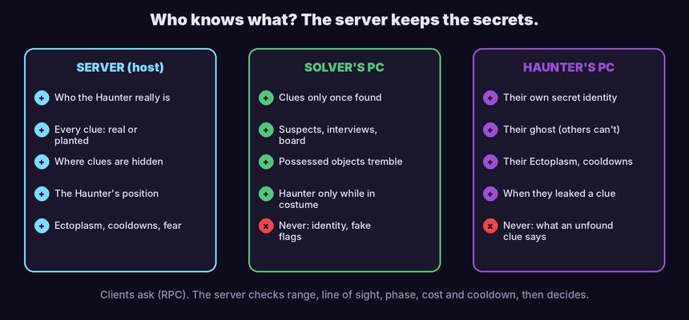</p>

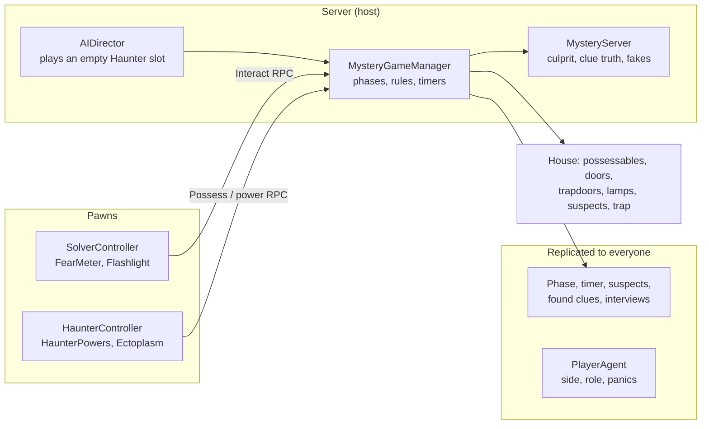


| Folder (`Assets/Unmasked/Scripts`) | What's inside |
|---|---|
| `Core` | Match flow (`MysteryGameManager`), per-player state (`PlayerAgent`), camera, shared types |
| `Solvers` | `SolverController`, `FearMeter`, `Flashlight` |
| `Haunter` | `HaunterController` (possession, costume), `HaunterPowers`, `Ectoplasm`, fog, phantom |
| `Mystery` | Case, suspect and clue data, `Cases` (one case per house), and `MysteryServer` (the secret half) |
| `House` | Possessable furniture and lamps, doors, trapdoors |
| `Traps` | Trap pieces and the trap site |
| `AI` | `AIDirector` and the interviewable `SuspectNPC` |
| `Animation` | `PawnAnimator`: walk bob, panic scramble, ghost float, dizzy stun, mask pop |
| `UI` | Placeholder IMGUI HUD and Suspect Board |
| `Town` | Hollow Creek: `TownLayout` (the town data), `HouseSite` (one house on its lot), `TownDirector`, the `MysteryVan`, the `TownMap` (M, minimap, waypoints) and `NightEventFX` |
| `Editor` | **Build Hollow Creek (town)** and **Build Blackwood Manor (3D)** builders, the small test room, and the player `BuildScript` |

Networking is Netcode for GameObjects (host, join or dedicated server). The van is driven on the
driver's machine (ownership moves to whoever is at the wheel) so it feels instant, and the server
checks arrival at the house. The town, houses, characters, prefabs, materials, sky and
post-processing are generated by **Unmasked > Build Hollow Creek (town)**, so the project needs no
hand-made assets yet. The look uses the built-in render pipeline
with a custom toon shader and the Post Processing package (`com.unity.postprocessing`).

---

## 📈 Progress

The current playable slice, what was tested and what wasn't, and where every asset comes from:
[`Docs/SLICE_PLAN.md`](Docs/SLICE_PLAN.md), [`Docs/TEST_REPORT.md`](Docs/TEST_REPORT.md) and
[`Docs/ASSET_MANIFEST.md`](Docs/ASSET_MANIFEST.md).

<p align="center"></p>

The full checklist is in [Docs/PROGRESS.md](Docs/PROGRESS.md). Run `unmasked status` for a live view
in the terminal, including compile results and recent commits.

---

## 💻 Developer terminal commands (Ubuntu / WSL)

Every block below can be pasted into a **fresh Ubuntu terminal from any folder**. On Windows, open
**Ubuntu (WSL)**: it sees your desktop at `/mnt/c/Users/<you>/Desktop`.

### 1. First time: install tools and upload to GitHub

```bash
# Find the game folder (Windows desktop through WSL, or ~/Desktop on Ubuntu)
P="/mnt/c/Users/aleks/Desktop/Unmasked Game"; [ -d "$P" ] || P="$HOME/Desktop/Unmasked Game"; [ -d "$P" ] || echo "Game folder not found: set P to where it is."

# Install git, git-lfs, the GitHub CLI and the `unmasked` command
bash "$P/tools/unmasked.sh" setup && export PATH="$HOME/.local/bin:$PATH"

# Create a new PRIVATE GitHub repo called "unmasked" and upload everything (opens a browser to log in)
unmasked publish unmasked
#   ...or create it PUBLIC straight away, so anyone can see this page and download the game:
#   unmasked publish unmasked --public
```

The repo ends up at `https://github.com/Normansrule/unmasked`. After that, `unmasked save "message"`
pushes each new round. The `_to_delete` folder (old delivery zips) is in `.gitignore`, so it never uploads.

To let anyone download the game, make the repo public:
`gh repo edit Normansrule/unmasked --visibility public --accept-visibility-change-consequences`

### 2. Day to day

```bash
export PATH="$HOME/.local/bin:$PATH"   # only needed if a new terminal says "unmasked: command not found"
unmasked status                 # milestones, last compile check, commits, cloud builds
unmasked save "Add new clue"    # commit everything and push to GitHub
```

### 3. See the game in Unity

**Straight from the desktop folder (Windows, no terminal):**

1. Open **Unity Hub**, click **Add** > **Add project from disk** and pick the `Unmasked Game` folder.
2. Open it with Unity **6000.0.32f1** (Hub offers to install it if you don't have it). The first
   open takes a few minutes while Unity imports everything.
3. If Unity asks to restart for the Input System, click **Restart Unity**.
4. When **Welcome to UNMASKED** appears, click **Build Hollow Creek**.
5. Press **Unmasked > Play Hollow Creek**, then click **Host** in the game window.

**From a terminal:**

```bash
unmasked open     # opens the project in Unity (it offers to build the town; then Unmasked > Play Hollow Creek, Host)
unmasked check    # compiles headless and lists any errors (log: Logs/check.log)
unmasked world    # regenerates the town, houses and manor and rebuilds both Unity scenes headless
unmasked build    # builds Windows/macOS/Linux players into Builds/ and zips them
unmasked play 2   # opens two game windows: click Host in one, Join 127.0.0.1 in the other
```

No Unity yet? On Windows, install [Unity Hub](https://unity.com/download) and add Unity
**6000.0.32f1** with the *Windows, Mac and Linux Build Support* modules. On native Ubuntu run
`unmasked install-unity`. If Unity is installed somewhere unusual: `export UNITY_PATH=/path/to/Unity`.

### 4. Publish downloads for players

```bash
unmasked secrets           # one time: lets GitHub Actions use your Unity license
unmasked release v0.1.0    # tags a version; GitHub builds all 3 platforms and attaches the zips
```

Watch cloud builds with `gh run watch`, or open the **Actions** tab on GitHub.

### Working on another computer

```bash
gh repo clone Normansrule/unmasked ~/unmasked && bash ~/unmasked/tools/unmasked.sh setup
```

### Changing the 3D world and regenerating the README art

```bash
nano "$(unmasked where)/Docs/tools/make_town.py"             # roads, HQ, shops, the square, where each house's lot is
nano "$(unmasked where)/Docs/tools/make_houses.py"           # the cottage, the farm and the Victorian, room by room
nano "$(unmasked where)/Docs/tools/make_manor.py"            # Blackwood Manor: walls, rooms, furniture, pumpkins, clue spots...
nano "$(unmasked where)/Docs/tools/make_costumes.py"         # villains, outfits, Halloween props, the van
nano "$(unmasked where)/Docs/tools/dressing.py"              # window trim, shutters, foundations, jack-o'-lantern arches and trees, string lights
nano "$(unmasked where)/Docs/tools/make_textures.py"         # surface patterns: siding, shingles, brick, stone, grass...
unmasked world                                               # regenerate every file and rebuild both Unity scenes
python3 -m pip install --user numpy pillow                   # once, for the renderer
python3 "$(unmasked where)/Docs/tools/make_images.py"         # redraw every picture (3D ones take a few minutes)
python3 "$(unmasked where)/Docs/tools/make_images_town.py"    # just the town pictures: map, houses, sizes, drive, events
python3 "$(unmasked where)/Docs/tools/make_images_look.py"    # the carvings and the Nights of the Jack set pieces
python3 "$(unmasked where)/Docs/tools/make_sounds.py"          # remake every sound (wind, wails, thunder...)
python3 "$(unmasked where)/Docs/tools/make_images_sounds.py"   # the sounds picture
python3 "$(unmasked where)/Docs/tools/make_images_cases.py"   # case files (with alibi rooms), return visits, suspects-by-house and witness pictures
python3 "$(unmasked where)/Docs/tools/make_images_story.py"   # the story card, the Suspect Board and the anticipation animation
python3 "$(unmasked where)/Docs/tools/make_images_world.py"   # the horizon, the roads out of town, the character close-ups and the Mask Keeper
python3 "$(unmasked where)/Docs/tools/make_images_life.py"    # trick-or-treaters, the street, the valley train, the face animation
python3 "$(unmasked where)/Docs/tools/make_images_museum.py"  # the Historical Society from Founders Way and its Mask Gallery
python3 "$(unmasked where)/Docs/tools/make_images_folk.py"    # the townsfolk and an errand
python3 "$(unmasked where)/Docs/tools/make_images_people.py"  # character portraits and heights/builds
python3 "$(unmasked where)/Docs/tools/make_images_hub.py"     # the street remembers, the Lantern Watch, the silhouette check
python3 "$(unmasked where)/Docs/tools/make_readme_anim.py"    # the animated top of this page: progress tracker, rounds, one night, cast, handbook
python3 "$(unmasked where)/Docs/tools/make_reference.py"      # "Reference renders": big house stills and gameplay-tour.mp4 (needs ffmpeg)
```

### Check every case can be solved

```bash
python3 "$(unmasked where)/tools/casecheck/casecheck.py"       # two true clues always name one suspect; every alibi room exists
```

### Check the C# compiles without opening Unity

```bash
sudo apt-get install -y dotnet-sdk-8.0                         # once
bash "$(unmasked where)/tools/compilecheck/check.sh"           # builds every script against Unity's DLLs; prints errors with file:line
```

---

## 🗺 Roadmap

- [ ] First compile in Unity (the scripts already build cleanly in the offline compile check)
- [ ] Sitting and steering animations in the van, and a horn
- [ ] First playable slice: The Missing Harvest Lantern at Pemberton Cottage, start to finish (first call, case book and keepsakes done; needs a playtest in Unity)
- [x] Next night without restarting: go back to HQ after a case and take another call
- [x] A world past the town line: hills, far towns, landmarks, roads out and a forest
- [x] Characters with faces, hands and jointed limbs
- [x] A character pass: lashes, irises, nostrils, real hair, fingers, and different heights and builds
- [x] The Lantern Watch: costume pieces from errands that change how scary the night is
- [x] The street remembers: solved houses stay lit up with a party, haunted ones glow violet
- [x] Saved progress (case book, errands, favours, costume) and a Start Over button
- [x] A case checker that proves every case can be solved
- [x] First-time hints (the Club Handbook, F1) and an animated README that shows the progress
- [x] The Mask Keeper: a story that runs through all four cases
- [x] A living town: trick-or-treaters with rumours, cars on the roads out, a train across the valley
- [x] Faces that blink, glance and talk
- [x] A fifth call: the Historical Society, where the Mask Keeper is waiting
- [x] Townsfolk to talk to, with errands that earn the club favours
- [x] Suspect Board that separates evidence, testimony, hunches and deductions, with times
- [ ] Warmer storybook lighting: amber for welcome, teal for night, violet for hauntings
- [ ] More houses for Hollow Creek (the lighthouse? the old mill?) and calls that chain into a case
- [ ] AI Haunter wears the costume and dodges the trap
- [x] Spooky audio: wind, crows, the Banshee's wail, the Horseman's hoofbeats
- [ ] Footsteps, voices for the suspects, and real recorded sound to replace the synthesized one
- [ ] More legends (Krampus? the Jersey Devil?) and hand-made models
- [ ] Hand-made models to replace the box-built houses (the surfaces are procedural patterns for now), and a styled UI
- [x] A second case for each of the first four houses (return visits)
- [ ] Even more cases per house, and a campaign
- [ ] Relay lobby, so friends can join without port forwarding
